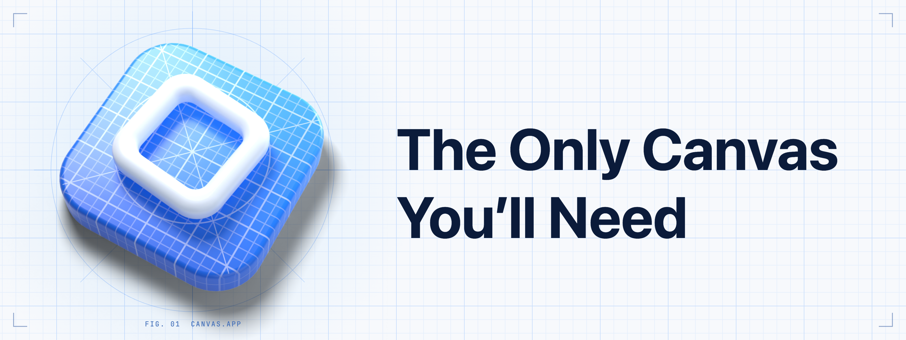

# Canvas

> **Canvas is in alpha.** Expect rough edges, and expect things to change. When something breaks, feels slow or confuses you, [open an issue](https://github.com/antonijap/canvas/issues/new/choose): every report gets Canvas to a proper first version faster. Security problems go through [SECURITY.md](SECURITY.md), not public issues.

Canvas is a next-generation design tool for designing with LLMs. You and an agent work on the same canvas at the same time: point at something, say "make this calmer", and watch the agent do it, with its work in your undo history next to your own.

It also stretches what a canvas is. Boards and layers sit next to notes, to-do lists, live product metrics, videos and GPU shaders, all on one surface you can pan and zoom. A design, the thinking behind it and the numbers it should move live in one place.

## Install

1. Download Canvas from [getcanvas.cc/download](https://getcanvas.cc/download). It runs on macOS 26 or later, on Apple silicon.
2. Unzip it, move `Canvas.app` to Applications and open it. The first launch opens a Welcome file with a short course.
3. Connect your agent: press **Connect** beside Claude Code or Codex on the Welcome card (or in Settings > Agents), then start a new agent session. Connect runs the agent's own `mcp add` for you. To do it by hand, run the line for the one you use in Terminal:

   ```sh
   claude mcp add canvas --scope user -- /Applications/Canvas.app/Contents/Resources/node/bin/node /Applications/Canvas.app/Contents/Resources/server/mcp/server.ts
   ```

   ```sh
   codex mcp add canvas -- /Applications/Canvas.app/Contents/Resources/node/bin/node /Applications/Canvas.app/Contents/Resources/server/mcp/server.ts
   ```

4. Check it: `/mcp` in Claude Code (or `codex mcp list`) lists `canvas`, and the dot on the Welcome card turns green. Ask your agent "what do I have selected in Canvas?".

Canvas brings its own Node and MCP server inside the app, so there is nothing else to install. If you keep `Canvas.app` somewhere other than Applications, press Connect again (it fills in where the app is now) or change the two paths. The Welcome card and Settings > Agents show both commands with this Mac's paths, with Connect and Copy.

Canvas updates itself: a new version downloads in the background, is checked against its checksum and signature, and installs when you choose Restart to Update or quit (Settings > General > Update automatically turns it off).

## Design with an agent

How it works: you open Canvas, connect Claude Code or Codex to it once through Canvas MCP, then ask your agent for changes in its own chat (or press Cmd+Return on a selection in Canvas). The agent edits the open file while you watch. The first launch opens a Welcome file whose card has a Connect button for each agent you have installed, the exact commands with Copy buttons, and a dot that turns green once your agent connects. Settings > Agents shows the same.

The server always registers under the name `canvas`, so `/mcp` in Claude Code lists it as `canvas`. With the downloaded app, use the commands in [Install](#install). From a source checkout ([Run it](#run-it)), point at this folder instead:

```sh
claude mcp add canvas --scope user -- "$(command -v node)" "$PWD/mcp/server.ts"   # Claude Code, from this folder
codex mcp add canvas -- "$(command -v node)" "$PWD/mcp/server.ts"                 # Codex
```

More in the [MCP guide](docs/developer-guide.md#register-the-mcp-server).

- **It sees what you see.** The agent reads your selection, the camera and the page you're on, and can take a screenshot of the window.
- **It builds on the canvas.** It adds boards and layers, edits properties, groups, reorders and sets up auto layout. Your Cmd+Z undoes the agent's whole run as one step.
- **It points.** It highlights layers, flies the camera to them, or asks you to pick something and waits for your click.
- **It explores.** Shift+Cmd+Return makes three variations of a board or layer side by side, built from your file's tokens, components and product brief, with real apps as references. Keep one with a click.
- **It tells you when it's done.** Canvas sweeps a gloss over what changed, shows a toast with the agent's summary and plays a sound.

## More than layers

- **Notes and to-dos** that format like Notion: headings, lists, checkboxes, and pasting from Claude keeps the formatting.
- **Live data cards** running PostHog queries. Secrets stay in the macOS Keychain.
- **Video cards** that play a local file over a design, so motion sits next to the static screens.
- **Shader cards** running WGSL on the GPU. An agent writes the shader, gets back compile errors or a rendered frame with its GPU cost, and fixes it in the same turn.

## Design tools

- Boards grouped into pages. A layers panel to rename, hide and reorder; drag layers between frames on the canvas.
- Auto layout, type, fills, strokes, effects, components with instance overrides, and design tokens you can inspect and swap.
- The standard design-tool shortcuts and click rules: Option-drag to duplicate, Shift+2 to zoom to the selection, K to scale a layer with its contents. Every key is listed below.

## Keyboard shortcuts

The favourites. Every key is in Settings > Shortcuts and in [docs/shortcuts.md](docs/shortcuts.md).

| Keys | Action |
|---|---|
| Cmd+Return | Ask an agent about the selection |
| Shift+Cmd+Return | Three variations of the selection |
| Cmd+L | Copy a `canvas://` link to the selection, to paste to an agent |
| Cmd+K | Quick actions |
| . | Repeat the last edit on the selection |
| Shift+A | Auto layout |
| K | Scale tool |
| Option + hover | Distances to the hovered layer |
| Option + drag | Drag a copy |
| Shift+Cmd+V | Paste in place |
| Shift+2 | Zoom to the selection |
| `+8`, `*2`, `(a+b)/2` in a field | Fields do maths |

## How it's built

Canvas has four parts: a Rust drawing engine, a local server, a native macOS shell and an MCP server for agents.

**The engine** (`engine/`) is written in Rust and compiled to WebAssembly (WASM). WASM is a compact binary format that browsers run at close to native speed, so the same Rust code that would run in a desktop app runs inside the app's web view. It does three jobs:

- **Layout** with [Taffy](https://github.com/DioxusLabs/taffy), the flexbox engine behind auto layout, hug and fill.
- **Text** with [Parley](https://github.com/linebender/parley), which shapes and wraps type so line breaks match across sizes.
- **Painting** with [Vello](https://github.com/linebender/vello), which draws vector shapes on the GPU through WebGPU, the browser's modern GPU interface.

The engine renders each board into GPU tiles at a few fixed zoom levels and reuses them while you pan and zoom, so a canvas with hundreds of screens stays smooth. Hit testing (what's under the pointer) runs on a bounding-volume tree in the same engine. The same engine runs shader and video cards. Without WebGPU, Canvas falls back to an HTML renderer.

**The server** (`src/`) is Node running TypeScript directly, with no build step. It owns the document: it reads and writes it, keeps undo and redo for you and for agents, journals writes so a crash loses nothing, and streams only what changed to the view. It listens on your machine only.

**The shell** (`apps/macos/`) is SwiftUI wrapped around a full-window web view. It adds the native parts: Liquid Glass toolbars, the inspector, the colour picker, menus and Keychain access.

**Canvas MCP** (`mcp/`) is a stdio server that gives agents 78 tools, from reading the selection to writing shaders. It talks to the server over HTTP, so an agent and the person always see the same state.

Documents are plain JSON. A `.canvas` package holds the design, its pages, widgets and copied assets in one folder.

## Run it

Canvas is a Mac app. From a fresh clone, one command builds everything and opens it:

```sh
pnpm app
```

It installs the dependencies, builds the Rust drawing engine (a few minutes the first time), builds `build/Canvas.app` for this checkout, and opens it. The first launch opens a Welcome file in `~/Documents/Canvas`: an eleven-lesson course with something to try on every board, and a card that connects your agent.

You need macOS 26 or later, Xcode 26 or its Command Line Tools (`xcode-select --install`), Node 22.18 or later, pnpm and [Rust](https://rustup.rs). `pnpm app` adds Rust's `wasm32-unknown-unknown` target and the pinned `wasm-bindgen-cli` itself if they are missing. Run `pnpm app --engine` after changing anything in `engine/`.

### The browser version

`pnpm start` serves the same canvas to a browser, for a quick look or on a machine without the app:

```sh
pnpm install --frozen-lockfile
pnpm start "$PWD/demos/learn.canvas"   # open the URL it prints
```

It has simpler web chrome than the app. Without the engine build (`engine/pkg`, which git ignores) it draws with the fallback HTML (DOM) renderer and says so at the bottom of the page; `pnpm build:engine` builds it, then reload.

The [build guide](docs/developer-guide.md#build-from-source) covers the toolchains, `apps/macos/build.sh` and checkouts outside `~/Code/canvas`. `pnpm release:app` prepares a signed, self-contained release (the app with Node and its server inside, zipped, with draft notes in `qa/out/release/`) without publishing anything.

Privacy: a release build sends only anonymous counts of how often each feature is used, once a day, never file names or contents. Settings > Privacy turns it off and shows the exact JSON ([what Canvas collects](https://getcanvas.cc/privacy#usage), [details](docs/developer-guide.md#usage-counts)).

Architecture, tests and troubleshooting are in the [developer guide](docs/developer-guide.md). Third-party licenses are in [THIRD_PARTY_NOTICES.md](THIRD_PARTY_NOTICES.md). Canvas itself is released under the [Apache License 2.0](LICENSE).
