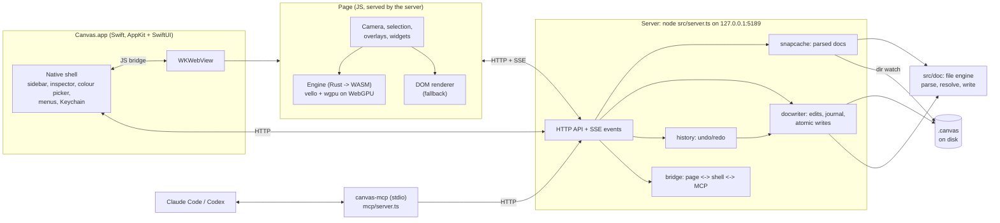

# Canvas developer guide

Start with the [README](../README.md) to open a file. This guide covers the build, MCP setup, shortcuts, and internals.

## Requirements

| What | Version | Why |
|---|---|---|
| macOS | 26 or later, Apple silicon (`LSMinimumSystemVersion`, also the `-target` apps/macos/build.sh compiles for); developed on macOS 27 | The app shell. macOS 26 is the floor: the window chrome uses its glass, and WKWebView has WebGPU on by default from 26. `pnpm release:app` fails if the binary's minimum and Info.plist disagree. |
| Xcode Command Line Tools | current (`xcode-select --install`) | `swiftc` and `codesign` for `apps/macos/build.sh`. A full Xcode is not needed. |
| Node | 24 (package.json says `>=22.18`) | The server and MCP run `.ts` files directly through Node's type stripping. No build step. |
| mise | any | How this machine installs Node: `mise use -g node@24`. The app looks for Node at `~/.local/share/mise/installs/node/24/bin/node` among other places. |
| pnpm | compatible with the checked-in lockfile | Installs dependencies. |
| Rust | 1.98 (stable, edition 2024) | The engine. |
| wasm32 target | `rustup target add wasm32-unknown-unknown` | The engine builds to WebAssembly. |
| wasm-bindgen-cli | exactly 0.2.130 | Must match the `wasm-bindgen` crate pin in `engine/Cargo.toml`. |
| Google Chrome or another Chromium | optional | Only for the MCP `render_node` tool and `pnpm bench`/`pnpm fidelity`. |

### The file engine

The parser, schema, resolver, HTML renderer and writer live in `src/doc/`. They came from an earlier standalone project at `0360756` and are maintained here now; there is no sibling checkout. Canvas code imports them only through `src/engine.ts`.

## Build from source

`pnpm app` (`scripts/app.sh`) is the whole build for a fresh clone: dependencies when `node_modules` is missing, Rust's wasm32 target and the pinned `wasm-bindgen-cli` when missing, `engine/build.sh` when `engine/pkg` is missing (or with `--engine`), then `apps/macos/build.sh` into `build/Canvas.app` (git ignores `build/`) with `CANVAS_REPO` set, and `open`. It never writes the tracked `apps/macos/Canvas.app`. The steps below are what it runs.

`pnpm release:app` (`scripts/release-app.sh`) prepares a release people can download, in `qa/out/release/<version>/`: a self-contained app (Node in `Contents/Resources/node`; the server, the MCP server, the engine build and the course file with their production dependencies in `Contents/Resources/server`), `Canvas-<version>.zip` (ditto) and `RELEASE-NOTES.md` (checksum, commit, signer, notarization, requirements, changes). Node and the app are signed with the keychain's Developer ID Application identity and the hardened runtime (Node gets the JIT entitlements V8 needs); with `CANVAS_NOTARY_PROFILE` set (a profile made once with `xcrun notarytool store-credentials`) it notarizes and staples too. The app runs the server inside it before any checkout, so a release needs nothing installed. It refuses when `package.json` and `Info.plist` disagree on the version. It never tags, pushes or publishes.

Install Node and pnpm, then install the dependencies in both checkouts as shown in the [README](../README.md#run-it). Run the build commands from the Canvas checkout.

```sh
xcode-select --install  # once, if the Command Line Tools are missing
apps/macos/build.sh
open apps/macos/Canvas.app
```

To enable the WebGPU renderer, install Rust and build the WASM package:

```sh
rustup target add wasm32-unknown-unknown
cargo install wasm-bindgen-cli --version 0.2.130 --locked
pnpm build:engine   # runs engine/build.sh
```

The engine build writes to the ignored `engine/pkg` directory. Without it the page draws with the DOM renderer. The app build replaces the tracked `apps/macos/Canvas.app`; include that change only when you mean to ship a new app build. Build your own app on another Mac rather than relying on the checked-in development signature.

Run `pnpm tokens` after changing `src/tokens.ts`. To regenerate the vendored shader library, build the GLSL translator with `(cd engine/glsl && cargo build --release)` and run `node scripts/paper/gen.ts`.

## Running

**The app.** Build it from source: `pnpm app` writes and opens `build/Canvas.app` (`apps/macos/build.sh` alone writes `apps/macos/Canvas.app`; neither is committed). It starts the server (`node src/server.ts`) if nothing answers on the port and opens the last file you had open. A server of the same installation with other code (its `/health` root matches the app's own server folder and its version does not: an older Canvas left it running, then an update replaced the files) is stopped with `POST /quit`, which saves first, and replaced (`ServerCode` in `apps/macos/ShellLogic.swift`). A busy server that times out is asked again with a longer wait before anything is decided. Another copy of Canvas on the port (a checkout, another account's Canvas: another root) is used and never stopped, with a note when its code differs; an answer that is not positively Canvas's (`/health` with `app: "canvas"`, or the exact older shape: ok, a 12-digit version and root) is never stopped either. The server stays up while the app runs.

**First launch.** With no file opened before (no `canvas.lastFile`, no tabs, `canvas.welcomed` unset), the app asks the server for the Welcome file (`POST /api/welcome`, `src/onboarding.ts`): `~/Documents/Canvas/Welcome.canvas`, a copy of `demos/learn.canvas` (an eleven-lesson course, one board per lesson, rebuilt by `node demos/build-learn.ts`, which keeps the widget and to-do item ids of the last build) with a welcome card left of its boards. Lesson 2, Connect your agent, walks through connecting. The card says what Canvas is for, shows the `claude mcp add canvas ...` and `codex mcp add canvas ...` commands with Connect and Copy, and a dot that turns green while an MCP client talks to this server (`GET /api/mcp/setup`). The file is made once; someone who used Canvas before is marked welcomed and never sees it. QA instances skip it unless `CANVAS_QA_FIRST_RUN=1`.

The app runs the server of `CANVAS_SERVER` if set, else of the checkout named in its Info.plist `CanvasRepo` (`pnpm app` writes it; so does `CANVAS_REPO=... apps/macos/build.sh`), else `~/Code/canvas`. It finds Node in this order: `CANVAS_NODE`, the usual install places (mise, Homebrew), then `PATH`. Finder starts apps with a bare `PATH`, so a Node only on your shell `PATH` is not enough.

Server output when launched from Finder: `~/Library/Logs/Canvas/server.log`.

**The browser.** Run the local server and open its address in a browser. WebGPU enables the Rust renderer:

```sh
pnpm start                        # http://127.0.0.1:5189
pnpm start "$PWD/demos/learn.canvas"
```

The browser version has the web chrome (file menu, left sidebar, properties). The app adds the native shell (Liquid Glass islands, native inspector, colour picker, menus). Query flags on the page: `?renderer=dom` forces the DOM renderer, `?shell=native` hides the web chrome (the app sets it).

The editor sidebar has separate round icon buttons for Layers, Assets and Tokens. The macOS row also has Widgets and a panel toggle. When the panel closes, only the toggle stays in place.

The file menu lists `.canvas` documents under `~/Desktop` and `~/Code`. Set `CANVAS_ROOTS` to change that.

The server listens on `127.0.0.1` only and answers only to localhost host names. Writes need an `x-canvas: 1` header.

## Register the MCP server

The MCP server talks to the Canvas server over HTTP. If no server runs, it starts one for the disk tools; `launch_canvas` opens the app.

Claude Code (user scope):

```sh
claude mcp add canvas --scope user -- ~/.local/share/mise/installs/node/24/bin/node ~/Code/canvas/mcp/server.ts
```

Codex (`~/.codex/config.toml`):

```toml
[mcp_servers.canvas]
command = "/Users/<you>/.local/share/mise/installs/node/24/bin/node"
args = ["/Users/<you>/Code/canvas/mcp/server.ts"]
```

Use absolute paths and the `node/24` path (not a patch version), so a Node update does not break it. The Welcome card and Settings > Agents show both commands with this machine's paths filled in (`GET /api/mcp/setup`).

**Connect.** The Welcome card and Settings > Agents have a Connect button beside each installed agent: it runs that command for the person (`src/mcp-connect.ts`).

- `POST /api/mcp/connect {agent: "claude" | "codex"}` answers `{ok: true, agent, registered: true, message}` (message: "Added. New Claude Code sessions use it; restart any that are open.", because sessions already open keep the MCP they started with) or `{ok: false, agent, error, code}` with code `missing` (404), `untrusted` (403), `failed` (502, `error` is the CLI's stderr, trimmed to 400 characters) or `timeout` (504, 20 s).
- Same guard as `/quit`: the `x-canvas: 1` header and a same-origin (or no) Origin. A web page on another site or port gets 403 and nothing runs.
- The CLI is found where agent runs look (`searchDirs` in `src/agent-run.ts`: `PATH`, then `~/.local/bin`, `/opt/homebrew/bin`, `/usr/local/bin`, since an app opened from Finder has a bare `PATH`; `CANVAS_AGENT_PATH` replaces the list). A binary owned by someone else or writable by others is refused, never run. It runs with `execFile` (no shell), arguments as an array, `childEnv`'s environment (`HOME`, `CLAUDE_CONFIG_DIR`, `CODEX_HOME` pass through) and a 20 s timeout: `claude mcp add canvas --scope user -- <node> <server>` or `codex mcp add canvas -- <node> <server>`, with the absolute paths `setupCommands` shows. When Claude Code says canvas already exists (a moved app, another Node), Canvas runs `claude mcp remove canvas --scope user` and adds it again; `codex mcp add` replaces an entry by itself. One Connect per agent at a time.
- `GET /api/mcp/setup` says `connected` (an MCP talked in the last 50 s), `outdated` and `otherCopy`. canvas-mcp sends the code it loaded (`x-canvas-mcp-version`: src and mcp hashed together, `mcpCodeVersion` in `src/version.ts`, worked out once when it starts) and its copy (`x-canvas-mcp-root`) on every request. An MCP of this copy whose version is not the code on disk now, or one that sends none (from before an update; it may send only `x-canvas-source: mcp` on its writes), is `outdated`: the Welcome card and Settings > Agents say "Connected (older version, restart your agent session)". An MCP of another copy (a checkout talking to the installed app) is `otherCopy`: "Connected (an agent runs another copy of Canvas)", with no restart advice, since a restart loads the same copy. Any current MCP of this copy wins over both.
- `GET /api/mcp/setup` adds `installed: {claude, codex}` (the CLI Canvas would run) and `registered: {claude, codex}`: canvas is in `~/.claude.json`'s `mcpServers` (or `$CLAUDE_CONFIG_DIR/.claude.json`) or `~/.codex/config.toml`'s `[mcp_servers.canvas]` (or `$CODEX_HOME`), its args hold this server's `mcp/server.ts`, its Node exists and it is not disabled. Read from the files, cached 3 s, never with `claude mcp get` (that health-checks the server, which would start canvas-mcp and turn the Connected dot on). A stale entry reads as not registered, so the button says Connect and fixes it.
- On the Welcome card the button says Connect, Connecting… while the CLI runs, then Added; the card's status line says the next step or the error, and Copy stays as the manual way. Settings > Agents is one card: a row per agent with Connect (Connecting…), or a green dot and Connected, and a … menu with Copy command and the agent's Model and Reasoning; then Default agent, Show the agent's cursor, Cursor speed and Stop a run after. Under the card: "Other apps: getcanvas.cc/download#connect" (the words live in `ConnectCopy`, `apps/macos/SettingsLogic.swift`).
- Tests: `test/mcp-connect.test.ts` (fake CLIs that keep their config in a scratch `CLAUDE_CONFIG_DIR` and `CODEX_HOME`), `pnpm qa first-run` (the card, with the page's fetch stubbed), `pnpm qa:native first-run` (the real CLIs against the QA instance's fresh HOME).

The server's MCP name is always `canvas` (title "Canvas" and a one-line description in its `initialize` answer), so `/mcp` in Claude Code and `codex mcp list` show it as `canvas`. Register it under that name everywhere.

**Connected.** canvas-mcp says hello (`POST /api/mcp/hello`) when a client connects and every 20 s while it runs, and every request it makes counts too (`x-canvas-source: mcp` on writes, `x-canvas-mcp` on reads). The Welcome card and Settings > Agents show Connected until 50 s pass without one. Canvas's own runs (sessions `run-...`) do not count, and the heartbeat does not keep an idle server alive.

**Toasts you can act on** (the app's toast, `Toast` in `DesignSystem/Components.swift`, rules in `ToastLogic`): a toast with a file path or an error copies on click (the path, else the error's text) and says Copied; an error gets Ask agent when Claude Code or Codex is installed, which opens the Cmd+Return composer on the selection (else the board in view) with the toast quoted, for you to send. Deleting a board or a page, or a card, shows Undo, which steps back only while that delete is still the step Undo would take. A toast you can act on stays 6 s, and while the pointer is on it. The page sends buttons as `{toast, toastActions: [{id, label}]}` and gets `{cmd: "toastAction", id}` back (`host.toast` in the page script).

Canvas MCP is all an agent needs: `add_nodes` adds new layers and boards from node JSON, `place_nodes` moves layers to another parent, and every edit is a step in Canvas's undo history.

An agent's boards never land on top of each other (`src/placement.ts`). A new board without x/y goes right of everything on its page, 40 px away, level with the page's top board. A board that `add_nodes`, `move_board` or `place_nodes` (to the canvas) would put over a board or card on its page moves right along its row until clear, and the answer says where it landed (`placed`, `note`); `allowOverlap: true` keeps the spot. Boards that hug their content are measured on the page, else their size is estimated from their layers. A person's drags, drops and pastes go where they are put.

### Tools

Three tiers, so most tools work with the app closed.

| Tier | Tools |
|---|---|
| Disk (no page needed) | `get_document_summary`, `get_fonts`, `list_installed_fonts`, `lookup_nodes`, `inspect_node`, `resolve_link`, `render_node` (headless Chromium), `export_nodes` (PNG at a scale or a store preset, SVG; headless Chromium), `set_node_props`, `move_board`, `scale_nodes`, components (`swap_instance`, `reset_overrides`, `push_overrides`), `add_nodes`, `delete_nodes`, `duplicate_nodes`, `group_nodes`, `ungroup_nodes`, `reorder_nodes`, auto layout (`add_auto_layout`, `remove_auto_layout`, `place_nodes`; they use the open page's measurements when there is one), `undo`, `redo`, pages (`list_pages`, `create_page`, `rename_page`, `delete_page`, `move_boards_to_page`, `set_active_page`), widgets (`list_widgets`, `list_widget_kinds`, `add_widget`, `update_widget`, `remove_widget`, `widget_action`, `refresh_widget`), shaders (`list_shader_presets`, `list_shaders`, `create_shader`, `update_shader`, `export_shader`), videos (`list_videos`, `add_video`, `video_frame`), variations (`make_variations`, `list_variations`, `keep_variation`, `discard_variations`, `get_product_brief`, `set_product_brief`, `get_design_context`, `check_variation`, `mark_variation`), comments (`list_comments`, `add_comment`, `reply_comment`, `resolve_comment`) |
| Live state (a page is open) | `get_selection`, `wait_for_selection`, `get_events`, `get_viewport`, `canvas_status`, `get_current_file`, `list_tabs`, `get_theme` |
| Commands (page or app answers) | `select_nodes`, `clear_selection`, `highlight_nodes`, `clear_highlights`, `fit_view`, `set_zoom`, `pan_view`, `open_file`, `close_tab`, `set_theme`, `launch_canvas`, `screenshot_view`, `reveal_widget`, `notify_user`, `finish_work` |

Errors read `code: message Hint: ...`. Codes: `no_server`, `no_app`, `no_page`, `no_shell`, `stale_revision`, `not_found`, `ambiguous`, `unsupported`, `timeout`, `client_gone`, `invalid`. `stale_revision` means the file changed since the agent read it: read again and redo.

Typical agent flow: `get_selection` for "this", edit with `set_node_props` (passing the revision as `expectedRevision`), check with `screenshot_view` or `render_node`, then `finish_work` once.

### Links (Cmd+L)

Cmd+L (Edit > Copy Link) puts one line on the clipboard that names the file, the page and the selected nodes; with nothing selected, the board that fills most of the view (else only the page). Paste it into Claude Code or Codex and the agent knows what "this" is:

```
canvas://open?file=/Users/me/Desktop/My%20App.canvas&page=page-2&node=Home,Btn01
```

- `file`: the absolute path; `/` and `:` stay as they are, everything else outside `A-Z a-z 0-9 - _ . ~` is percent-encoded (UTF-8). `page`: the page id, left out when the file has no pages of its own. `node`: the file's own ids (instance paths like `Ins01/Lbl01`, cards as `widget:<id>`), comma-separated, each encoded the same way. Unknown keys are ignored, so newer links still open. Built and parsed by `src/page/link-logic.js` (tests: `test/link.test.ts`); the shell's parser is `CanvasLink` in `apps/macos/ShellLogic.swift`.
- Agents: every node tool takes the link as `link` (or the link in place of `file`, `id` or an entry of `ids`); it fills the file and the node arguments, and arguments passed beside it win (`mcp/link.ts`). `resolve_link` answers the file, the page and each node's name, type, board and page, and lists ids that are gone.
- Clicking one: Canvas.app registers the `canvas` URL scheme (`CFBundleURLTypes`). It opens the file's tab, shows the page, selects the nodes and zooms to them (`src/page/link.js` `openLink`). QA builds have no URL scheme, so a click never reaches them; `qa.openurl` delivers a link in-process.

## Keyboard shortcuts

Canvas shortcuts in the app and browser:

| Keys | Action |
|---|---|
| Space + drag | Pan (hand) |
| Cmd + scroll, pinch | Zoom |
| Cmd + `+` / Cmd + `-` | Zoom in / out |
| Shift + `+` / Shift + `-` | Zoom in / out 2x about the middle of the view (`src/page/navigate.js`) |
| Arrows / Shift + arrows, nothing selected | Pan 40 px / 200 px |
| Z held + click, Option+click | Zoom tool: 2x in / out about the pointer; nothing is selected or moved while Z is down |
| Cmd+' | Pixel grid on/off (View > Pixel Grid; on by default, drawn from 400% up) |
| Control+G, Shift+G | Layout guides on/off (View > Layout Guides; the menu owns Control+G in the app). A frame's guides (grid, columns, rows: inspector > Layout guide, `metadata.canvasLayoutGuides`) are drawn over the canvas while on, and a layer moved or resized inside the frame snaps to their edges and lines |
| Shift+Cmd+8, Shift+Cmd+7 | Bulleted / numbered list: on a selected text layer every paragraph, while editing the selected paragraphs; again takes it off. While editing, Tab / Shift+Tab nest a list item, Return on an empty item ends it a level at a time, Backspace at its start takes its marker off, "- ", "* ", "1. " typed at a paragraph's start make a list |
| Shift+R | Rulers on/off (View > Rulers). Drag out of a ruler onto a board to add a guide there (the top ruler makes a horizontal guide); drag a guide to move it, onto a ruler or off the board to remove it. Guides are saved on the board (`metadata.canvasGuides`, offsets from its top-left, whole px), one undo step per drag |
| Click the zoom percentage | Type a zoom (150, 150%, 1.5x, fit) and Return; the zoom choices are under the field |
| Shift+Cmd+C | Copy as PNG: the selection at 2x on the clipboard (Edit > Copy as PNG); several layers make one picture placed as on the canvas, what lies between them left out |
| Right-click > Copy as | PNG, SVG, CSS, SwiftUI, text, link. CSS and SwiftUI describe the layer itself (size, position, auto layout, paint, type), not its children (`src/copy-as.ts`, `src/codegen.ts`, `POST /api/copy-as`) |
| Right-click > Select layer | Every layer under the pointer, topmost first; picking one selects it (engine `hitTestAll`) |
| Shift+Cmd+E | File > Export: the selection, else every layer on the page with export settings, each with its settings (one 1x PNG without) into a folder |
| Cmd + 0, Shift+0 | Zoom to 100% |
| Shift+1 | Fit everything on the page |
| Shift+2 | Fit the selection (the page when nothing is selected) |
| 1 to 9, 0 | Opacity of the selection 10% to 90%, 100%; two quick digits are a percentage. Bare digits never zoom |
| F | Unassigned |
| Arrows / Shift + arrows | Nudge 1 px / big nudge (10 px default) |
| Delete, Backspace | Delete selection |
| Enter / Shift+Enter, \\ | Select children / parent (\\ is a second key for parent) |
| Shift+Cmd+L | Lock or unlock the selection (`locked`). Locked layers and everything inside them ignore canvas clicks, Cmd+click, the marquee, Cmd+A and select matching, and show no handles; the Layers panel still selects them and the inspector edits them. A locked board is empty canvas to the pointer |
| Shift+Cmd+A | Select inverse: Select All's scope (the selection's siblings, else the page's boards and cards) minus the selection |
| Option+Cmd+A | Select matching layers: the same name and kind in the other boards of the page. Edit > Select All with Same: fill, stroke, effect, text properties, font, instances |
| Option+Space | Keyboard selection: a pink cursor; arrows move it (Shift: 10x), Return selects what is under it, Cmd+arrows draw a selection box from it, Esc puts it away (`src/page/keybox.js`) |
| Option+L | Collapse every open row in the Layers panel |
| I (Control+C in the app) | Eyedropper: a colour sampled from the screen becomes the selection's fill (the app's NSColorSampler; Chrome's EyeDropper in the browser) |
| Option+/ / Shift+/ | Remove the selection's fills / strokes (an instance writes an empty list). One undo step |
| Shift+X | Swap fill and stroke (a new stroke gets 1 px). One undo step |
| Control+Cmd+M | Use as mask: each selected layer cuts the layers above it in its parent to its shape; again to stop. One undo step |
| Shift+Up / Shift+Down in a hex field | Lighter / darker by 10% lightness (Up / Down alone: 1%), the opacity kept |
| Double-click an image layer | Crop: drag the image to move it, a corner to scale it (aspect kept); Return, Esc or a click outside writes Crop (`src/page/image-crop.js`) |
| Esc | Cancel a move or resize, else deselect, a nested layer too (Shift+Return or \ selects the parent) |
| K | Scale tool on/off (V or Esc leaves it) |
| Opt+Cmd+Shift+R | Resize board to fit content |
| Shift + click, drag on empty canvas | Add to selection, marquee select (a board only when enclosed whole; one it touches gives the layers it touches) |
| Cmd + click, Cmd + drag | The deepest layer under the pointer; deep marquee: the deepest layers it touches |
| Shift held while dragging | Move on one axis only |
| Control held while moving or resizing | Bypass snapping to objects |
| Option + drag (or Option pressed mid-drag) | Drag copies, the originals stay; one undo step |
| Drag a Widgets panel row or shader tile onto the canvas | Adds that card centred where it drops, selected; one undo step (a click adds it in the middle of the view) |
| A shader tile dragged over a layer | Outlines the frame, rectangle or ellipse under the pointer (text and icons pass it to the layer around them; the selected layer wins when the pointer is over it); the drop makes the shader that layer's fill, on top of its fills (a shader already there is replaced). Inside an instance it is an override. One undo step. Over empty canvas, or with Option held, it adds a shader card instead |
| Drag image files from Finder onto the canvas | PNG, JPEG, GIF, WebP or SVG: image layers at their own size (long side at most 4096), side by side, centred where they drop, inside the frame under the pointer; the files are copied into the package's `media/`. With Cmd: the first image becomes the fill (cover) of the layer under the pointer. One undo step |
| Cmd+V with a picture on the pasteboard (a screenshot) | An image layer in the middle of the view, or in the selected frame; Canvas's own copied layers still paste as layers |
| Option + hover | Distances from the selection to the hovered layer |
| Right-click > Export as PNG / Export as | The layer, or the whole selection when the click is inside it. PNG at 1x, 2x, 3x or a store preset (App Store 6.5" 1242x2688, App Store 6.9" 1290x2796, Google Play 1080x1920: that exact size, no alpha channel, another shape fitted on white). Export as: SVG (text as text, images embedded), PDF (the SVG drawing printed by Chrome: vector, one page the layer's size), JPG (over white) and WebP at 1x to 3x. One layer: a save panel named after it; several: a folder, files named after the layers. The last folder is remembered (`src/export.ts`, `POST /api/export`) |
| Double-click | One level in from the selection. A text layer it reaches is selected; the next double-click edits it (one that was already selected edits at once) |
| Delete a page (Pages list, right-click) | Deletes its boards, their layers and its cards with it: one undo step brings all of it back. A page with boards asks first |
| Option+W / A / S / D, Option+H / V | Align top / left / bottom / right, horizontal / vertical centres |
| Option+Shift+H / V | Distribute horizontal / vertical spacing |
| Control+Option+T | Tidy up: the selection as an evenly spaced row, column or grid from its top-left, in the order it sits |
| Inspector > Arrange, right-click > Align | With two or more selected: the six aligns, distribute both ways and tidy up, each one undo step (Shift+click an align button to align to the parent frame). Layers an auto layout frame places and ones inside an instance stay where they are and stay out of the box the rest align in (a locked layer stays put but the others still align to it); with fewer than two that can move (three to distribute) the buttons are off (`src/page/shortcuts-logic.js` arrangePlan, `apps/macos/ShellLogic.swift` ArrangeActions) |
| Shift+H / Shift+V | Flip horizontal / vertical |
| Shift+Cmd+H | Show or hide the selection |
| Tab / Shift+Tab | Next / previous sibling |
| N / Shift+N | Next / previous board |
| Cmd + arrows (Shift: big nudge) | Resize width and height (with Lock aspect ratio on, the other side follows) |
| Cmd+Option+Up / Down | Turn the selection 1 degree (one undo step per press) |
| Cmd+B / I / U, Shift+Cmd+X | Bold, italic, underline, strikethrough (text layers; while editing, the selected letters) |
| Shift+Cmd+. / , | Font size up / down |
| Option+. / , | Letter spacing up / down 0.1 px |
| Option+Shift+. / , | Line height up / down 1 px (Auto becomes the px it draws at) |
| Option+Cmd+. / , | Font weight to the next / previous hundred |
| Return with several text layers selected | Multi-edit: the first selected is edited, the others take what is typed; one undo step |
| While editing text | A click on another text layer edits it at the click. The text style keys above (Cmd+B / I / U, Shift+Cmd+X, size, letter spacing, weight) and the inspector's text fields style the selected letters only (styled ranges); with only a caret, all the letters |
| Opt+Cmd+L / T / R / J | Text align left, center, right, justify |
| Cmd+L | Copy a link to the selection, else the board in view (see [Links](#links-cmd-l)) |
| Opt+Cmd+C / Opt+Cmd+V | Copy / paste properties |
| Opt+Cmd+K / Opt+Cmd+B | Create component / detach instance |
| Cmd+Z / Shift+Cmd+Z (Ctrl+Y) | Undo / redo |
| Cmd+Return | Ask about the selection: opens the composer on the spark (not in a text field). In the composer Return sends, Shift+Return is a new line, Esc closes it (a run goes on) |
| Shift+Cmd+Return | Make 3 variations of the selected board or layer, side by side (also Cmd+K). Keep on a caption keeps one, Esc discards all three; one undo step each (see [Variations](#variations)) |
| . | Repeat the last property edit on the selection (Edit > Repeat Fill Change). A value set outright (inspector field, fill, stroke, effect, text style, a handle drag, an agent's `set_node_props`) repeats as that value; a relative edit (`+10`, `*2` typed in a field, Up/Down on a Mixed field, an arrow-key nudge) repeats as the same change from each layer's own value. The toast says which. One undo step per repeat; keys a layer cannot hold are skipped (`src/repeat.ts`, `POST /api/repeat`) |

Handles on the selection (one drag is one undo step, written on release; Esc cancels; whole px while pixel snapping is on; a value label follows the pointer; they hide while moving, resizing, rotating, editing text, in scale mode, with several layers selected, or when the layer is too small on screen):

| Drag | Action |
|---|---|
| Inside a selected auto layout frame | Its padding zones and gaps show tinted pink, the one under the pointer striped (`src/page/autolayout.js`) |
| A padding zone's pink bar | That side's padding. Option: the opposite side too. Option+Shift: all four. Shift alone: steps by the big nudge. Click: type a value |
| A gap's pink bar | The gap (it may go negative). Shift: big-nudge steps. Click: type a value |
| A corner knob of a selected frame or rectangle (40 px or more on screen, upright, radius not a token) | Corner radius of all four corners, toward the centre rounds more. Option: that corner alone (`src/page/radius.js`) |

App menus (Canvas.app; the browser handles the same keys on the page). Menus: Canvas (About, Settings, Hide, Quit), File, Edit, View (Quick Actions, zoom, Hide UI), Object (group, auto layout, components, order, flip, rename, show/hide), Arrange (align, distribute), Window:

| Keys | Action |
|---|---|
| Cmd+N | New Canvas |
| Cmd+O | Open |
| Cmd+W | Close the tab |
| Shift+Cmd+S | Save as Canvas |
| Cmd+R | Rename the selected layer (in the Layers panel); Tab and Shift+Tab move to the next and previous name. With several layers: Rename Layers (Match, Rename to with $& the current name, $1 to $9 the match's groups, $n / $nn / $nnn counting up from Start at, $N / $NN / $NNN counting down to it, a preview; one undo step) |
| Layers panel padlock | Lock or unlock a row (shown on hover, kept while locked); drag down the padlocks to lock or unlock every row crossed, one undo step. A row its parent locks cannot unlock on its own |
| Cmd+, | Settings: General, Canvas, Agents, Sounds, Performance, Shortcuts (see [Settings](#settings)) |
| Cmd+\\ | Hide or show the panels |
| Cmd+K, Cmd+/ | Quick actions: find boards, layers, text, components, pages and cards on every page, select matching layers, run any command (apps/macos/Palette.swift, `GET /api/search`). Arrows move, Return runs, Cmd+Return or Tab runs the second action (every match on the page, all instances of a component), Esc closes. In a to-do item Cmd+K completes the item instead |
| Cmd+F | Find and replace (Edit > Find and Replace): text in every text layer on every page, Match case (Aa), Whole words (W). Return / Shift+Return next / previous match (its page shows, its layer is selected), Replace (Return in the replace field) changes the match shown, Replace all (Cmd+Return there) every match; one undo step each. Esc closes (`src/page/find-replace.js`, `GET /api/search/text`, `POST /api/replace`) |
| . | Repeat the last property edit ("Repeat Fill Change", disabled with nothing to repeat; also in Cmd+K) |
| Cmd+X / C / V | Cut / copy / paste: layers, boards and cards, to another page, tab or file (see [Copy and paste](#copy-and-paste)) |
| Cmd+L | Copy Link: a canvas:// link for an agent's chat |
| Shift+Cmd+V | Paste in place |
| Shift+Cmd+R | Paste to replace: the selected layers give way to the copied ones |
| Shift+Cmd+K | Place Image: pick image files, placed in the view or the selected frame |
| Cmd+A | Select all |
| Cmd+D | Duplicate in place (boards and cards go to the right; on moved copies: repeats their step) |
| Cmd+G | Group selection |
| Opt+Cmd+G | Frame selection |
| Shift+Cmd+G | Ungroup |
| Cmd+] / Cmd+[ | Bring forward / send backward |
| Opt+Cmd+] / Opt+Cmd+[ | Bring to front / send to back |
| Shift+Cmd+0 | Home: the pinned first tab (Window > Home) |
| Shift+Cmd+[ / ] | Previous / next tab (Window menu, keys "{" and "}"), Home first. A file tab drags sideways to reorder (`TabOrder` in ShellLogic.swift; the order is kept in `canvas.openFiles`) |
| Cmd+M | Minimize |
| Cmd+Q | Quit |

Inspector fields: Up/Down change by 1 (Shift x10). Drag a field's label icon to scrub (Shift x10, Option x0.1), or hold Option over the label or the input and drag: the pointer's height from the press sets the speed (up 2x, near 1x, down 1/2, further down 1/4). Fields take + - * / ^ and parentheses; a leading +8, *2, /2 or ^2 applies to the current value. The lock in the Dimensions row keeps W and H in ratio (fields, handles, Cmd+arrows; Control frees one handle drag), saved per layer in `metadata.canvasLockAspect`. The Component section of an instance: the component's name picks another component to swap to (overrides on layers whose names and types match carry over), each override is a row whose arrow (or right-click) resets only it, and Push changes to main moves the overrides into the main component (`src/overrides.ts`).

The inspector's Export section (`apps/macos/InspectorExport.swift`): "+" adds an export setting (scale, suffix, format: PNG, JPG, WebP, SVG, PDF), saved on the layer under `metadata.canvasExports`; the next "+" takes the next scale up with its "@2x"-style suffix. A suffix goes on the file name as typed and replaces the scale's "@2x" ("Home" + "-dark" is "Home-dark.png"). "Export <name>" and Shift+Cmd+E export with the settings (`POST /api/export` with `items`).
### Fills, gradients and images

The inspector's Fill and Stroke "+" asks for the paint type (Solid, Linear, Radial or Angular gradient, Image..., a Shader preset; strokes take solid and gradient). A paint row's swatch opens its popover (`apps/macos/PaintEditor.swift`): tabs switch the type (a colour becomes a gradient from it to itself transparent, a gradient gives its first stop back), a blend mode menu sits beside them, and under them the editor for the type: the colour picker; gradient stops on a bar (click to add, drag to move, the selected stop's colour below), type, angle, flip, rotate, opacity; image mode (Fill, Fit, Crop, Tile with its size), Rotate 90°, Choose image..., opacity and adjustments; a shader's preset and Paper parameters. A row's right-click has Copy Fill / Paste Fill. The gradient's handles live in the popover, not on the canvas.

File format (`src/doc/schema.ts`): an image fill is `{type: "image", url, mode: "fill" | "fit" | "crop" | "tile" | "stretch", crop: {x, y, width, height}, scale, rotation: 0 | 90 | 180 | 270, adjust: {exposure, contrast, saturation, temperature, tint}, opacity, blendMode}`. `crop` is the image's rectangle as fractions of the layer, so it holds when the layer is resized; `scale` sizes a tile against the image's own pixels; adjustments run from -1 to 1 and fold into one colour matrix (`src/page/image-adjust.js`): the scene names an adjusted copy with `#adjust=` on the image URL and the page recolours the decoded pixels, the HTML renderer uses an SVG `feColorMatrix`. Any paint and any layer take `blendMode` (names in the file: multiply, screen, overlay, darken, light, colorDodge, colorBurn, hardLight, softLight, difference, exclusion, hue, saturation, color, luminosity); the engine draws a blended paint or layer in a layer of its own with that mix. Frames and rectangles take `cornerSmoothing` (0 to 1, iOS is 0.6; the engine draws a smoothed corner, the DOM renderer a circular one). A layer with `mask: true` (Control+Cmd+M, Use as mask) is not drawn: the siblings above it are cut to its alpha by the engine, clipped to its shape by the HTML renderer (free frames only). Selection colors (several layers, or a frame or group) come from `GET /api/selection-colors` and change through `POST /api/selection-colors` (`src/selection-colors.ts`): every layer that uses the colour, descendants included, in one write and one undo step.

### Shader fills

A layer's fill can be a shader: `{type: "shader", shader: "mesh-gradient", preset: "Ink", params: {...}}` (a Paper Shaders preset, `list_shader_presets`) or `{type: "shader", source: "<WGSL with fn shade>", uniforms: [...]}`, with `opacity`, `enabled` and `autoplay`. `src/shader-fill.ts` resolves either to WGSL and packed params for the engine scene and the headless renderer. The engine paints a placeholder image for it in the board's scene (2 texels per unit, long side at most 1024, fixed per layer size so a zoom needs no new paint), runs the shader into that texture like a shader card (same admission: at most four play at once, 30 fps, a still at t = 2 s under Reduce Motion or when not admitted), and draws only the layer's part of the board's tiles again per frame. So the fill sits in the layer's paint order: under its children, clipped to its shape and corner radius, inside its parent's clip. `render_node` and PNG export draw the t = 2 s still with WebGPU in headless Chrome; SVG export embeds that still as a PNG. Agents set one with `set_node_props`. By hand: drop a shader tile from the Widgets panel on a layer, or Cmd-drag a shader card already on the canvas onto it (without Cmd a tip at the pointer says so) (the card's Paper preset or WGSL becomes the fill, the card goes back where it was; `src/page/drops.js` `dropCard`, `cardFill` in `drop-logic.js`).

## Architecture



- **Server (`src/server.ts`)**: one Node process. Serves the page, resolved board scenes (`/api/scene`), fonts (`/api/fonts/file`, Google Fonts fetched and cached when the document uses web families), document diffs over SSE, and every write endpoint. No framework.
- **Page (`src/server.ts` page script + `src/page/*.js`)**: one rAF loop (`flushCam`) moves the camera, places labels, overlays and widgets, and drives the engine. Boards load lazily (viewport plus a prefetch margin).
- **Engine (`engine/`)**: Rust crate `canvas-engine`. Lays out resolved boards (taffy, parley for text), paints with vello, caches each board as GPU tiles at quantized scales and composites them. Also runs shader and video cards. JS API in [engine/API.md](../engine/API.md).
- **Native shell (`apps/macos/`)**: SwiftUI over a full-window WKWebView. The page is the app; the shell adds native panels and talks to the page through a JS bridge and to the server over HTTP. Design system in `apps/macos/DesignSystem/`, tokens generated from `src/tokens.ts`.
- **MCP (`mcp/`)**: stdio server. Talks to the Canvas server over HTTP only, never to the app directly. Starts a bare server when none runs (unless `CANVAS_MCP_NO_SPAWN=1`) and replaces a stale one after code changes.
- **Engine for files (`src/doc/`)**: the file parser, schema, resolver, renderer and writer, taken from an earlier standalone project and maintained here. Imported only through `src/engine.ts`.

## Talk to the selection

Select something and a spark (Liquid Glass, `apps/macos/Spark.swift`; drawn by the page in the browser) sits 8 px right of the selection box's top-right corner. Click it or press Cmd+Return: the composer (`src/page/spark.js`, layout math in `src/page/spark-logic.js`) opens beside the selection, never over it; drag it by its chip row, double-click there to put it back. Return sends the request to the person's own Claude Code (Codex when Claude Code is not installed or cannot start; Settings > Agents can make Codex the default), run headless by the server (`src/agent-run.ts`) with only the Canvas MCP tools:

- Claude Code: `claude -p --input-format stream-json --output-format stream-json --verbose --tools "" --mcp-config <run>/mcp.json --strict-mcp-config --allowedTools mcp__canvas --disallowedTools <tools that leave the selection> --permission-mode dontAsk --permission-prompts none --restricted --disable-slash-commands --no-chrome --session-id <uuid>` (`--resume <id>` for a follow-up). The prompt and a picture of the selection go in on stdin.
- Codex: `codex exec --sandbox read-only --json --skip-git-repo-check --ignore-user-config --ignore-rules -c mcp_servers.canvas.* -c approval_policy="never" --disable shell_tool --disable unified_exec ... -i <picture> -` (`codex exec resume <thread>` for a follow-up).

When Claude Code reports a login error, Canvas asks you to open Terminal, run `claude`, sign in, and try again.

The binary must be the person's own (resolved path, owned by them, writable by nobody else). The child gets a minimal environment (no keys or tokens), runs in an empty folder in its own process group, stops after 10 minutes (Settings > Agents) or 20 MB of output, and dies with Stop and with the server. canvas-mcp runs with `CANVAS_MCP_SESSION=run-<id>`, so the run is one undo step and its summary ("Changed 6 properties on 4 layers") counts exactly its history entries. Threads (prompts, steps, summaries, harness and session id, the last 5 runs per layer) live in the sidecar under `threads`; Cmd+K lists them as Recent asks. Runs are logged to `~/Library/Logs/Canvas/agent-runs.log` with only the prompt's first line. Endpoints: `/api/agent/*` (see the comment in `src/agent-run.ts`).

A run's Undo (the composer's) undoes all of its steps or none: when another run or the person edited the same file in between, its steps are not all on top, and it answers "Other edits came after this run". A second send while the first is on its way is refused (one run per layer, at most 3).

### Variations

Select a board or a layer and press Shift+Cmd+Return (or Cmd+K > Make 3 Variations, or the MCP's `make_variations`). The server (`src/variations.ts`) copies the selection's board three times beside the original (right of it when that is free, else under it; `placeRow`), then runs the same harness as talk to the selection, with these differences: Claude Code gets `--tools Skill,WebSearch`, keeps skills on (no `--disable-slash-commands`) and, when the person set up Mobbin's MCP, its three read tools; Codex gets `web_search="live"` and the same Mobbin tools. No Read, Bash or WebFetch. The page (`src/page/variations.js`, pure parts in `variations-logic.js`) shows one line under the original ("Making 3 variations", then "2/3", a stop button), then a caption under each copy with its direction, the apps it follows and Keep.

What the agent gets, in its prompt (`buildVariationsPrompt`):

- The context pack (`contextPack`, `get_design_context`): the file's variables, text styles as used, components, the literal colours and spacing values it already uses, its fonts, and pictures of the original and its two nearest boards on the page.
- The product brief: a few lines in the sidecar under `brief` (Product, For, Platform, Tone). With none, the run drafts one from the file and saves it (`set_product_brief`). Cmd+K > Edit Product Brief opens it in a small sheet (Cmd+Return saves, Esc cancels).
- References: Mobbin (`search_screens`, `search_flows`) when configured in `~/.claude.json` or `~/.codex/config.toml` with a mobbin.com URL, else web search; 6 to 10 screens.
- Her design skills, inlined from `~/.claude/skills`, `~/.agents/skills` or `~/.codex/skills` (owned by her): `no-ai-design-slop`, `interfaces-that-feel`, and `sf-typography` or `inter-typography` for the fonts the file sets. `CANVAS_SKILL_DIRS` overrides the folders.
- The steps: a "Directions: name: idea, like <reference> | ..." line first, one direction per copy, then the quality gate before each copy is shown.

The quality gate (`lintVariation`, MCP `check_variation`): colours that are a variable's value spelled out or not in the file at all, spacing off the file's scale (its own values, number variables, and 4 pt steps when the file is on a 4 pt grid), absolutely placed siblings 1 to 3 px off each other, dividers that do not span their container, grey text on a coloured background, one-line labels whose line height is not 100%, and line heights or fixed heights that clip glyphs. `mark_variation` runs it again and refuses a copy twice while issues remain; the third time it takes it and records how many were left.

The copies and every edit the agent makes are one undo step (the copies are made under the run's MCP session). Keep deletes the other copies in one step ("Keep Variation"), Esc or Discard all of them ("Discard Variations"); Esc while it is still making stops the run first. An undo of either brings the captions back (`reconcile`). Sets live in the sidecar under `variations` (the last 10). Endpoints: `/api/variations/*` (see the comment in `src/variations.ts`).

### Agent cursor

While an agent edits through Canvas MCP (a talk-to-the-selection run, or any agent session), the page shows a second cursor: an arrow with the agent's name ("Claude", "Codex": the MCP client's own name, sent as `x-canvas-agent`), neutral like the rest of the agent UI. It glides to the layer an edit targets and presses; a move or resize drags an outline along the change, a text edit shows a caret, a new layer is drawn in as a box. It never moves the real pointer and never takes input (`pointer-events: none`), and it lives in world coordinates, so it follows pan and zoom.

- `src/history.ts` tells `onAgentEdit` listeners about every edit recorded with source `mcp`; `src/agent-cursor.ts` turns its ops into actions (move, resize, text, add, delete, edit), at most 6 per edit, and the server sends them on the document's stream as `agentedit` `{session, agent, actions}`.
- `src/page/agent-cursor.js` draws it; the queue and timing are `src/page/agent-cursor-logic.js` (tested in `test/agent-cursor.test.ts`). Edits play one at a time (320 ms glide, 280 ms act); a backlog shares one second from the newest edit, down to 22% of the time each, and the oldest are dropped past that. Two idle seconds, then it fades. Reduce motion: no glide.
- Settings > Agents turns it off or sets its speed.

### Comments

Press C and click: a comment thread is pinned to the layer under the pointer. The design is `design/comments/comments.canvas`; the contract (ids, ops, tombstones, anchors, limits) is `cloud/protocol.ts` and [docs/cloud/protocol.md](cloud/protocol.md), shared with a team's own server.

- **File**: `comments.json` in the `.canvas` package (`CommentsFile`, format 1), made on the first comment with a new `doc` uuid. It is not in `document.json`, not in the undo history, and not part of a board's revision. Written whole and atomically (temp file, flush, rename) by `src/comments-file.ts`; a file that is not valid comments is never overwritten (the route answers 422). A single-file `.canvas.json` document has no comments: Save As a `.canvas` first. Without a `server` in the file, `seq` is 0 and `outbox` stays empty.
- **Routes** (`src/comments.ts`): `GET /api/comments?file=` answers `{doc, threads, me}` (`doc` null before the first comment); `POST /api/comments/ops?file=` takes `{ops: OpEnvelope[]}` (at most 100, `x-canvas: 1`, same-origin like every write), checks each with `checkEnvelope`, applies it with `applyOp` and answers `{doc, applied, rejected, threads, me}`. Ops that fail do not stop the others. An envelope's `doc` may be the nil uuid `00000000-0000-4000-8000-000000000000`, meaning this file's own document, so a client needs no read before its first comment. A replayed create or reply is acknowledged once. Open pages of the file get a `comments` event on its stream and read again.
- **Author**: the person's name from Settings > General > Your name in comments (`commentName` in the shell's state, `src/settings.ts`; the Mac's full name until changed; "Me" in a browser, or `CANVAS_COMMENT_NAME`), with no email. An agent writing through MCP is its client's name from `x-canvas-agent` ("Claude Code", "Codex", else the client's own). The page shows an agent's comments with a grey sparkles mark; it tells agents by that name, since the protocol's author has no kind.
- **Save As** gives the copy a new `doc` and the threads under it (a fork; outbox and server link stay behind). A Finder or sync-folder copy keeps `doc`.
- **Page** (`src/page/comments.js`, rules in `comments-logic.js`, tests `test/comments-logic.test.ts`): comment mode (C, the Comment button in the browser's bar, or `{cmd: "comment"}` from the shell) outlines the layer under the pointer (the same `pickSelectable` click rule selection uses; Cmd for the deepest) and a click opens the composer there. The anchor is the layer id, the point as fractions of its box, the page, the board and a `preview` `{name, type, width, height}`; an empty click is a page point. Pins are DOM over the canvas, placed in `host.beforeFrame` from `host.worldRectOf`, so they follow moves, resizes and the camera and cost nothing while all stand still. A layer with no drawing is asked for (`GET /api/node`): a 404 means deleted, and the thread sits right of its board's top corner, stacked, saying Layer deleted with the stored preview; Pin to a layer moves it by hand (`thread.move`). It is never reattached by itself. A pin moves by dragging it: a press that travels past 4 pt (`DRAG_SLOP`) drags instead of opening the thread, the tip keeps the offset it was grabbed at, the layer under the tip lights up, and the drop sends one `thread.move` with the anchor `anchorAt` gives that point (the same rule as a new comment there). Esc while dragging puts it back. Comments are not in undo, so neither is a move. In a shared file only the thread's author or the Cloud owner may drag it (`mayMove`, matching the server's `mayApply`). The comment-mode cursor and the pin a click leaves while its comment is written are the add pin: the 28 pt teardrop of every pin with a small light plus, the cursor an SVG at 1x and 2x drawn with the pin's own three shadows (`addPinSvg`). Resolved threads hide until Show resolved (the bar at the bottom while the file has comments; kept in `localStorage`).
- **MCP**: `list_comments {file?, includeResolved?}` (threads, comments, whether each layer still exists), `add_comment {nodeId, body, x?, y?}`, `reply_comment {threadId, body}`, `resolve_comment {threadId, resolved}`; they use the same two routes.
- **Tests**: `test/comments.test.ts` (routes, guards, tombstones, atomic write, Save As, MCP round trip), `test/comments-logic.test.ts`, `pnpm qa comments` (C, click, follow, reply, resolve, Show resolved, deleted layer, reopen, light and dark), `pnpm qa:native settings` (the name field).

#### Sharing and sync

A file's comments can sync live through a Cloud: the team's own Cloudflare Worker (`cloud/adapters/cloudflare`), or a Cloud hosted on one of the team's Macs (`cloud/adapters/mac`, see [Host a Cloud on your Mac](cloud/hosting.md)). Canvas hosts nothing. Everything below is in `src/cloud-sync.ts` (the state, no network), `src/cloud.ts` (the network and the routes) and `src/cloud-config.ts` (the address).

- **Many Clouds**: Canvas keeps any number of Clouds (servers, Clouds joined with an invite, and Clouds this Mac hosts, one per team), at most 200, in `AppSettings.clouds` (`apps/macos/SettingsLogic.swift` `CloudList`; the single Cloud of older versions moves into the list once, written before the old keys go). The shell sends the list with a revision (`cloudsRev`); the server takes only the newest (`src/cloud-config.ts`), and refuses every request, socket and Keychain read for an address that is not exactly one of them (`target` in `src/cloud.ts`). `CANVAS_CLOUD_URL` counts only while no shell sent a list. A file whose Cloud is not in the list does not connect: its status is `notAdded` and its comments wait in the outbox. `POST /api/cloud/remove {url}` stops everything for a Cloud at once (sockets, timers, tunnel, cached answers, a joined Cloud's invite); the shell must first acknowledge its removal with a list without it before adding it again. Home has a row and a page per Cloud (the Recents cards under its name; a word only when it needs the person: Sign in, Down); its search finds Clouds too. Add Cloud (the + by Home's Clouds label, or Settings > Cloud) opens a sheet: Join with an invite (name, fingerprint and the disclosure lines before Join), This Mac, Cloudflare (Alpha). Server Clouds carry an Alpha badge in Home and Settings; Mac-hosted and joined Clouds do not. Settings > Cloud lists the Clouds by name (a filter past 8) and opens a page per Cloud. File > Share Comments to Cloud asks which Cloud when more than one can take the file. Tests: `test/cloud-multi.test.ts`, `Tests/SettingsTests.swift`, `Tests/HomeLogicTests.swift`, `pnpm qa:native cloud`.
- **Several hosted Clouds**: each Cloud this Mac hosts is its own `cloud/adapters/mac` process on its own port (5190-5197; the tunnel helper serves no other), with its own data folder (`<state>/cloud-host` for the first, `<state>/cloud-hosts/<slot>` for the others), people, invites and tunnel keys (Keychain `host:keys`, `host:keys:<slot>`), known by its host id (`<state>/cloud-hosts.json` maps slots to ids). The host routes take `hostId`. Tests: `test/cloud-host-tunnels.test.ts`.
- **Hosted on a Mac** ([cloud/hosting.md](cloud/hosting.md)): Settings > Cloud > Host a Cloud starts the Cloud as its own process on 127.0.0.1:5190 (`src/cloud-host.ts`, `cloud/adapters/mac`), reached from other Macs only through the encrypted tunnel helper (`src/cloud-tunnel.ts`, `cloud/tunnel`). Copy Invite puts a single-use link on the clipboard, never on screen; opening it asks first and shows the fingerprint. A hosted Cloud is `canvas-cloud://<host id>` in settings and in `comments.json`, reached with a device token in `authorization: Bearer`, never a dev email or an Access token. When it does not answer, the status is "Cloud down" ("<name> isn't open right now") and comments wait in the outbox. Routes: `GET /api/cloud/host`, `POST /api/cloud/host/start`, `/stop`, `/wipe`, `/invite`, `/remove`, `POST /api/cloud/join`, `POST /api/cloud/leave`.
- **Cloud settings** (Settings > Cloud, `apps/macos/CloudSettings.swift`): with no address saved, one card with the address field and Sign in (off until the address is valid; a hint under the field says what to type). Sign in saves the address and signs in; a local server first shows the full pane so the development email can be typed, then Sign in again. Once an address is saved: the server address (https, or http on this Mac), its name, Sign in, "Signed in as <email>, <role>" with Sign out, and a status line: Connected, Offline, Signed out, Sign in again, The server is too old. The address (and, for a local server only, a development email) is sent to the server with the shell's state like the other settings. Sign in opens a small window on the server's `/v1/me`, where Cloudflare Access shows its own login (a one-time email code). When `/v1/me` answers with the email, the shell reads the `CF_Authorization` cookie of that window (a non-persistent web store) and writes it to the Keychain (service `cc.getcanvas.canvas.cloud`, account the host) and to the server's memory with `POST /api/cloud/token` (`x-canvas: 1`). The token is in no file, no UserDefaults and no log (a test greps the state and package folders); after a restart the server reads the Keychain item like widgets read theirs. It goes to the configured server only, as the `cf-access-token` header on every request and on the room socket. A 401, a redirect, an HTML login page or an Access 403 make the status "Sign in again"; comments are never lost (they wait in the outbox). A JSON 403 from the Worker is "No access to this team".
- **Local development and tests only**: for `http://localhost` and `http://127.0.0.1` the server sends `x-canvas-dev-email` (the Development email field, or `CANVAS_CLOUD_DEV_EMAIL`) instead of a token, matching the team server run with `DEV=1`. Never for another host. `CANVAS_CLOUD_URL` sets the address without the app (tests, `qa/cloud-e2e.ts`).
- **Share** (File > Share Comments to Cloud, or `POST /api/cloud/share?file=`): registers the file's `doc` (`POST /v1/docs`; owner or editor), turns the local threads into ops sent as the sharer (`thread.create` with the same ids and anchors, `comment.add` for replies, `thread.resolve` for resolved threads; deleted comments and threads are not sent), and sets `server: {url}` in `comments.json`. A file already shared only connects. A file with no comments yet gets its `doc` first.
- **Two things kept apart in `comments.json`**: `threads` is what the server confirmed (the snapshot from `welcome`, then every `applied` entry in order, up to `seq`); `outbox` is this app's ops the server has not acknowledged; `rejected` is what it refused. The page shows `viewOf(file)`: the confirmed threads with the outbox (and refused creates) applied on top, so a comment appears when it is typed. Why not store the shown threads and a second confirmed copy: one copy of the truth, half the bytes, and the confirmed side can never drift from the server. An unshared file is unchanged: `threads` is what it shows and the outbox stays empty. Two keys beyond the contract (unknown keys are kept): `me` (who the server said this app is) and `relayed` (agent authors by comment id).
- **Live sync**: one room socket per open shared file (Node's own `WebSocket`, which takes headers; no dependency). `hello {since: seq}`; a `welcome` with threads replaces the confirmed threads; `applied` entries apply with `applyOp` using the server's author and time (an entry at or below `seq` is skipped, so a replay changes nothing); an `ack` removes its op once its entry is applied; a `reject` moves the op to `rejected`. Ops go out 50 at a time, one batch at a time, at most 100 a minute (a big share paces itself under the server's limit; a "too many this minute" refusal stays in the outbox). Reconnect after 1 s, doubling to 60 s, with 20 % jitter; offline is a normal state, not an error. A socket that closes asks `/v1/me` why (offline, Sign in again, no access).
- **Authors**: the server's verified author wins for synced comments. An agent's MCP comment sets `Author.agent` (locally and in what the page shows). The server knows only people, so it is sent by the person whose app relayed it and shows as theirs for everyone else; on the relaying machine `relayed` keeps showing it as the agent's.
- **Page**: the shared bar (top right, under the toolbar island; design board 5) shows the avatars of people who commented (agents excluded) and a dot (green connected, grey offline, amber sign in again or other trouble; its tooltip says which). It never names the server: the name lives in this Mac's settings and Home shows it. A pending comment shows a clock and "Sends when you're back online" ("Sending" while connected). A refused one shows "Not sent: <reason>" with Retry and Discard (`POST /api/comments/retry|discard?file=`). `GET /api/comments` answers `sync: {url, host, status, connected, me, pending[], rejected[]}` for a shared file.
- **Tests**: `test/cloud-sync.test.ts` (outbox and confirmed rebuild, ack, refusal, reconnect with since, snapshot, share, token never on disk, dev header only for localhost, the 401 rules), `node qa/cloud-e2e.ts` (the real server run locally with `DEV=1` and two Canvas servers: share, a comment reaching the other file in under a second, offline then reconnect, a person removed from the rules; needs `pnpm install --frozen-lockfile` in `cloud/adapters/cloudflare`), `pnpm qa comments` (the shared bar, pending and refused states), `pnpm qa:native settings` (the Cloud tab and a sign-in against a local development server), `Tests/SettingsTests.swift` (address rules).

## Home

The macOS top bar, editor sidebar headers and bottom tool palette use 28 pt rounded-rectangle controls with a 6 pt continuous corner radius. The Comments and Conversations web headers use the same dimensions. The top bar uses 4 pt gaps between neighbouring chips and leaves a flexible drag area between New and the right-side actions. Empty space between chips also moves the window. Home and file tabs show a grey fill when selected and a lighter fill on hover. File tab close buttons use a scaled 20 pt shape. The tab strip scrolls when the tabs exceed the available width. At 720 pt with both sidebars open, the tool palette stacks its two groups and keeps each button 28 pt square.

Home and an open file share one left sidebar panel (`LeftColumn` in `Shell.swift`): Home swaps in its own rows (`HomeSidebar`), and the width, resize handle and sidebar toggle are the same in both.

The left sidebar is a full-height column flush with the window's left, top and bottom edges, drawn in the native sidebar material (`sidebarMaterial()` in `Components.swift`, an `NSVisualEffectView` with the `.sidebar` material blending behind the window). It reaches up into the title bar: the window buttons, the sidebar toggle and Home sit on it, and the file tabs start right of it. A 1 px hairline marks its right edge. The right sidebar is the same flush column, mirrored, below the top bar and solid (`sidebarSurface(canvasEdge:)`), because the Comments and Conversations panels live in the canvas page where the system material cannot reach.

Home is the pinned first tab (`apps/macos/Home.swift`; the logic, without views, is `HomeLogic.swift`, tested by `Tests/HomeLogicTests.swift`). It cannot be closed: with no file open it shows a house and "Home", with files open only the house. A click, Shift+Cmd+0 or Window > Home (`MenuSpec.window`, so it is also in Settings > Shortcuts) shows it. `CanvasModel.homeShown` swaps the screen: Home draws over the canvas web view, which is hidden (not removed), so every file tab's page stays alive and nothing else runs under it; Cmd+W with Home showing closes nothing. Opening a file by any route (`CanvasModel.open`) leaves Home. Closing the last file tab, or a launch with nothing to open, lands on Home.

- **Recents**: the app's own list in UserDefaults (`canvas.recents`: path and last opened time, newest first, at most 50, one entry per path). An install from before Home starts from its open tabs. The file the app opens by itself on a first launch (the course) is not a recent until the person opens it from Home or its tab.
- **Cards**: thumbnail, name, and one line under it: "Opened" or "Edited" with a relative time (an edit later than the last open wins), with a small cloud before it when the file's `comments.json` has a `server` (the tooltip names the server: the name given in Settings > Cloud, else its host), and the open comment count only when it is above zero (threads not resolved or deleted, plus new threads waiting in the outbox). Home reads each `comments.json` itself (up to 8 MB) off the main thread, so there is no server route. A file that is gone shows greyed with "Moved or deleted" and Remove from recents; right-click has Open, Show in Finder and Remove from recents. The grid reflows from a 220 pt card width.
- **Thumbnails**: when a file's page goes out of sight (another tab, Home, the tab closing) and when the app quits, `takeSnapshot` of the web view is saved as a 480 px wide PNG at `<state folder>/thumbnails/<first 16 bytes of SHA-256 of the path, in hex>.png` (state folder: `CANVAS_STATE_DIR`, else `~/Library/Application Support/Canvas`). Never inside the `.canvas` package. No picture yet: a neutral tile with the file's initial.
- **Sidebar**: search (filters the cards by name; hidden until there is a first file), Recents (every file), On this Mac (files not shared to a server), Learn Canvas (the course copy, `POST /api/welcome`), then after a 12 pt gap and no label, Cloud: the server from Settings > Cloud, under the name given there (empty: its host), with its status dot (green connected, grey offline, amber sign in again; asked every 30 s while Home shows and when Canvas comes to the front) and Add Cloud (Settings > Cloud). The server row opens the server view: who you are connected as and the host, then the files on this Mac whose comments are shared to it, with open comments. Files that exist only on the server are not listed: the server stores comments, not files.
- **Main view**: the title with Open and New file, level with the sidebar's first control, then the cards. No filter over the cards: the sidebar picks what they are. A view with nothing to list shows one muted line centred in the space under the header, with no box or glyph: "Files you open show up here" with no recents at all (a first launch; shown at once, with no flash), "No files match “q”" for a search, "No files shared to this server yet" in the server view, else "Nothing here yet". Dropping `.canvas` files on the window opens them, as everywhere.
- **QA**: `pnpm qa:native home` (`qa/native/scenarios-home.ts`): the pinned tab and its shortcut, recents order, comment counts, the cloud on shared cards, On this Mac and Recents, search and its empty line, Remove from recents, thumbnails on disk, alignment of the marked controls, the server view and the first-launch page, with screenshots in `qa/out/native/home-*-light.png` and `-dark.png`. QA instances get their own `CANVAS_STATE_DIR`.

## Copy and paste

Cmd+C, Cmd+X, Cmd+V, Shift+Cmd+V and Cmd+D work on layers, boards and cards (to-do, note, PostHog, shader, video), alone or mixed, within a page, to another page, to another tab or file. The page (`src/page/structure.js`) sends the selection to `POST /api/structure` (`copy`, `cut`, `paste`); the server builds the payload (`src/structure.ts` `copyNodes`, `src/clipcards.ts`) and keeps the last one. A paste is one undo step: the cards' write joins the layers' step.

- **Clipboard.** In the app the payload goes on the pasteboard as JSON under `cc.getcanvas.canvas.clipboard`, and the plain text beside it is the names of what was copied, one per line: pasting into a chat or a note gives names, never JSON. Paste reads Canvas's type first. A browser tab writes the names as text and a marker in the HTML part; the payload then comes from the server's slot. A QA build uses a pasteboard of its own (`canvasPasteboard`, `qa.pasteboard`), never the person's.
- **Where it lands** (`pastePlace`): layers go into a selected frame, else next to the selected layer, else onto the canvas. Cards always go on the canvas. Things pasted onto the canvas land where they were copied when that spot is free, else to the right of it, clear of boards and cards; boards and cards pasted together move by the same step. Shift+Cmd+V keeps the spot. Paste here (right-click) puts the top-left at the pointer. Cmd+D on a card puts the copy to its right.
- **Ids.** Fresh ids, one map for the whole paste (an instance of a component pasted with it uses the copy). A cut pasted back into its own file keeps the ids that are free, cards included.
- **Components, another file.** An instance stays an instance. When the target has the same component (same id, draws the same) it links to it. Otherwise the main component comes along into the target's hidden holder of components kept off the canvas (the frame deleted mains go to; "Components from other files" when a paste makes it), with the components it uses, keeping its ids when they are free, so the next paste links to it. Like a component from a library it is not on the canvas, and it goes once no instance uses it. A payload without the definitions pastes detached layers.
- **Variables, another file.** A variable the target defines the same way stays a token. One it lacks or defines differently becomes the value the source drew, in the layer's theme. A paste never adds or changes the target's variables (there is no undo for variable edits yet).
- **Images, another file.** A relative image is copied into the target package: the same path when it is free or holds the same bytes, else `assets/<name>-<hash>.<ext>`; a file outside the source's folder goes to `linked/<hash>-<name>`, as Save As does. A single-file `.canvas.json` target gets the absolute path. Fonts are references only.
- **Files a payload names.** A payload can reach a paste from the system clipboard, where any app can write Canvas's pasteboard type. The server seals every copy it makes (an HMAC with a key made at start, `sealPayload`); a sealed payload brings its image and video files as above. Any other (changed after Canvas wrote it, from another app, from before a restart) brings only files inside its source document's folder, and only when that folder is a `.canvas` package or a document this server opened (`screenPayload`). The rest paste without those files: the image paint is left out, a video card forgets its file, and the toast says "Pasted without N files". The server's own slot (`fromServer`) is always Canvas's copy.
- **Undo takes the files back.** Files a paste copied into the package (not the ones already there) ride on its history step (`addStepFiles`); its undo moves the ones nothing in the document or its cards uses to a temp folder, and redo puts them back (`src/pastefiles.ts`).
- **Paste to replace** (Shift+Cmd+R, Edit and right-click menus): each selected layer gives way to a copy of the clipboard's layers at its index; placed freely, their top-left lands on its x/y. Cards are left alone. One step (`replaceNodes`).
- **Several frames** selected: Cmd+V pastes one copy into each (`frameTargets`, `places`, `pasteMany`), one step. Into a frame smaller than the copy, the layers keep their x/y and are centred on an axis where they do not fit.
- **Plain text** from another app pastes as an Inter 14 text layer (its tracking, auto width, 400 px wide past 60 characters) in the selected frame or the middle of the view (`textLayer`, `op: "add"`). Canvas's JSON or marker always wins.
- **Space held** (keep the parent when adding): a paste goes beside the selected frame instead of into it, Paste here and image drops land on the canvas, a pasted or placed image is not put in the selected frame.
- **One paint** (`InspectorPaint.swift` ReorderRow, `PaintEditor.swift`): a click on the area left of a fill, stroke or effect row's swatch picks the row (grey; `CanvasModel.paintRow`). While a row is picked, Cmd+C copies its paint (`cc.getcanvas.paint` or `cc.getcanvas.effect`, sealed, with `cc.getcanvas.paint.list` naming the list), Cmd+V replaces it, Cmd+X does both, Delete removes it and Esc lets it go; a new canvas selection or any click in the window lets it go too. A picture on the pasteboard pasted onto a picked fill row uploads through `/api/images` and writes only the image paint's `url` (mode, crop, rotation, adjustments kept). With no row picked, Cmd+V with only a copied paint on the pasteboard puts it on top of the selected layers' list it came from (copy the property, select the layer, paste); anything else goes to the canvas as before.
- **Place Image** (File menu, Shift+Cmd+K): the open panel for images (the page's own file picker in a browser tab); they go side by side where a pasted image goes, through `POST /api/images`. A QA build takes `qa.choose` files instead of showing the panel.
- **Cards.** A note keeps its text, a to-do its items. A shader card's source is written under the new card's id. A video card plays the same file in its own file; into another package the file is copied into its `media/` (a linked video stays a link). A PostHog card keeps its config; its Keychain reference stays within its own file but never crosses to another file, so the pasted card asks to be connected again. A card pinned over a node lets go of it.

## Settings

Canvas > Settings (Cmd+,) is a toolbar-tab window (`apps/macos/Settings.swift`; values, limits and persistence in `apps/macos/SettingsLogic.swift`, tested by `Tests/SettingsTests.swift`). Values live in UserDefaults under `canvas.settings.*`; snapping and the big nudge stay `canvas.snap.*`.

| Tab | Settings | Read by |
|---|---|---|
| General | Theme; open files where you left them or fitted; scroll to zoom; Your name in comments (starts as the Mac's full name); Update automatically and the version, with Check for Updates (see [Updates](#updates)) | shell, page |
| Canvas | Snap to objects, pixel grid, smart guides; big nudge; board names | page |
| Agents | Connect an agent: the Claude Code and Codex commands with Copy, and Connected (live); default agent (shows which are installed); run time cap (1 to 60 min); agent cursor on/off and speed | server, page |
| Cloud | Server address, its name in Home (empty: the host), Sign in and Sign out, Connected or Offline (see [Sharing and sync](#sharing-and-sync)); a development email for a server on this Mac; Share Comments | shell, server |
| Sounds | finish_work sound on/off, volume, preview | shell |
| Performance | Tabs kept open (`TabPool`, 1 to 8); board snapshot cache size and Clear | shell, page |
| Privacy | Share usage counts (on), Help improve Canvas (off), What Canvas collects, Show what's sent (see [Usage counts](#usage-counts)) | server |
| Shortcuts | Read-only list from the menus (`MenuSpec`) and the canvas keys, as keycaps | |

The page gets `{cmd: "prefs"}` (every live tab when a setting changes, and on each `snapHello`) and keeps a copy in localStorage for its next load. The server gets the default harness and run cap with the shell's bridge state (`src/settings.ts`).

### Usage counts

Canvas counts how many times a day each feature is used and, in a release build, sends those counts once a day to `https://getcanvas.cc/api/usage`. Counts only: never file names, paths, document contents, prompts, layer names, user names, emails or hardware ids. The website's privacy page says the same: https://getcanvas.cc/privacy#usage.

- **What**: one JSON body per completed UTC day, `{v, build, os, arch, day, events: {name: count}, install?}`. `v` is the app version, `build` the commit, `os` the macOS version, `arch` `arm64` or `x86_64`. The names are the list `USAGE_EVENTS` in `src/usage-counts.ts` (anything else is ignored); at most 60 names, counts capped at 100000, at most 8 KB.
- **Where counted**: the server counts at the point each thing happens (`countUsage(name)`): `file.new` (`/api/canvas/new`), `file.save` (a write that put a changed document on disk, `src/docwriter.ts`), `agent.connected.claude|codex|other` (a new MCP session, `src/onboarding.ts`), `mcp.connect_clicked` (a Connect on the welcome card or in Settings > Agents, `src/mcp-connect.ts`), `agent.prompt` and `agent.run_done` (`src/agent-run.ts`), `agent.run_undone` (an undo of a step a Canvas agent run made, `src/history.ts`), `variations.make|keep|discard`, `comment.thread_created|replied|resolved` (`src/comments.ts`), `widget.add.<kind>`, `export.<format>`, `copy_as.<format>`. The page posts `link.copy` (Cmd+L). The shell posts `app.open`, `crash` (the last run never quit: `RunMarker` in `SettingsLogic.swift`), `file.open` and `course.opened` (a tab opened, the Welcome file), `update.toast_shown`, `update.download_clicked`, `update.ready` (a verified update is waiting), `update.installed` (the first launch of the version a quit installed), `update.failed` (a download refused by its checks, or an install that did not take) and `bug.report_opened` to `POST /api/usage/count {name}` (`x-canvas: 1`).
- **Where kept**: `usage.json` in the state folder (`CANVAS_STATE_DIR`, else `~/Library/Application Support/Canvas`): `{days: {"YYYY-MM-DD": {name: n}}, lastTry, install: {month, id}}`, written two seconds after a count and on exit, at most 30 unsent days. A development build writes `usage-dev.json` instead, so its counts never reach a release's sender.
- **When sent**: at server start, when the app first says sharing is on, and every hour: each completed day with counts, oldest first, one POST each (5 s timeout). On `{"ok":true}` the day is deleted. On anything else (an error status, a timeout, no network) the day stays, `lastTry` is set to today and nothing more is tried until the next UTC day. Never a retry loop.
- **Who sends**: only a release build: the server runs from inside an app bundle (`.app/Contents/Resources/server`, `scripts/release-app.sh`), the app said Share usage counts is on, and it is not a QA build (the QA app says `qa: true`, and `CANVAS_QA=1` servers never send). `pnpm app`, `pnpm start`, `pnpm qa` and the tests never send. Without the app (a browser, tests) the server counts nothing to disk at all: counts wait in memory until the app says what the switches are.
- **The switches** (Settings > Privacy, sent with the shell's bridge state as `usage: {share, improve, version, commit, os, qa}`): Share usage counts (default on; off deletes what was waiting, and nothing is counted or sent). Help improve Canvas (default off, needs sharing): adds `install`, 32 random hex characters made on the Mac and replaced every calendar month (UTC); turning it off deletes it. Show what's sent opens the exact JSON for today (`GET /api/usage/preview`, built by the same code as the sender).
- **Testing**: `test/usage-counts.test.ts` posts to a local server through `CANVAS_USAGE_URL`; `pnpm qa:native privacy` opens Settings > Privacy and reads the JSON.

## Updates

A downloaded copy of Canvas updates itself (`apps/macos/Updater.swift`; the pure parts, tested by `Tests/ShellLogicTests.swift`, are `AppUpdate` in `ShellLogic.swift`). Only a release build does: the server runs from inside the app (`Contents/Resources/server`), it is not a QA build and `CANVAS_SERVER` does not point at a checkout. `pnpm app` builds and QA builds never check; Check for Updates there says the build is from source.

What the person sees:

1. At launch (10 s in) and every 6 hours the app reads `https://getcanvas.cc/releases.json` (a plain GET, no identifiers). Nothing newer: nothing happens. Canvas > Check for Updates… does the same on demand and answers "Canvas is up to date".
2. A newer release whose `minimumSystemVersion` this Mac meets and whose `arch` list has this Mac's: with Settings > General > Update automatically on (the default), the zip downloads in the background to `~/Library/Caches/<bundle id>/Updates/<version>/` and is checked (below).
3. Checked: the toast "Canvas 0.1.2 is ready" with Restart to Update, and Canvas > Restart to Update (the item shows only while an update is waiting; Settings > General shows it too).
4. Restart to Update quits the way Cmd+Q does (the text being typed and the inspector's queued writes are saved first; a write that fails keeps the app open), stops the server (`POST /quit`, which finishes its writes, then waits up to 10 s for it to stop answering, so the new app never talks to the old server), starts the helper and exits. The helper swaps the app and opens it again; the next launch says "Canvas is updated to 0.1.2". Quitting instead of restarting installs the same way without reopening.
5. Update automatically off, or a running app that is not Developer ID signed: the old behaviour, a toast "Canvas 0.1.2 is out" with Download (the website's download page), once per version. Where the app cannot replace itself (its folder is not writable by this account, or macOS runs it from a translocated copy because it was opened where it was downloaded) the toast says why and offers Download; Check for Updates opens the download page.

What is checked before anything is replaced, in this order; the first failure refuses the update, deletes the download, logs the reason to `~/Library/Logs/Canvas/update.log` and says it in a toast with Download (`AppUpdate.verdict`):

- the running app has a Developer ID team identifier (an ad-hoc or unsigned app never updates itself);
- the zip's size and SHA-256 match the manifest's;
- `ditto -x -k` unzips it into a fresh folder holding exactly one `Canvas.app` (not a link);
- its bundle id is the running app's, its version is the manifest's and newer than the running one;
- `codesign --verify --deep --strict` passes;
- its team identifier equals the running app's, both read with the Security framework (`SecStaticCodeCreateWithPath`, `SecCodeCopySelf`, `SecCodeCopySigningInformation`, `kSecCodeInfoTeamIdentifier`): no team id or name is written anywhere in the code;
- Gatekeeper accepts it (`spctl --assess --type execute`) and it is notarized (the `notarized` code requirement through `SecStaticCodeCheckValidity`). Both, because `spctl` accepts a Developer ID app that is not notarized when it has no quarantine flag, and a file `URLSession` downloads has none.

The manifest's `file` must look like `Canvas-<letters, digits, . _ + ->.zip` and is fetched only from `https://getcanvas.cc/download/<file>` (`AppUpdate.downloadURL`).

The helper (`AppUpdate.helperScript`) is a `/bin/sh` script written to `~/Library/Caches/<bundle id>/update-helper.sh` and run detached with the app's pid. It waits for that pid to exit (a minute at most, else it gives up and changes nothing), copies the new app with `ditto` next to the old one (`.Canvas.app.update-<pid>`), moves the old one aside (`.Canvas.app.previous-<pid>`) and the new one into its place, puts the old one back if that move fails, clears the quarantine flag, deletes the old copy and the download, logs the result and opens the app (Restart to Update only). The paths are single-quoted, so folders with spaces or apostrophes work. Settings and documents are not touched: they live outside the app.

### Publishing a release for it

`pnpm release:app` with notarization makes the zip; upload it to `getcanvas.cc/download/<file>` and then update `releases.json`, whose `latest` needs every field the app reads:

| Field | Example | Use |
|---|---|---|
| `version` | `0.1.2` | Compared with the running version (0.1.10 is newer than 0.1.9; `-alpha.2` is older than the same version without it); the app inside the zip must have exactly this `CFBundleShortVersionString` |
| `file` | `Canvas-0.1.2-2c4b1469.zip` | The name under `/download/` |
| `size` | `53617915` | Bytes, from `RELEASE-NOTES.md` |
| `sha256` | `2c4b…5ca7` | 64 hex digits, from `RELEASE-NOTES.md` |
| `minimumSystemVersion` | `26.0` | Macs below it are not offered the release |
| `arch` | `["arm64"]` | Architectures the build runs on; missing means any |

Upload the zip before the manifest: a manifest that names a file not there yet fails the download, and the app tries again at its next check. The app must be notarized (Gatekeeper refuses it otherwise) and signed by the same Developer ID team as the version people have.

### The local end-to-end test

`node scripts/update-e2e.ts` (about 10 minutes, needs the Developer ID identity in the keychain and `engine/pkg`) builds 0.1.1 and 0.1.2 with `scripts/release-app.sh` (`CANVAS_NOTARY_PROFILE=none`) under the test bundle id `cc.getcanvas.canvas.updatetest`, with no document types and no `canvas://` scheme; the version edits to `apps/macos/Info.plist` and `package.json` are put back however it ends, so nothing to commit. A local server plays the website, and `CANVAS_UPDATE_MANIFEST=http://127.0.0.1:<port>/releases.json` points the app at it: the app honours it only for plain http on 127.0.0.1, and under it, and only under it, it skips the Gatekeeper check (un-notarized builds never pass it; the log says it was skipped) and the bridge's `update.check` and `update.restart` ops work (`update.state` always answers). The 0.1.1 app runs from `qa/out/update-e2e/Test Apps/` on its own port and folders (never `/Applications`, never the app on 5189) and must:

- answer "Canvas is up to date" for the same version;
- refuse a zip with one byte changed (SHA-256), an app with one byte changed inside whose manifest matches the zip (signature), the app re-signed ad-hoc (team) and a manifest that names another version;
- download, verify and offer the real 0.1.2, take an edit to the open document, restart into 0.1.2 at the same path with nothing left beside it, the download gone, no quarantine flag, the document open again with the edit, and the usage counts written.

It deletes the builds, the scratch folder and the test bundle id's preferences, caches and WebKit data at the end (`UPDATE_E2E_KEEP=1` keeps the folder, and a later run with `UPDATE_E2E_REUSE=1` reuses its two builds). The helper's rollback runs in `Tests/ShellLogicTests.swift` against temporary folders.

## File format and save safety

A Canvas file is a `.canvas` package: a folder holding `document.json` (the design, plain JSON) and `widgets.json` (widgets and pages). The server also opens a single-file document, `foo.canvas.json` (the design as one plain JSON file, its widgets in `foo.widgets.json` beside it): tests, benchmarks and the golden fixtures use it. Canvas.app and the file menu show only `.canvas` packages. Per-node extras use the node's `metadata` slot. A text node may add `spans` (styled ranges: `[{start, end, fontWeight: "700", fill: "#E5484D"}]`, UTF-16 offsets into `content`, sorted, never overlapping, each holding only what differs from the layer; `src/page/text-spans.js`), `textTruncation: "ending"` and `maxLines`, and paragraph settings: `paragraphSpacing` and `paragraphIndent` (px), `lists` (`[{p, type: "bullet" | "number" | "none", level: 1-5}]`, one per list paragraph, `p` counting paragraphs between newlines from 0; `none` is an item whose marker Backspace took, its indent kept), `listSpacing` (px between list items), `hangingList` and `hangingPunctuation` (markers, and an opening quote that starts a paragraph, outside the box), and `letterCase` (`upper`, `lower`, `title`, `small-caps`: the letters drawn in that case, kept as typed; small caps are the font's own `smcp`); `src/page/text-paras.js` holds the layout rules every renderer follows). A frame may hold layout guides in `metadata.canvasLayoutGuides` (`src/page/layout-guides-logic.js`). A file without them reads as before; a key set on the whole layer takes it off the spans.

Writes go through `src/docwriter.ts`:
- **Edits never block the server.** An edit changes the in-memory document (copy on write per touched path) and answers at once with a new revision. The file is written afterwards.
- **Atomic writes.** Serialize only the boards that changed, write a temp file next to the document, fsync, rename over the original, fsync the folder. A crash leaves the old file or the new one, never a partial one.
- **One write in flight per file.** A burst of edits costs a couple of writes; the file ends at the latest state.
- **Save log (documents of 1 MB or more).** A save appends only what changed (the layers an edit replaced, with their path of ids; a board whole when it is new or changed at its own level) to `.<name>.canvas-log` beside the document and fsyncs it (`src/doc/doclog.ts`): about 1 to 5 ms instead of rewriting 18 to 77 MB. Each record carries its length and a sha256, so a crash mid-append keeps the records before it. Loading applies the log only when its header names the document's own bytes and the very file (inode, mtime and ctime), so the same bytes put back later by an older build, git or a sync client do not bring old edits back. A restore in place (`cp -p` of a backup, a backup tool that writes the old bytes into the same file and sets the mtime back) still moves the ctime, which nothing can set back: when `document.json` is again exactly the bytes the log started from and only its ctime moved, Canvas takes it as the person rolling the file back. The logged edits are not put on top again (by the running owner or by whoever opens the file after a crash); they are saved as a recovery copy beside the document and the person is told where. A tag or a permission change on `document.json` itself (not on the package) in the seconds before compaction looks the same and is handled the same way: nothing is lost, the edits wait in the recovery copy. The header names the server that owns the log: only it appends. Another Canvas server on the same file writes whole, with the log's edits in it, and retires the log. Appends and every whole write by Canvas hold `.<name>.canvas-lock` (flock), whether or not the writer saw a log when it loaded (another Canvas may have made one since and be folding it), so they never interleave; the empty lock file stays beside every document Canvas has written. The log is used only where the volume has flock (`logLockable`, tried once per folder): on another platform, or a network share that answers `ENOTSUP` or `ENOLCK`, saves stay whole as before the log, the lock is a no-op, and a log that came along with a copied package is still read and folded. There is no lock file of our own as a stand-in: one could be taken from a holder on another Mac, stay held after a crash, or be taken by two processes at once. When something that does not read the log (another app, an older build) saves `document.json`, the owner puts the log's edits back on top of that save; a stale log whose server is gone becomes a recovery copy. Every whole write by Canvas (the plain `saveDoc` in `src/doc/docfile.ts` too) retires the log it holds: right before its rename it appends a fold line (`F <sha256 of the bytes it puts in place>`) to the log, and removes the log once the rename is durable. A Canvas that dies in between leaves a log beside bytes that hold it; its fold line names them, so nobody puts its edits on top again (a nudge would land twice) or keeps them as a recovery copy, and the next Canvas under the lock just removes it. A build that does not know the line stops reading at it; the records before it stay valid. A log of a newer version is never removed, and saves stay whole while it is there. `document.json` is always a whole, plain document: it is written whole again once edits pause for 1.5 s, at the latest 10 s after the log's first record, when the log passes a quarter of the document, right after opening a file whose log has no running server, before Save As and at quit. Save As writes the copy from `document.json` with its log applied (another Canvas's unfolded log, or one a crash left, even when this server never opened the source), whole; a log never comes along into the copy. A build that does not read the log opens the file as of its last whole write (seconds old while Canvas runs, current after it quits). Copy the whole package, never `document.json` alone, while Canvas has it open. A copy carries the log along: the header also names the log file's own inode, so a log in another file is a copy (Finder Duplicate, `cp -R`, a backup put back). It applies to the copy's `document.json` when that holds the bytes the log was written for, and is folded into it at once; otherwise its edits are saved as a recovery copy. No log is removed unread: a log of this server that the file's state did not write (the package was moved and opened at its new path) is folded at once, or saved as a recovery copy once it is stale (also when it goes stale before that fold lands: only a state that wrote every record of a log takes it as covered). A log deleted from outside while Canvas runs (`git clean -fd`, `git stash -u`, a cleanup tool) loses nothing: while `document.json` is still the bytes the log applied to, Canvas writes the log's edits again, whole. A log is never recovered or removed without its lock, and a load that needs the lock while another Canvas holds it waits for it off the main thread, so the server keeps answering. An edit sent to a file that was moved or deleted while open is refused with a message ("moved or deleted ... Open it from its new place"), never answered and lost.
- **Version control.** In a repository that holds `.canvas` packages, git-ignore the save log and its lock: they are working files, not part of the document, and a `git clean` or `git stash -u` would otherwise delete or stash them while Canvas runs.

  ```gitignore
  .*.canvas-log
  .*.canvas-lock
  ```
- **Crash journal.** Every edit not yet on disk is appended to `.<name>.canvas-journal` next to the document and fsynced (group commit) before the edit answers. On the next load, a journal whose server is gone is applied to a copy of the document as it is on disk. That copy is saved next to it as `<name>.recovered-<time>` (in the temp folder if the document's folder refuses it) and the load reports where it is. The document itself opens as last saved: the person compares the two and keeps what they want. Entries that cannot be applied keep the journal as `<name>.journal-<time>`.
- **Leftovers of a crash.** A server killed mid-write can leave temp files next to the document. The next server to open it removes them. A kept copy of the bytes a write replaced (`-prev.tmp`) goes only when its bytes are the ones the dead server's write was based on (their hash is in its name) or the document's; anything else may be someone's save and is kept as `<name>.conflict-<time>`.
- **Outside changes win.** Each write is tied to a disk signature (inode, size, mtime, ctime). If anything else changed the file, the write is dropped, the file reloads, and pending edits replay on the new bytes. An edit that cannot replay is reported and Canvas's version is saved next to the file.
- **Own writes are recognised**, so the watcher does not reload them.
- **Quit** waits for pending writes (up to 5 s) and saves a recovery copy of anything that never landed.
- **Revisions** guard every write path. A stale `expectedRevision` gets `stale_revision`, never a silent overwrite.

## Performance

Measured on an Apple M5 Pro with headless Chrome 156 (WebGPU) unless noted. See the [benchmark notes](perf/engine.md) and [stress tests](perf/stress.md).

| Scenario | Result |
|---|---|
| Zoom and pan, 81-board 16.9 MB file, overview | 60 fps, p99 16.8 ms, 0 frames over 25 ms |
| 500 boards / 99k nodes: longest frame while boards load | 50 ms (was 7,150 ms) |
| 1,150 boards / 228k nodes / 59 MB: open to settled | 8.5 s (was 120.7 s) |
| same file: frame p50 / max during zoom and pan | 16.7 / 16.8 ms |
| 5,000 boards / 270k nodes / 77 MB: cold open to the first complete picture | 3.4 to 5.1 s (was 43 to 58 s; `pnpm bench`) |
| Flush to disk, 31 MB file, p50 / p95 | 5 / 6 ms through the save log (was 35 / 147 ms) |
| Idle CPU after a gesture | 0% |
| 200 images of 8192x8192 on one board: longest frame | 16.8 ms |
| 30-minute soak | No growth in listeners or DOM nodes |
| Height edit to canvas | 8 ms (optimistic apply), undo under 1 ms |
| `/api/board` p50 on a 16.9 MB file | 3 to 7 ms |
| SSE payload per change | 0.1 to 0.2 KB (diffs, not whole documents) |

How it gets there:
- Per-board GPU tiles at power-of-two scales, stale tiles stay on screen until exact ones replace them: no blank frames while zooming.
- Image-level release under a tile budget scaled to the display; images decode at 512 px until a board shows them large.
- Fonts register during idle time, never mid-gesture.
- The server keeps parsed documents per file signature, sends diffs over SSE, and writes off the request path.
- The engine restarts after a GPU device loss; the DOM renderer is the last resort.
- One web view per open tab (`apps/macos/Model.swift`, at most `TabPool.keep`, fewer under macOS memory pressure): switching back to a tab shows its page as it was. A hidden tab's page closes its streams and stops drawing; shown again it reconnects with the revision it has and catches up.
- Board data by content key (`src/keyed.ts`): `/api/scene` and `/api/board` asked with the board's key and the scene environment are immutable, so the browser keeps unchanged boards across reloads and launches. A request for an old key gets today's board, uncached.
- Board snapshots (`src/page/snapshots.js`, IndexedDB, 200 MB LRU): a board not drawn yet shows the picture of its current key at once, and the engine's drawing replaces it.
- The server keeps the three most recently used documents parsed; others drop after 30 idle minutes.
- Page timings (`canvasHost.perf`: load, look, show, page switch) reach `canvas_status`.

Harnesses: `pnpm bench:latency` (the latency budget: frames, input-to-paint and writes against their budgets, exits 1 on a miss; run it before a release, see [perf/latency.md](perf/latency.md)), `pnpm bench` (the speed suite on generated 200, 2,000 and 5,000-board files, about 5 minutes, see [perf/latency.md](perf/latency.md)), `pnpm bench:baseline` (the older server and page scenarios, about 15 minutes), `pnpm bench:cache <file> [pageId]` (load with and without the caches), `node bench/stress.ts <scenario>` (adversarial files and gestures), `pnpm fidelity` (engine vs DOM pixel diff). They need Chromium and run on temp copies only.

## Testing

```sh
pnpm test          # node:test, every test/*.test.ts (server, writer, history, MCP, page logic, widgets)
pnpm typecheck     # tsc --noEmit
(cd engine && cargo test)          # engine unit tests on the host target
(cd engine/glsl && cargo test)     # GLSL -> WGSL tool
```

Swift tests are plain executables (no XCTest). From `apps/macos`:

```sh
swiftc -parse-as-library DesignSystem/ColorMath.swift Tests/ColorMathTests.swift -o /tmp/colormath-tests && /tmp/colormath-tests
swiftc -parse-as-library ShellLogic.swift Tests/ShellLogicTests.swift -o /tmp/shell-tests && /tmp/shell-tests
swiftc -parse-as-library LayersLogic.swift Tests/LayersLogicTests.swift -o /tmp/layers-tests && /tmp/layers-tests
swiftc -parse-as-library ShellLogic.swift PaletteLogic.swift Tests/PaletteLogicTests.swift -o /tmp/palette-tests && /tmp/palette-tests
swiftc -parse-as-library ShellLogic.swift SettingsLogic.swift Tests/SettingsTests.swift -o /tmp/settings-tests && /tmp/settings-tests
swiftc -parse-as-library ShellLogic.swift SettingsLogic.swift CloudPicker.swift Tests/CloudPickerTests.swift -o /tmp/picker-tests && /tmp/picker-tests
swiftc -parse-as-library ShellLogic.swift SettingsLogic.swift HomeLogic.swift Tests/HomeLogicTests.swift -o /tmp/home-tests && /tmp/home-tests
```

Tests never touch real documents: they use temp folders (`CANVAS_ROOTS`), a stubbed Keychain and a fake PostHog. `test/widgets-secrets.test.ts` contains obviously fake `sk_live_...` strings to check secrets never leak; they are not real keys. `test/fixtures/json-kind.ts` is a test-only widget kind (a number from any JSON URL, once the "App value" card) that the source, secret and HTTP tests register; Canvas itself no longer offers it, and a document that still holds one shows it as an unsupported card that can be moved and deleted.

### QA in headless Chrome

`pnpm qa` drives `demos/playground.canvas` (one board per feature, built by `node qa/playground.ts`) in headless Chrome on the engine renderer, with real mouse and key events through the DevTools protocol. Nothing is scheduled: each command runs when you invoke it. It needs Chrome (an installed one, else Playwright's Chrome for Testing) and the engine build in `engine/pkg`.

```sh
pnpm qa                         # the scripted scenarios (qa/scenarios.ts), sharded; under a minute
pnpm qa resize card             # only scenarios whose area or name has one of the words
pnpm qa --update-baselines      # write the end-state pictures as the new baselines
pnpm qa:matrix                  # generated scenarios (qa/matrix.ts) plus seeded random sequences; a few minutes
QA_SEED=4242 pnpm qa:matrix "seed 4250"   # replay one random sequence
pnpm qa:coverage                # catalog coverage per area; writes qa/out/coverage.json
QA_SHARDS=1 pnpm qa             # one worker
```

- **Catalog.** `qa/features.yaml` lists every feature (id, name, area, how a test drives it: `page`, `native` or `mcp`) and its cases: node types, states (one, many, rotated, inside an instance, inside auto layout, hidden, another page), themes, file sizes, inputs, and cases of its own (resize handles, MCP tool names). Each scenario declares `covers: ["feature:case", ...]`; a pair the catalog lacks is an error (`test/qa-checks.test.ts`). `pnpm qa:coverage` counts covered and passing pairs per area from the scenarios and the last runs (`qa/out/last-run.json`, `qa/out/matrix-last.json`).
- **Shared checks** (`qa/runner.ts`, `qa/checks.ts`) run after every scenario, written or generated: no page exception, console error or server stderr error; the selection box is where the selection is drawn, and the size the page posts to the native inspector (checked in a `?shell=native` tab) matches the drawing; no floating UI (toasts, variation captions, spark, agent cursor tag, board labels) overlaps another or clips its text; latency samples a scenario measures (`t.measureWrites`) stay inside [the budget](perf/latency.md) (enforced on one or two workers; with more the machine is shared and the run reports the p95 per kind); the saved package is valid (schema, unique ids, refs and overrides resolve, variables exist, pages list real boards once); undoing every step gives the original bytes and redoing them the end bytes; a copy of the saved package, reopened in a new tab, draws the same picture as the live page. A scenario opts out of a check only with a reason (`skip: { visual: "why" }`).
- **Frame by frame.** An end-state picture cannot see a frame that flickered. `qa/frames.ts` records every frame the engine draws during a gesture (it wraps the engine's `frame()` and copies the canvas in the same task, with the pointer the frame was drawn for) and checks them in the page: during an auto layout drag nothing outside the frames it changes may change, their other children show only where they were or where they land, and the dragged layer is at the pointer. The auto layout scenarios run it on nested auto layout with image fills and on the 200-board stress file, some drags on a busy GPU (engine `setDebug(32)`: one tile render a frame); the native scenario runs it in the app's web view. A failure writes the frames to `qa/out/frames/`.
- **Visual regression.** The reopened picture (cropped to the scenario's board, card or edited layer, at 100% when it fits, device scale 1, Reduce Motion on, animations and the caret frozen, chrome panels hidden, shader and video frames painted flat since they are playback state) is compared with `qa/baselines/<scenario>.png` (`qa/baselines/matrix/` for generated ones). Over 0.1% of pixels off fails with `qa/out/shots/<scenario>.diff.png` (baseline, now, diff). A missing baseline is written and fails once, so a new one is looked at before it is committed.
- **Shards.** Scenarios go to `QA_SHARDS` worker processes (default half the cores, at most 12), each with its own scratch server, temp folder and Chrome, longest first (`qa/out/timings.json`). Scratch folders live under the OS temp folder and are removed at the end.
- **Matrix.** Every edit (move, resize from each edge and corner, opacity, flip, hide, nudge, Cmd+arrow resize, fill, radius, rotation, rename, group, ungroup, auto layout on and off, duplicate, delete, copy and paste) on every node type in the playground (rectangle, ellipse, frame, group, text, image, instance, rotated, inside auto layout, inside a frame, nested) and the card edits on every card kind, each with its own expectation and the shared checks. Then 24 random sequences of 6 edits from a base seed (printed; `QA_SEED` replays, `QA_RANDOM` sets how many).

### Native QA (real macOS input)

`pnpm qa:native` tests what the browser runner cannot reach: the sidebar's drags, the SwiftUI inspector's fields, menus, the palette, the Settings window. It runs scenarios (`qa/native/scenarios.ts`) in QA instances of the app with real `NSEvent`s, next to the Canvas you have open, and never touches it or your files. No Accessibility permission, no computer use, no cursor movement.

```sh
pnpm qa:native                    # every native scenario; about 2 minutes on one instance
pnpm qa:native inspector pages    # only scenarios whose area or name has one of the words
QA_NATIVE_SHARDS=3 pnpm qa:native # up to 3 instances side by side
QA_NATIVE_KEEP=1 pnpm qa:native   # keep the instances' temp folders (app.log, server.log)
QA=1 apps/macos/build.sh          # the QA build by hand (CANVAS_APP_OUT=/path/X.app writes it elsewhere)
```

- **The QA build.** `QA=1 apps/macos/build.sh` adds `apps/macos/QA.swift` with `-D CANVAS_QA`. The normal build has none of it (`strings` on its binary finds no `qa.` op). The runner builds it into the OS temp folder with `SWIFT_OPT=-Onone` (about 40 s) and reuses it until a Swift file changes; `apps/macos/Canvas.app` is never rebuilt by it.
- **Isolation.** Each instance is a copy of the QA build under its own bundle id (`cc.getcanvas.canvas.qa.r<runner pid>s1` ...: unique per run, so two runs at once never share or delete each other's), so its preferences and WebKit storage are its own, with no document types, launched in the background with `open -g -n` as an accessory app (no Dock icon; it never activates itself, so it never takes your keyboard). Its window does appear on screen while it runs. Its server runs on a free port with `CANVAS_QA=1`, `HOME`, `CANVAS_ROOTS`, `CANVAS_LOG_DIR`, the trust file and the video cache all in one temp folder. At the end the runner kills that pid only, removes the folder, the bundle id's preferences and caches, and unregisters the copy from Launch Services.
- **Input.** A server started with `CANVAS_QA=1` forwards `qa.*` bridge ops to the shell (any other server refuses them): `qa.mouse`, `qa.drag`, `qa.scroll`, `qa.key`, `qa.type` post events into the app's own queue (`NSApp.postEvent`) in window points, top left origin; `qa.state` (selection, section, pages, layers, palette, menu, windows, settings), `qa.views` (AppKit text fields, switches, toolbar buttons, SwiftUI drop targets), `qa.marks` (SwiftUI views marked `.qaID("id")` or `.qaText(title)`: frame and label), `qa.find` (text drawn in the window, by Vision text recognition on its own capture), `qa.pixels`, `qa.shot` (the window from the window server), `qa.js` (the page), `qa.menu` (a pop-up or right-click menu; `pick: "Copy as > Copy as CSS"` reaches into a submenu), `qa.mainmenu` (a menu bar item: enabled, key, checkmark, and `perform` runs its action), `qa.exportdir` (the folder File > Export writes to, instead of its panel), `qa.reset`. A window named `popover` targets an open popover (the zoom field) and makes it key inside the app.
- **Finding controls.** SwiftUI exposes no accessibility tree to its own process, so the chrome marks what scenarios look for: `.qaID("zoom-pill")` or `.qaText(title)` (`DesignSystem/Components.swift`) on a view lays an invisible AppKit view under it in a QA build and compiles to nothing in the normal one. `ListRow`, `SectionHeader`, `InspectorSection`, `SearchField`, `SettingsRow`, the segmented controls, shader tiles, library rows and the inspector's field captions carry their text. `t.findText` and `t.textAt` read the marks first and fall back to text recognition only for text no mark carries, one read at a time on the whole Mac (a lock in `/tmp`, across runs), retried on the CPU when the Neural Engine fails (`e5rt` errors on a loaded machine). The run's last line counts the text recognition reads. A new control a scenario needs: mark it, do not OCR it.
- **System windows stay out.** Save and open panels are never shown: `runModal` notes the title (`qa.state` `panels`) and answers Cancel. Hide Canvas and Hide Others are counted (`hides`), never done.
- **What stays in the app.** System drag and drop would follow the real cursor and drop on whatever window is under it, so a QA build runs drags as an in-process session that the posted moves drive (`VirtualDrag`, with a file promise fulfilled in place, so WebKit hands the page a drop of "Files" as it does for real). Menus are not drawn (a shown menu takes the whole screen's mouse): the click that opens one is real, and `qa.menu` runs the picked item's own action. `NSEvent.pressedMouseButtons`, `mouseLocation` and `modifierFlags` answer the posted input, not your hardware.
- **Output.** A screenshot per scenario in `qa/out/native/`, results in `qa/out/native-last.json` (read by `pnpm qa:coverage`). Scenarios declare `covers` like the page ones (`test/qa-native.test.ts` checks them against the catalog).

It needs the engine build (`engine/pkg`, or `CANVAS_ENGINE_PKG`). A text recognition fallback loads Vision's model on its first use in an instance (30 to 60 s). Exit code 1 means a scenario failed or the QA build does not compile; a Mac that cannot run it (no engine build, no `swiftc`, no window server session, an instance that never starts) gets `qa:native skipped: <why>` and exit 0, so `pnpm qa:release` goes on.

### Agent swarm

`pnpm qa:swarm` sends exploratory testers (Claude Code and Codex) at Canvas. It runs only when you type it, and **without `--go` it is a dry run**: it prints the plan and every exact prompt and command line, and spawns nothing, so a bare run spends no tokens.

```sh
pnpm qa:swarm                                         # dry run: 10 agents, plan and prompts
pnpm qa:swarm --go --agents 4 --area select           # 4 agents on one catalog area
pnpm qa:swarm --go --persona keyboard --harness codex # one persona, Codex only
pnpm qa:swarm --help                                  # every flag
```

Each agent gets a persona (designer on a 300-board file, keyboard-only, agent-heavy through MCP, first-time user, accessibility user), one area of `qa/features.yaml` with the cases nothing covers yet, and its own scratch folder under the OS temp folder: a copy of its fixture, its own server, its own headless Chrome with the file open, the Canvas MCP server pointed at that server, and a `canvas` command (`qa/swarm-tool.ts`) that clicks, drags, types, takes screenshots and records findings as JSON lines. In-app agent runs are off on the scratch servers (`CANVAS_AGENT_PATH` points at an empty folder), so no agent starts nested model runs. Claude runs with `--permission-mode dontAsk`, a short tool allowlist, only the canvas MCP server and a `--max-budget-usd` cap (`--budget-usd`, default 3); Codex runs without your config (no other MCP servers), in its workspace-write sandbox on the scratch folder with network on for localhost. Both are killed at `--minutes` (default 20). Every finding then goes to a verifier on a fresh copy (the other harness with `--harness mix`), which answers CONFIRMED or NOT_REPRODUCED. Findings with the same feature and normalized title count once. Output in `qa/out/swarm/<timestamp>/`: `report.md` ranked by severity, `findings.jsonl`, `scenarios.ts` with a `qa/scenarios.ts` stub per confirmed finding (paste it into the suite and make it fail before the fix), `evidence/` and `logs/`. Before spawning, a one-word Claude call checks that the CLI is logged in and has quota left.

### Release checklist

`pnpm qa:release` runs the release checklist from [the QA plan](qa-plan.md#8-release-checklist-pnpm-qarelease), then the long suites (`pnpm test`, `qa`, `qa:matrix`, `qa:coverage`, `qa:native`, `bench`, the ones defined). Each item prints PASS, FAIL, NEEDS-MAINTAINER (a decision only the maintainer makes: a licence, a history rewrite) or MANUAL (a step a person does, with the exact steps). The report goes to `qa/out/release/report.md`; exit code 1 when anything fails. It never rewrites history, picks a licence or touches the running app.

```sh
pnpm qa:release                   # checklist and long suites, about 90 minutes
pnpm qa:release --quick           # checklist only, shorter fuzz and crash runs; a few minutes
pnpm qa:release --only scrub,docs # some checks: scrub licence security agent fuzz crash migration a11y install docs, or a suite id
```

- **Scrub** (`scrub`): every tracked file (binaries too) and every added line in `git log -p --all` plus every binary blob in history, for API keys and tokens, private keys, secret files by name, personal paths, the committer's email, and private names (listed in the git-ignored `qa/release-private.txt`). A secret shows only its first 4 characters. Hits in the tree FAIL; hits only in history are NEEDS-MAINTAINER. Allowed hits (test fixtures, placeholder paths) go in `qa/release-allow.txt`, each with a reason. Customer and client names go in `qa/release-private.txt`, one per line: git ignores it, so the names never enter the repo.
- **Licence** (`licence`): LICENSE, the `license` fields, every npm package (`pnpm licenses list`) and Rust crate (`cargo metadata`) has a licence, and `THIRD_PARTY_NOTICES.md` names every shipped package. A generated list to start from is written to `qa/out/release/THIRD_PARTY_NOTICES.draft.md`.
- **Security, agent limits, fuzz** run `test/release-security.test.ts`, `test/release-agent-limits.test.ts` and `test/fuzz-canvas.test.ts` (part of `pnpm test` too). The fuzzer is seeded: `FUZZ_N=500 node --test test/fuzz-canvas.test.ts` runs more cases, `FUZZ_SEED=<seed> FUZZ_N=1` replays one.
- **Crash** (`qa/release-crash.ts`, also runnable alone, `CRASH_ROUNDS`, `CRASH_SEED`): a 6 MB document edited by three writers while its server gets SIGKILL at a random moment, again and again. The file must parse every time and every edit that was answered must be in the document or in a recovery copy.
- **Migration** (document formats): a `.canvas` package opens and saves into `document.json`, a single `.canvas.json` opens with its `foo.widgets.json` sidecar, Save as Canvas makes a package from it, through a scratch server.
- **Accessibility**: WCAG AA contrast of the chrome's text and outline pairs computed from `src/tokens.ts` in both themes, the Swift tokens in step with them, and the VoiceOver walk as MANUAL steps.
- **Install**: clones HEAD into a temp folder and follows the README (`pnpm install --frozen-lockfile`, `pnpm start` with the course file, the engine toolchain, `engine/build.sh` without `--quick`, `pnpm test`), then deletes the clone. Commit first: the clone sees HEAD only. The mac app build stays MANUAL.
- **Docs**: README links and anchors, the MCP tool count (from `tools/list`), the developer guide's tool table and environment variables, the shortcuts and engine claims, against the code.

## Environment variables

| Variable | Default | Effect |
|---|---|---|
| `CANVAS_PORT` | 5189 | Server port (app, server, MCP) |
| `CANVAS_CLOUD_URL` | none | The team server's address when the app has not sent one (tests, `qa/cloud-e2e.ts`) |
| `CANVAS_CLOUD_DEV_EMAIL` | none | The email sent as `x-canvas-dev-email` to a server on `http://localhost` or `127.0.0.1` (DEV mode only) |
| `CANVAS_CLOUD_KEYCHAIN_SERVICE` | `cc.getcanvas.canvas.cloud` | The Keychain service the sign-in token is read from (tests use their own) |
| `CANVAS_COMMENT_NAME` | `Me` | The name on comments made here when the app has not sent one (a browser, tests) |
| `CANVAS_ROOTS` | `~/Desktop:~/Code` | Folders the file menu scans, `:`-separated |
| `CANVAS_SERVER` | `~/Code/canvas/src/server.ts` | Server script the app starts |
| `CANVAS_NODE` | found automatically | Node binary the app uses |
| `CANVAS_APP` | `/Applications/Canvas.app`, else `build/Canvas.app`, else `apps/macos/Canvas.app` (the first that exists) | App that `launch_canvas` opens |
| `CANVAS_SIGN_IDENTITY` | first Apple Development identity | Signing identity for `build.sh` |
| `CANVAS_ENGINE_PKG` | `engine/pkg` | Where the WASM build is |
| `CANVAS_WEB_FONTS` | on | `0` stops Google Fonts downloads |
| `CANVAS_VIDEO_PROXIES` | `~/Library/Caches/Canvas/video-proxies` | Video proxy cache |
| `CANVAS_TRUST_FILE` | `~/Library/Application Support/Canvas/widget-trust.json` | Local widget source, secret and bundle approvals |
| `CANVAS_STATE_DIR` | `~/Library/Application Support/Canvas` | Where the gzipped backup of each write goes (`backups/`, the 10 newest per document) |
| `CANVAS_CHROME` | found automatically | The Chromium-family browser headless renders and exports use |
| `CANVAS_NO_WARM` | unset | Set: do not start the headless renderer early (tests and short scripts) |
| `CANVAS_MCP_NO_SPAWN` | unset | `1`: the MCP never starts a server |
| `CANVAS_CONNECT_TEMPORARY` | unset | `1`: Connect may register a server inside `.claude/worktrees/` (QA only, with scratch agent configs). Otherwise Connect refuses to register a server inside a temporary worktree: its path goes away and every agent session would lose the MCP |
| `CANVAS_MCP_NO_APP` | unset | `1`: `launch_canvas` starts only the server |
| `CANVAS_MCP_WANT_VERSION` | the code version of this checkout | The server version the MCP counts as current: another one is reported `stale`, and `launch_canvas` with `restartStale` replaces it. Agent runs pass the running server's version; tests pin it |
| `CANVAS_AGENT_LOG` | `~/Library/Logs/Canvas/agent-runs.log` | Where agent runs and variation sets log one line per event: a variation set starting, a fallback to another agent, and every run's end (status, time, edits) |
| `CANVAS_POSTHOG_BASE` | unset | Tests: sends the PostHog card's `us` and `eu` API calls to this origin (a local fake) and trusts it for the card's secret |
| `CANVAS_SECURITY_BIN` | `/usr/bin/security` | The tool that reads and writes widget secrets in the Keychain; tests point it at a fake |
| `CANVAS_LOG_DIR` | `~/Library/Logs/Canvas` | Where the app and server write `server.log` |
| `CANVAS_QA` | unset | `1`: the server forwards `qa.*` ops to a QA build of the app (`pnpm qa:native`) |
| `CANVAS_WELCOME_DIR` | `~/Documents/Canvas` | Where the first launch writes `Welcome.canvas` (a copy of the course, `demos/learn.canvas`) |
| `CANVAS_USAGE_URL` | `https://getcanvas.cc/api/usage` | Where a release build sends its daily usage counts; tests point it at a local server ([Usage counts](#usage-counts)) |
| `CANVAS_UPDATE_MANIFEST` | `https://getcanvas.cc/releases.json` | The local update test only: a manifest on `http://127.0.0.1:<port>`; anything else is ignored ([Updates](#updates)) |
| `CANVAS_NO_UPDATE_CHECK` | unset | Set: a release build does not check for updates on its own |
| `CANVAS_SAVE_LOG` | unset | `0`: every save writes the whole file. Unset (the default): documents of 1 MB or more save through the save log (`src/doc/doclog.ts`), except on a volume without flock (`docs/evidence/speed.md`, "Save log, last cases") |

## Troubleshooting

**Server hangs or files do not show on first launch.** macOS asks "Canvas would like to access files in your Desktop folder" (or Documents). While the prompt is open, reads of that folder block. Click Allow. File reads are async, so the server keeps answering meanwhile.

**macOS asks for Desktop access again after every rebuild.** Privacy grants are tied to the code signature. An ad-hoc signature changes on every build. Sign with a stable identity: have an Apple Development certificate in your keychain (`security find-identity -v -p codesigning`), or set `CANVAS_SIGN_IDENTITY`.

**"Canvas is damaged" or "cannot be opened" on another Mac.** The committed `Canvas.app` is signed with the owner's development certificate and is not notarized. Build your own with `apps/macos/build.sh`. If you copied a build over, clear the quarantine flag: `xattr -dr com.apple.quarantine apps/macos/Canvas.app`.

**"Canvas could not find Node to start its server."** Install Node 24 with mise, or launch with `CANVAS_NODE=/path/to/node`.

**App window stays empty.** Check `~/Library/Logs/Canvas/server.log`. Common causes: `node_modules` missing (`pnpm install`), repo not at `~/Code/canvas` (set `CANVAS_SERVER`), port 5189 taken (set `CANVAS_PORT`).

**Rendering looks like plain HTML / large files are slow.** The page fell back to the DOM renderer. Build the engine (`pnpm build:engine`) and check the browser console for `using the DOM renderer` and its reason.

**`wasm-bindgen` schema mismatch error.** The CLI version must equal the crate pin: `cargo install wasm-bindgen-cli --version 0.2.130 --locked`.

**`render_node` says it needs a Chromium-family browser.** Install Google Chrome, or use `screenshot_view` with the app open.

**MCP tools answer `no_page` or `no_shell`.** Nothing is open. Call `canvas_status`, then `launch_canvas` or `open_file`.

**Disk use.** `engine/target` grows to several GB. `cargo clean` in `engine/` and `engine/glsl/` when you need the space.

## Repository layout

```
src/                 server (TypeScript, run directly by Node)
  server.ts          HTTP API, SSE, page script
  docwriter.ts       edits, journal, atomic writes
  history.ts         undo/redo
  structure.ts       delete, duplicate, copy, cut, paste, group, reorder
  clipcards.ts       cards on the clipboard: copy, cut, paste across pages and files
  scale.ts resize.ts move.ts tracking.ts pages.ts widgets.ts videos.ts shaders.ts paper.ts fontfiles.ts
  repeat.ts          Edit > Repeat: the last property edit, per document, applied to a new selection
  page/              browser modules: engine view, live edits, snapping, structure, widgets, videos, shaders
  widgets/           widget kinds, Keychain access, trust list
  paper/             generated Paper Shaders library (WGSL) and thumbnails
mcp/                 canvas-mcp stdio server and tools
engine/              Rust/WASM renderer (vello, wgpu, parley, taffy)
  glsl/              naga build tool: Paper GLSL -> WGSL
  dev/ spike/        engine dev page and the original spike
apps/macos/          Swift shell, build.sh, tests, committed Canvas.app
scripts/             token generator, Paper shader generator, bridge smoke test
bench/ fidelity/     performance and pixel-diff harnesses
docs/                engine spike and performance write-ups
vendor/paper-shaders Apache-2.0 sources, unmodified
test/                node:test suites
```

## Background MCP for a second agent

Set `CANVAS_MCP_BACKGROUND=1` for any agent working while the person uses Canvas. It starts or shares a headless server on port 5199. `CANVAS_PORT` can choose another port; 5189 is reserved for the app and falls back to 5199. Every document tool needs `file` or a Canvas link. Look with `render_node`. Window tools return `background_mode`; ask the person to open the file when they want to see it. This switch is environment-only and lasts for the MCP process.

For Claude, save this as `background-mcp.json`, then run `claude --mcp-config background-mcp.json`:

```json
{
  "mcpServers": {
    "canvas": {
      "command": "node",
      "args": ["/path/to/canvas/mcp/server.ts"],
      "env": { "CANVAS_MCP_BACKGROUND": "1" }
    }
  }
}
```

For Codex, with Canvas already registered:

```sh
codex -c 'mcp_servers.canvas.env.CANVAS_MCP_BACKGROUND="1"'
```

Normal mode `open_file` defaults to `focus:false`: it adds the tab without switching the person's view. A hidden tab may have no live page. Live tools then return `no_page` with a background-mode hint. Only `focus:true` or the person switches to that tab.

## Live widget approvals

Live widgets ask before loading an address or reading a repository. Canvas stores approval on this Mac by widget kind and URL origin, folder path or repository name. Saving a source you enter in the app approves that target. A source from a shared file or added through MCP needs **Allow** if that target has no local approval. Moving or renaming a card leaves its approval alone. Changing to a target you haven't approved brings back the prompt.

LAN and loopback addresses are reachable after approval, including local dev servers. Page previews use a fresh Chromium profile and limit web requests to the approved origin, so assets hosted elsewhere may be missing. CI cards configured with a folder also ask before using the repository resolved from its remote. Analytics cards may separately ask to send a saved API key.

## Personal widgets

Put each kind in `~/Library/Application Support/Canvas/widgets/<id>/`. Set `CANVAS_WIDGETS_DIR` to use a different folder. The Widgets panel lists these kinds under Mine. The canvas asks you to allow each bundle before it runs. Editing any of its three files requires approval again. A canvas opened without the bundle keeps the widget's settings and shows an unsupported card.

A bundle has a `manifest.json` and a self-contained `renderer.js`. For example, in a folder named `hello`:

```json
{
  "id": "hello",
  "title": "Hello",
  "description": "A greeting",
  "defaultSize": { "w": 250, "h": 160 },
  "settings": [{ "key": "greeting", "label": "Greeting", "type": "text", "default": "Hello" }],
  "previewHTML": "<strong>Hello</strong>"
}
```

`settings` may be empty. Fields accept `text`, `textarea`, `number`, `select`, `bool` or `url`, with optional `default` and `help`. A select needs `options` with `value` and `label` strings. `previewHTML` is optional and renders with scripts and network access disabled.

```js
export default function render(root, { config }) {
  root.textContent = config.greeting;
}
```

Canvas calls the renderer in an isolated frame with `{ name, config, data, state, theme }`. Use DOM text APIs for fetched strings. For a polling kind, add `fetch.json` with an HTTP(S) URL and an optional JSON path and response byte limit, for example `{ "url": "https://example.org/greeting.json", "path": "$.greeting" }`. Canvas fetches that URL on the server and passes the selected JSON as `data`. Set `fields` to keep only those keys from an object or from each object in an array. The request uses the standard widget timeouts, concurrency and network rules. Set `pollIntervalSec` in the manifest to 15–3600 seconds (default 60). MCP lists and adds personal kinds with `local: true`.
