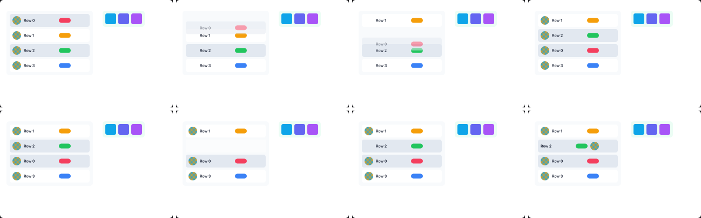
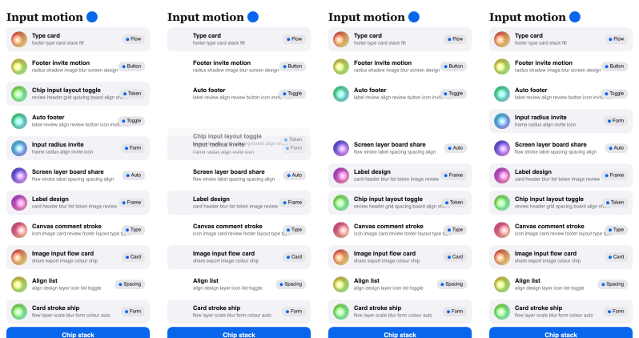
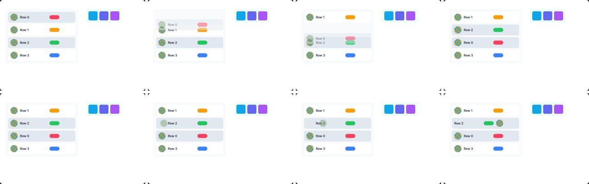
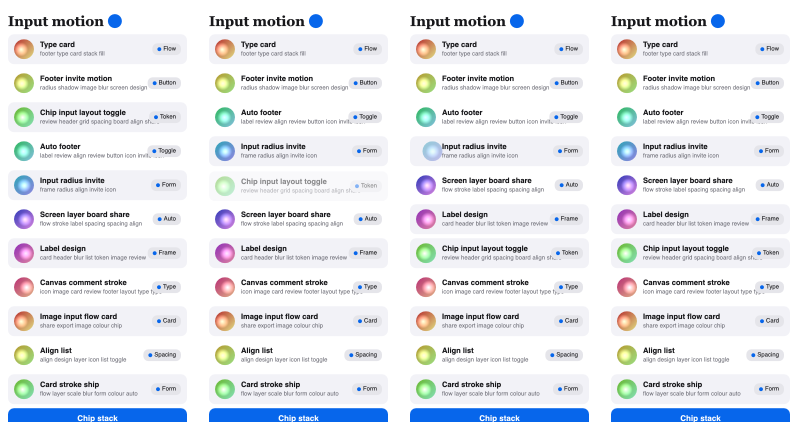

Evidence for the auto layout drag fix (the maintainer's report: "the whole auto layout collection is glitching all over the canvas" while dragging a child, right in the end). Rules: [README](README.md).

| Item | Commit | Tests | Command and result | Screenshot |
|---|---|---|---|---|
| Every frame of a drag in auto layout draws only the frame and the layer at the pointer: images stay, nothing vanishes or greys out at the start or the end, siblings show only where they were, on their way, or where they land, the layer is at this frame's pointer | b47b7d5, 5652b65, 97bd814 (branch `worktree-agent-a423e7483cf644e67`) | `qa/frames.ts` (records every engine frame, checks it in the page); `qa/scenarios.ts` "every frame of a drag in nested auto layout draws only the frame and the layer at the pointer" (a row in a column, an avatar inside a row, a chip out into another frame; two on a busy GPU) and "every frame of a drag in auto layout on a 200-board file is clean" (bench/fixtures/gen.ts); `qa/native/scenarios.ts` "every frame of a drag in nested auto layout is clean in the app" (WKWebView, real NSEvents). All fail on the old code. | `pnpm qa "every frame"`: `2 pass, 0 fail`; full `pnpm qa` after merging main: `60 pass, 0 fail, 0 skip`; `pnpm test`: `1413 pass, 0 fail`; `pnpm qa:native "every frame"`: `1 passed, 0 failed` | Before:   After:   |

How to read the strips. Each row is one drag: the picture before it, two frames during it, the picture after it. Top row of `aldrag-before.png`: dragging "Row 0" down its column, every avatar (an image fill) is gone for the whole drag. Bottom row: dragging an avatar inside "Row 2" on a busy GPU, the whole row is missing in the drag's first frame. `aldrag-large-before.png` (a list board of the 200-board stress file): the second frame lost every avatar, the third lost the "Input radius invite" row. The `after` strips are the same drags on the fixed code.
