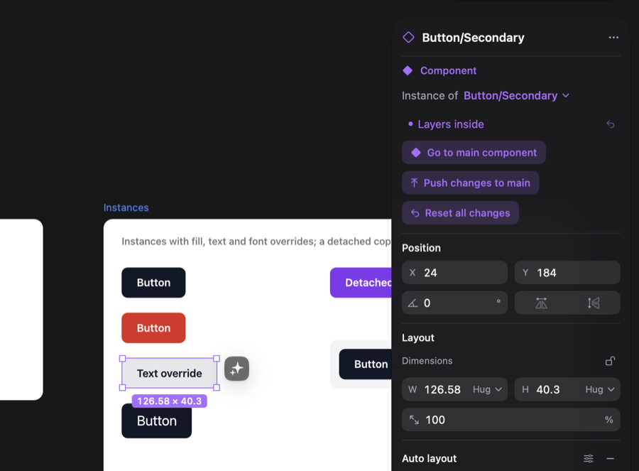
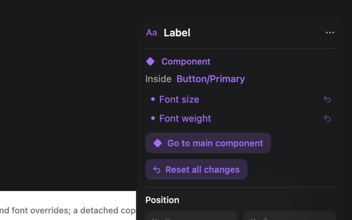
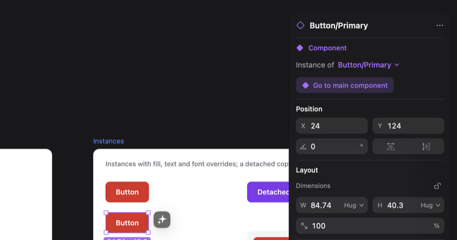
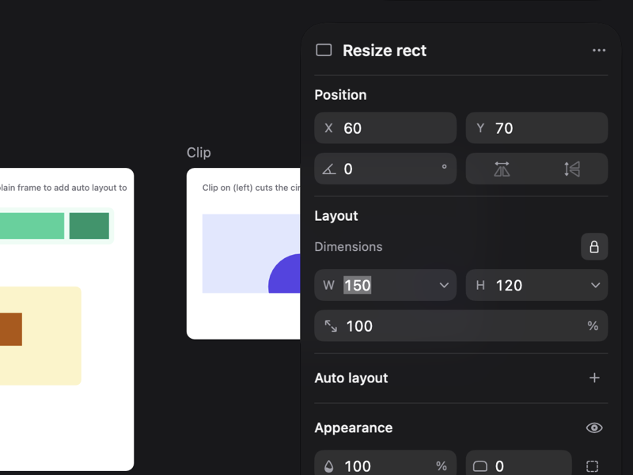
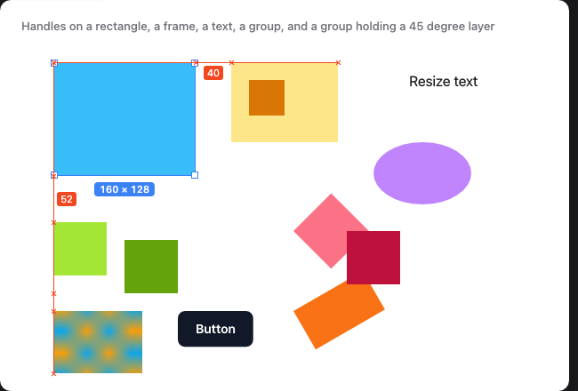
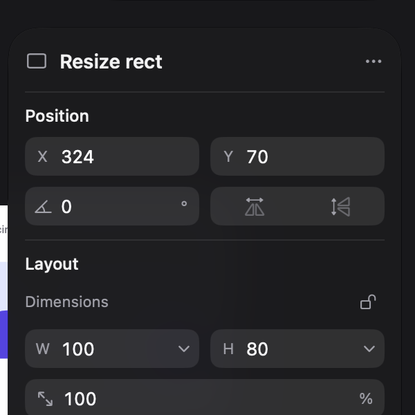
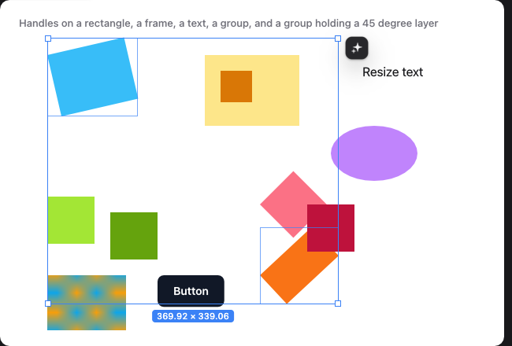

Components and the inspector's layout and position fields: swap instance, reset one override, push changes to main, lock aspect ratio, math with ^, Option-scrub, rotate by keys. Rules in [README.md](README.md); Rows in [interaction-conventions.md](../interaction-conventions.md) (Components and instances; Inspector fields; Resizing).

| Item | Commit | Tests | Command and result | Screenshot |
|---|---|---|---|---|
| Swap instance (P2): the component's name in the Component section is a picker listing every other component (and the canvas menu has Swap instance); overrides on layers whose path of layer names and type match carry over, others are dropped and named in a toast; an instance named after its old main follows the new one; several selected swap together; one undo step; MCP `swap_instance` | 833ee2e | `test/instance-swap.test.ts` "swap instance" (4 tests: carry-over by names, renamed instance keeps its name, several in one step, nested paths, refusals: same component, not an instance, not a component, a loop, a nested instance); `test/mcp.test.ts` "swap_instance, reset_overrides, push_overrides"; `qa/native/scenarios.ts` "swap an instance from the inspector's component picker" (real click on the name, the menu's item, disk and undo) | `node --test test/instance-swap.test.ts`: `pass 9, fail 0`; `pnpm -s test` (after merging main): `pass 1558, fail 0`; `pnpm qa:native "swap an instance"`: `PASS components / swap an instance from the inspector's component picker; its text override carries over` | Text override carried to Button/Secondary's label:  |
| Reset one override (P3): each override is a row in the Component section; its arrow, or right-click > Reset, resets that property only (Stroke resets stroke and its width; Layers inside resets every layer inside); `/api/overrides/reset` takes `keys`; MCP `reset_overrides` with `props` | 833ee2e | `test/instance-swap.test.ts` "reset one override" (an instance's own property, then the layers inside; a layer inside an instance one property at a time, the entry goes when empty); `apps/macos/Tests/ShellLogicTests.swift` OverrideLabels.groups; `qa/native/scenarios.ts` "reset one override from the override list" (right-click > Reset font size, then the other row's arrow) | `pnpm qa:native "reset one override"`: `PASS components / reset one override from the override list; push an instance's changes to its main`; Swift: `ok: 289 checks` | The rows on a layer inside an instance:  |
| Push changes to main (P3): Push changes to main in the Component section and the canvas menu; the instance's own overrides and those on layers inside it become the main component's values (below a nested instance: the main's override on it), leave the instance, and every other instance redraws with them; a replacement layer stays; one undo step; MCP `push_overrides` | 833ee2e | `test/instance-swap.test.ts` "push changes to main" (3 tests: values and undo, nested instance, nothing to push); `qa/native/scenarios.ts` (the button, disk, another instance drawn in the new fill) | `pnpm qa:native "reset one override"`: `PASS` (as above) | After the push, both instances above draw the pushed red:  |
| Lock aspect ratio (P2): a lock in the Dimensions row right above W and H, saved per layer in `metadata.canvasLockAspect` (the page gets `lockAspect` in the scene); with it on, a typed or scrubbed W or H changes the other side, handle drags keep the ratio and Control (pressed once the drag started) frees one drag, Cmd+arrows keep it; off, Shift keeps it as before | 833ee2e | `test/live-edit.test.ts` keepsRatio; `test/shortcuts.test.ts` resizeBy with the lock; `test/scene.test.ts` lockAspect; Swift AspectLock; `qa/scenarios.ts` "Lock aspect ratio: every handle keeps the ratio; Control frees one drag" (8 handles on a rectangle and a frame, a corner drag mid-way, Control); `qa/native/scenarios.ts` "Lock aspect ratio above W and H: a typed W changes H too" | `pnpm qa "Lock aspect"`: `1 pass, 0 fail`; `pnpm qa:native "Lock aspect"`: `PASS inspector / Lock aspect ratio above W and H: a typed W changes H too` | W 150 typed, H followed to 120:  A locked corner drag mid-way (160 x 128 from 100 x 80):  |
| Math with ^ (P3): `2^5`, `(1+2)^2*2`, right to left like maths, after a unary minus; a leading `^2` raises the current value (also each layer's own on a Mixed field) | 833ee2e | `apps/macos/Tests/ShellLogicTests.swift` powerScrubAspect; `qa/native/scenarios.ts` "fields take ^" (typed into X) | Swift: `ok: 289 checks`; `pnpm qa:native "fields take"`: `PASS inspector / fields take ^: 2^5, then ^2 raises the current value` | X after `(1+2)^2*2` then `^2`: 324:  |
| Option-scrub with speed by distance (P3): hold Option over a number field's label or input, press and drag; up from the press 2x, near 1x, down 1/2, further down 1/4 (four speeds); Shift x10; the label icon still scrubs without Option; a plain press on the input still only focuses it | 833ee2e | Swift ScrubSpeed bands; `qa/native/scenarios.ts` "Option over a field and drag scrubs" (real Option-drags on the X input: +20 at 1x, +40 at 2x, +5 at 1/4, a plain drag changes nothing) | `pnpm qa:native "Option over"`: `PASS inspector / Option over a field and drag scrubs; up is faster, down slower` | X after the three drags (60 + 65 = 125):  |
| Rotate by keys (P3): Cmd+Option+Up turns every selected layer 1 degree, Down back, kept in -180...180; quick presses all count; one undo step per press; a rotation bound to a variable is left alone | 833ee2e | `test/shortcuts.test.ts` rotateBy; `qa/scenarios.ts` "Cmd+Option+Up/Down turn the selection 1 degree" (two layers, 14 presses, undo) | `pnpm qa "Cmd+Option"`: `1 pass, 0 fail`; `pnpm qa` (after merging main): `96 pass, 1 fail` (a clipboard card scenario under load; `2 pass, 0 fail` on its rerun) | Two layers after 13 net presses (13 and 43 degrees):  |
| Swap a nested instance (an instance inside another instance) | done later: see [gaps.md](gaps.md) | | | Refused with a clear message (409 unsupported): an override that changes `ref` inside `descendants` is a new kind of override the writer, validation and the resolver's callers would all need to accept. Swap the outer instance, or swap it inside its component. |
| Option+drag a component from the Assets panel onto an instance (another swap gesture) | done later: see [gaps.md](gaps.md) | | | The Components panel rows have no drag to the canvas yet; the picker and the canvas menu cover swap. |
| Right-click a property field (Fill, Opacity) to reset its override | done later: see [gaps.md](gaps.md) | | | The reset lives on the Component section's override rows (arrow or right-click). The Fill, Stroke, Appearance and Typography fields belong to the paint and text work running in parallel (`InspectorPaint.swift`); adding a context menu there would collide. |

Full runs after merging main (b6a6f8a): `pnpm qa:native`: `49 passed, 1 failed` (arrange / the inspector's Spacing field: text recognition missed "Spacing" under load; `1 passed, 0 failed` on its rerun). Text recognition failed often while several agents ran native QA at once (`e5rt` errors from the Neural Engine); `qa/native/harness.ts` findText now asks again after one. "every frame of a drag in nested auto layout" fails the same way on a clean checkout of main (frame 0 of the qd_r2a drag), so it does not come from this work.
