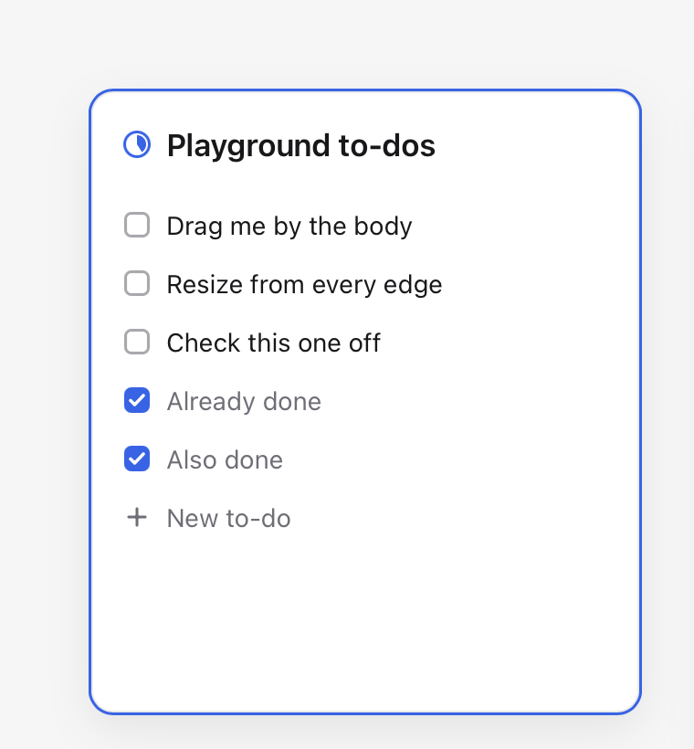
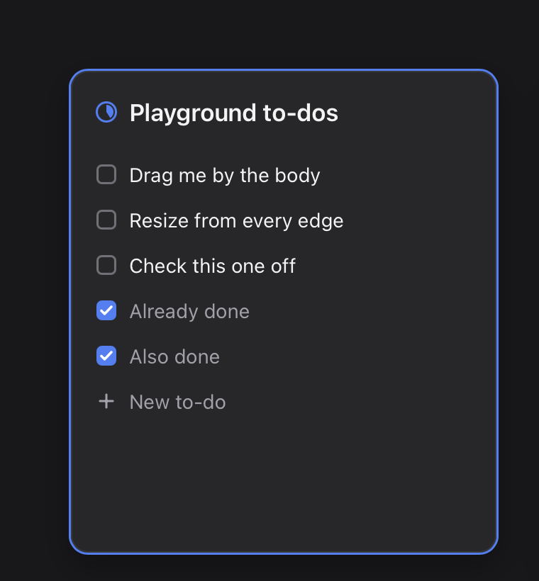
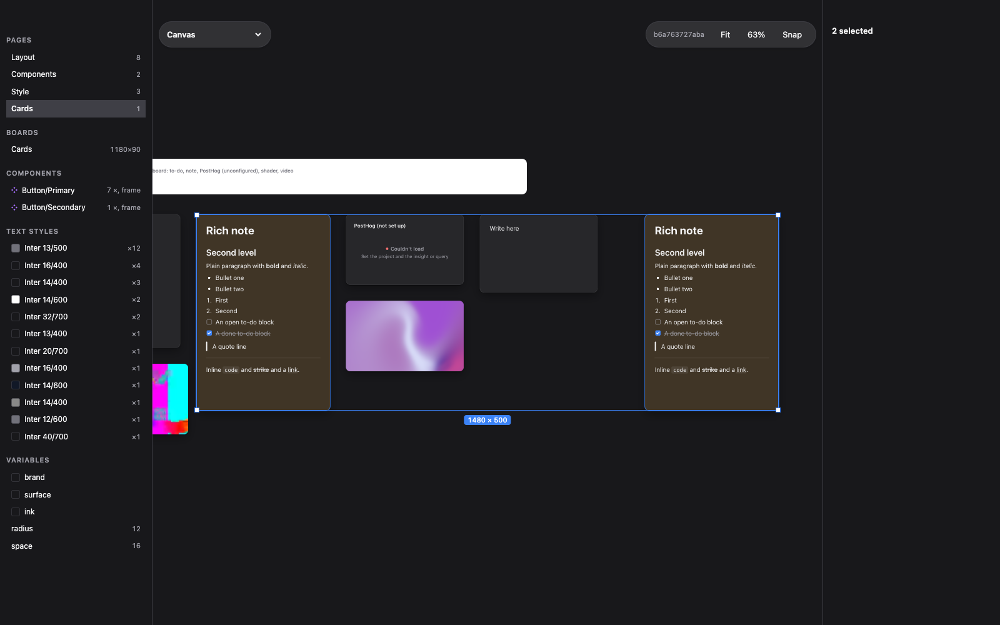
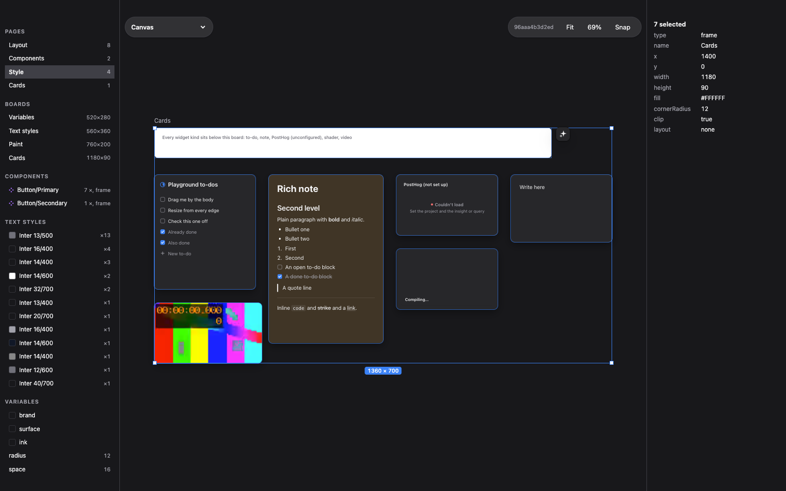
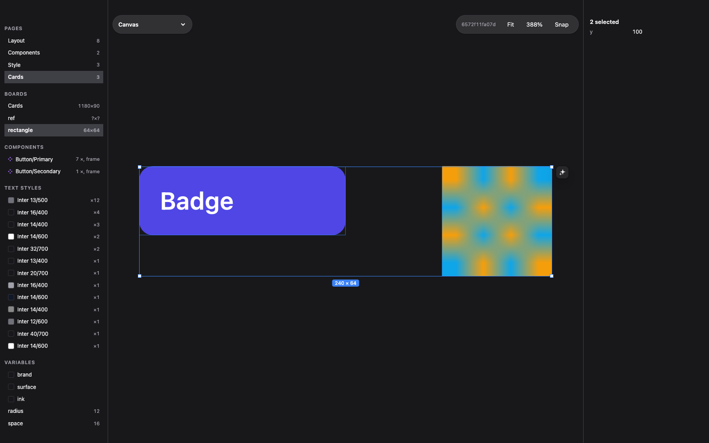
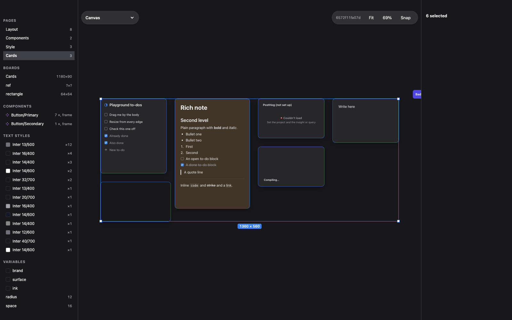
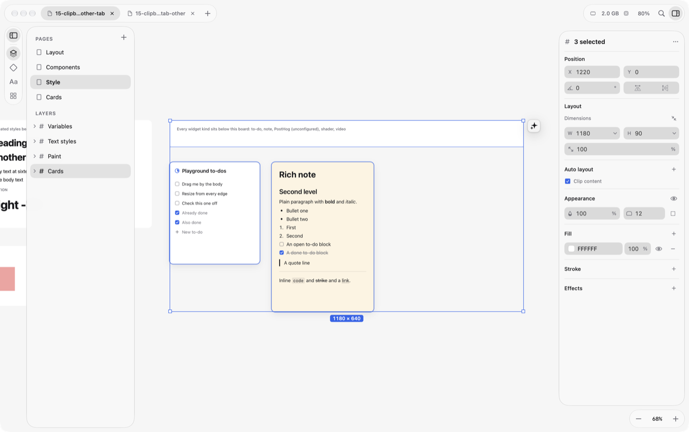

Copy and paste across pages, tabs and files, and the selected card's look (2026-11-16). How it works: [developer guide, Copy and paste](../developer-guide.md#copy-and-paste).

| Item | Commit | Tests | Command and result | Screenshot |
|---|---|---|---|---|
| Selected card: 1.5 px blue outline around its 12 px corners, outside its border, no handles; light | 06632b3 | `qa/scenarios.ts` "a selected card shows a blue outline, light theme" (todo, note, PostHog, video), `qa/native/scenarios.ts` "a selected card shows its blue outline, light" (pixels above the top edge are the selection blue, none inside) | `pnpm qa clipboard outline`: `6 pass, 0 fail, 0 skip in 19 s on 6 workers`; `pnpm qa`: `58 pass, 0 fail, 0 skip in 63 s on 9 workers`; `pnpm qa:native`: PASS cards / a selected card shows its blue outline, light (`TMPDIR=$(mktemp -d) pnpm qa:native` after merging main: `17 passed, 4 failed, 0 skipped in 133 s`; the 4 failures are text recognition errors under load, `qa.find: 500 e5rtError`, in widgets and menus scenarios; the run before the last merge: `17 passed, 1 failed`, the same error) |  |
| Selected card outline, dark | 06632b3 | `qa/scenarios.ts` "a selected card shows a blue outline, dark theme" (shader, to-do, note at 50%), `qa/native/scenarios.ts` "a selected card shows its blue outline, dark" | same runs: PASS cards / a selected card shows its blue outline, dark |  |
| Two selected cards each show the outline | 06632b3 | `qa/scenarios.ts` "two selected cards each show the outline" | `pnpm qa clipboard outline`: `6 pass, 0 fail` | (in the duplicate picture below: both notes outlined) |
| Cards copy, paste and duplicate (Cmd+D puts the copy to the right on free canvas, one undo) | 06632b3 | `test/clipboard.test.ts` (cards: every kind, ids, one step, cut keeps ids), `test/hunt5.test.ts` claude 12, `test/structure-page.test.ts` "cards on the clipboard", `qa/scenarios.ts` "Cmd+D on a card puts the copy to its right, one undo" | `pnpm -s test`: `pass 1413, fail 0`; `pnpm qa clipboard outline`: `6 pass, 0 fail` |  |
| Layers (a board) and cards, page to page: they land on the page shown, clear of its boards, one undo | 06632b3 | `qa/scenarios.ts` "a board and every card kind copied on one page paste on another" | `pnpm qa clipboard outline`: `6 pass, 0 fail` |  |
| Layers file to file: the instance stays an instance (its main component comes along, hidden), the image file is copied into the package, tokens the target lacks become the colour drawn | 06632b3 | `test/clipboard.test.ts` "layers into another file" (images, clash of names, components and the ones they use, variables, ids remapped, older payloads), `test/hunt4.test.ts` 1, 1b, 3, `test/structure.test.ts` (second paste links, undo byte for byte), `qa/scenarios.ts` "layers and every card kind copied in one file paste into another" (second tab on another file) | `pnpm -s test`: `pass 1413, fail 0`; `pnpm qa clipboard outline`: `6 pass, 0 fail` |  |
| Cards file to file: shader source written, video file copied into media/, PostHog keeps its config but not its Keychain reference | 06632b3 | `test/clipboard.test.ts` "another file: the video is copied in, ...", the same `qa/scenarios.ts` scenario | same runs |  |
| Copy in one tab, paste in another tab of the app (Canvas's pasteboard type, names as plain text, one Cmd+Z) | 06632b3 | `qa/native/scenarios.ts` "copy cards and a board in one tab, paste them in another tab" | `pnpm qa:native`: PASS clipboard / copy cards and a board in one tab, paste them in another tab |  |
| Variables copied into the target instead of resolved | not done | | Decision: a paste resolves a missing or different variable to the value drawn and never changes the target's tokens; Canvas has no undo for variable edits yet. | |
