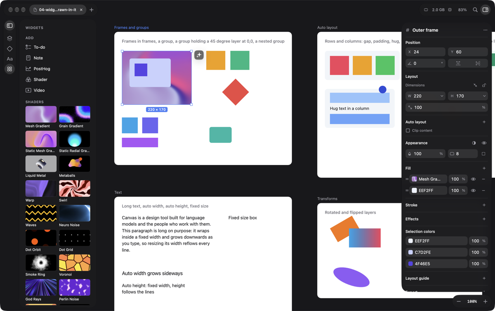
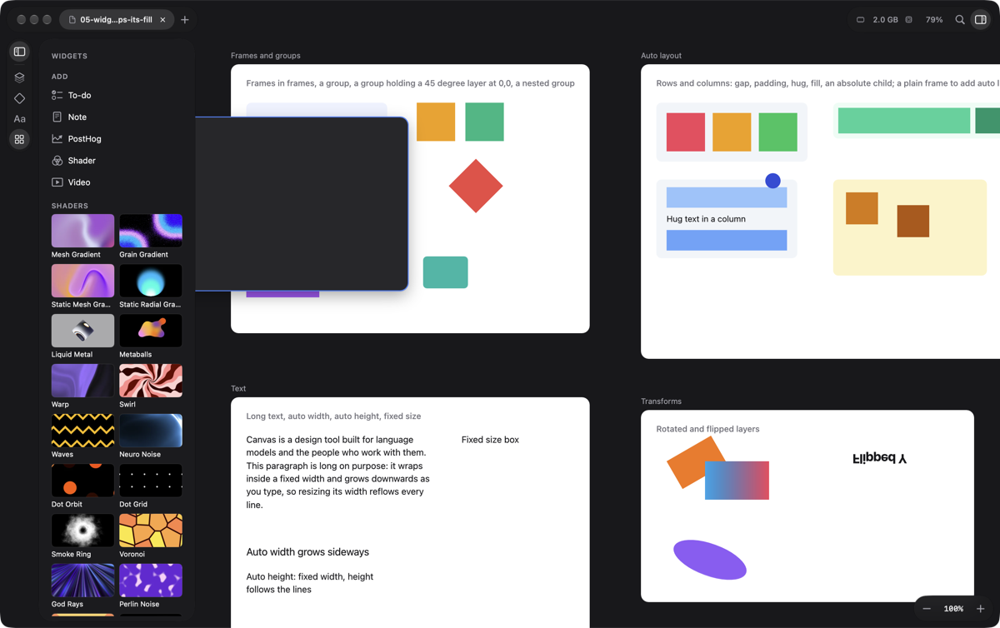
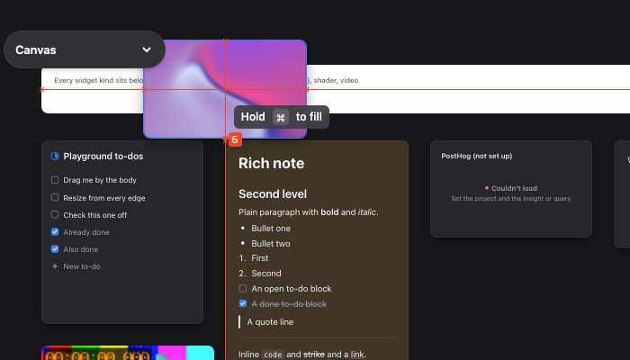
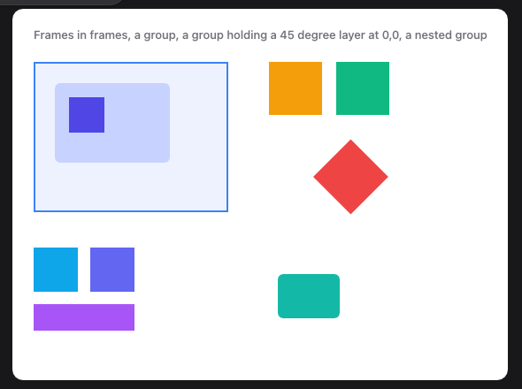
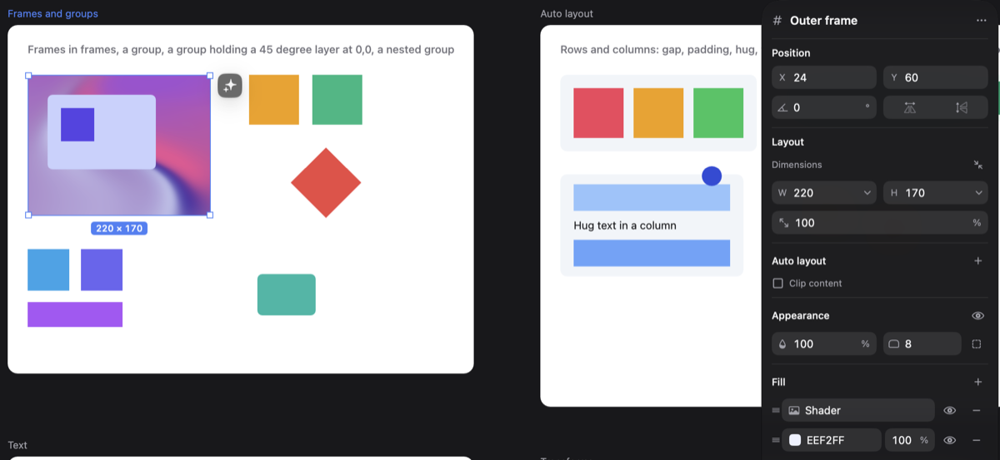
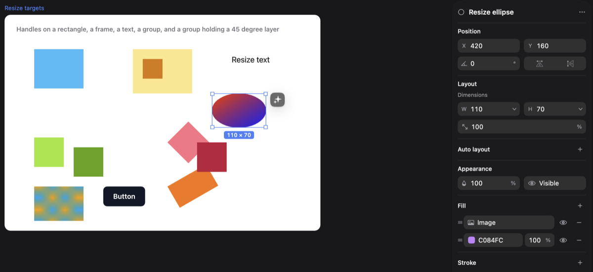
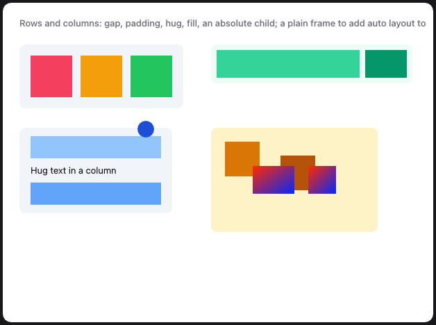
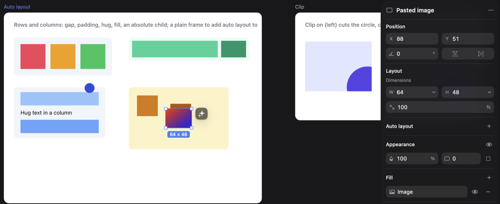

Drops on the canvas: shader fills by drop (a tile) or Cmd-drag (a card), image fills by Cmd-drop, image files from Finder, Cmd+V of a screenshot. Rules in [README.md](README.md); Rows in [interaction-conventions.md](../interaction-conventions.md) ("Paste an image", "Drop image files", "Image or shader onto a layer").

The convention: a plain drop places the thing where it lands (a shader card, an image layer inside the frame under the pointer); holding Cmd while dragging outlines the layer under the pointer, and the drop becomes that layer's fill. The fill goes on top of the layer's fills; a fill of the same kind (shader on shader, image on image) is replaced.

| Item | Commit | Tests | Command and result | Screenshot |
|---|---|---|---|---|
| A shader tile dropped on a layer fills it with no key held (2026-11-17, the maintainer: "when I drag shader I wanna use it on an element"). Over empty canvas, or with Option, it is a card. A shader card dragged over a layer without Cmd shows a "Hold ⌘ to fill" tip | see git log for "Shader tile" | `test/drop-logic.test.ts` "tileTarget"; `qa/scenarios-drops.ts` "drop a shader tile on a frame, no keys held", "an Option-drop of a shader tile", "a shader card dragged over a frame without Cmd"; `qa/native/scenarios.ts` "drag a shader tile onto a frame, no keys held", "Option-drag a shader tile onto a frame", "drag a shader tile onto empty canvas" | `node --test test/drop-logic.test.ts`: `pass 19, fail 0`; `pnpm qa -- drops keys`: `20 pass, 0 fail, 0 skip`; `pnpm qa:native widgets`: `8 passed, 0 failed`; full `pnpm qa:native`: `74 passed, 0 failed` | Plain drop in the app, the frame filled (inspector: Mesh Gradient over EEF2FF):  Option-drop, a card:  The tip without Cmd:  |
| Cmd-drop a shader tile on a layer: blue outline mid-drag, then the shader is the layer's fill, animating, clipped to its shape, under its children; an override inside an instance | 260609e, 8290fb7 | `test/drop-logic.test.ts`, `test/shader-fill.test.ts` (write, scene, undo and redo bytes, instance override), `engine/src/board.rs` tests (placeholder under the children, 1024 px cap, only the layer's area redrawn); `qa/scenarios-drops.ts` "Cmd-drop a shader tile on a frame" (outline, fill, drawn, animates), "plain drop ... adds a card", "inside an instance"; `qa/native/scenarios.ts` "Cmd-drag a shader tile onto a frame" | `pnpm qa drops`: `6 pass, 0 fail, 0 skip`; `pnpm qa:native widgets`: `PASS widgets / Cmd-drag a shader tile onto a frame: the frame's fill, drawn in it`, `5 passed, 0 failed`; `cargo test --lib`: `170 passed; 0 failed` | Outline mid-drag:  In the app, the frame filled (inspector: Shader over EEF2FF):  |
| Cmd-drop an image file on a layer: the image is its fill (cover) | 260609e | `test/shader-fill.test.ts` "a plain drop adds an image layer ... a Cmd-drop makes it the fill"; `qa/scenarios-drops.ts` "an image file Cmd-dropped on an ellipse"; `qa/native/scenarios.ts` "drag image files from Finder ... Cmd onto an ellipse" (a real file drag in the QA build, waits for the image to draw) | `pnpm qa drops`: `6 pass, 0 fail, 0 skip`; `pnpm qa:native widgets`: `PASS widgets / drag image files from Finder onto a frame: image layers; Cmd onto an ellipse: its fill` | The ellipse filled with the dropped image (inspector: Image over C084FC):  |
| Image files dragged from Finder: image layers at their own size (long side at most 4096), side by side, centred under the pointer, inside the frame under it; files copied into the package's `media/` | 260609e, 8290fb7 | `test/shader-fill.test.ts` (header sizes for PNG, JPEG, GIF, WebP, SVG; copied once per content; not-images refused; layer in the frame, one undo step), `test/drop-logic.test.ts` (side by side, parent frame, size cap); `qa/scenarios-drops.ts` "image files dropped from Finder"; `qa/native/scenarios.ts` (qa.files: a real file drag) | `pnpm qa drops`: `6 pass, 0 fail, 0 skip`; `pnpm qa:native widgets`: `5 passed, 0 failed` | Two dropped files in the yellow frame:  |
| Cmd+V with a screenshot on the pasteboard: an image layer in the middle of the view, or in the selected frame; Canvas's own copied layers still paste as layers | 260609e | `apps/macos/Tests/ShellLogicTests.swift` pasteImage (what wins on the pasteboard); `qa/scenarios-drops.ts` "Cmd+V of an image" (browser paste event and the app's command); `qa/native/scenarios.ts` "Cmd+V with a screenshot" (real Cmd+V in the QA build, its own pasteboard) | Swift: `ok: 215 checks`; `pnpm qa:native widgets`: `PASS widgets / Cmd+V with a screenshot on the pasteboard pastes an image layer` | The pasted picture in the selected frame:  |
| Drag an existing shader card onto a layer to make it the fill | done later: see [gaps.md](gaps.md) | | | |
