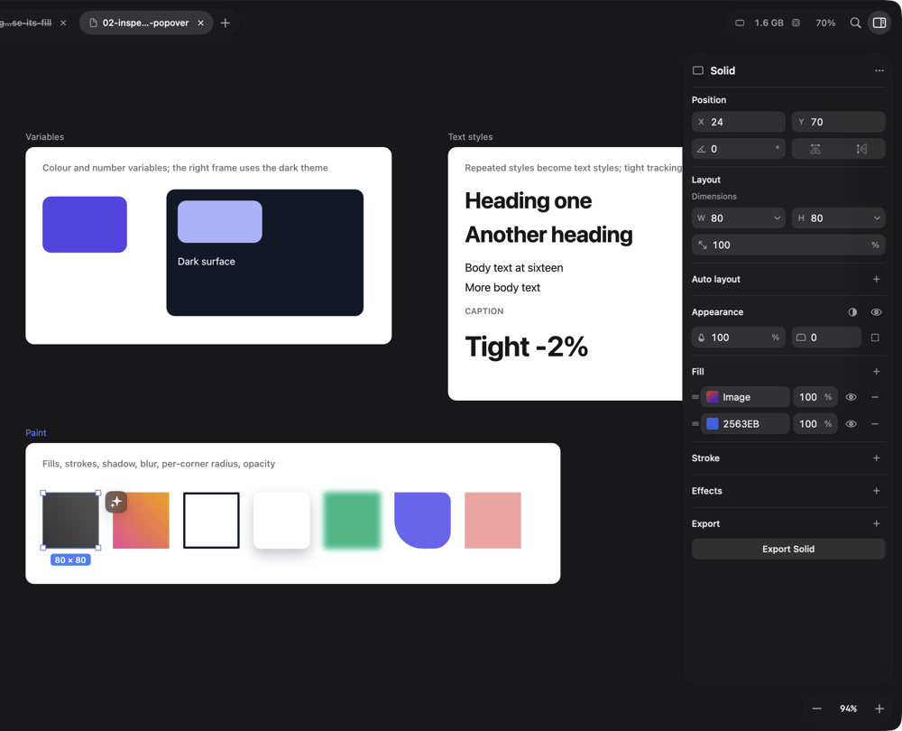
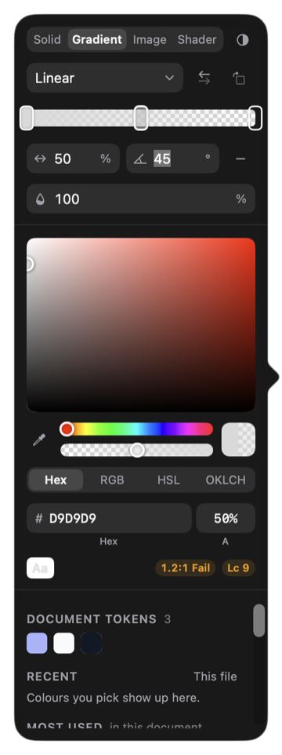
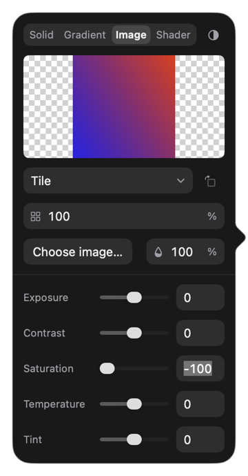
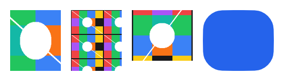
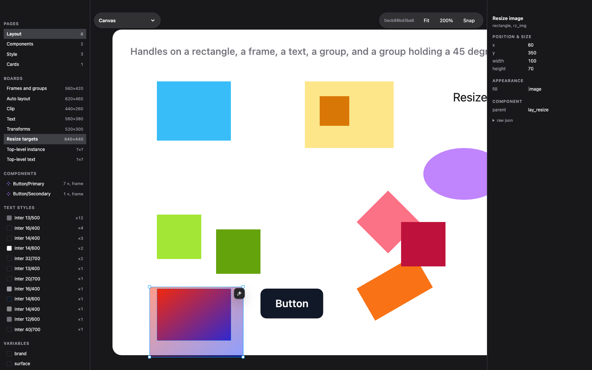
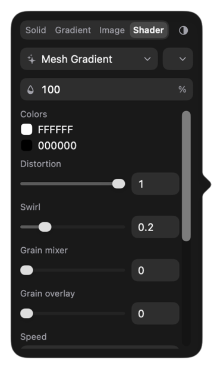
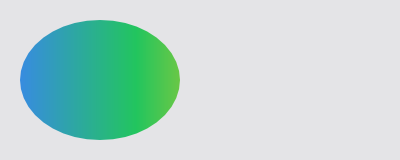
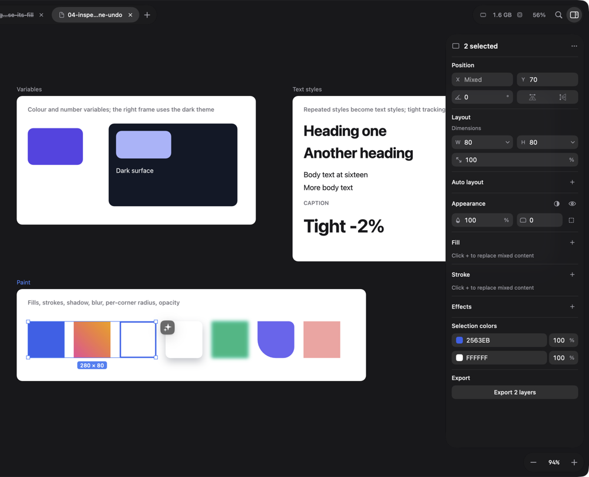
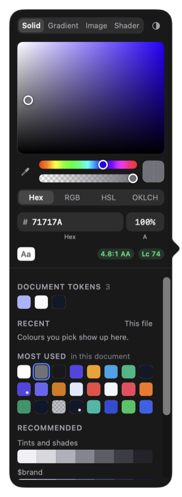

Fills, strokes, images and paint keys: the roadmap card "Fill + opens a type picker" and the rows of [interaction-conventions.md](../interaction-conventions.md) (Fills, strokes, effects; Images; Corner smoothing). Rules in [README.md](README.md). Branch `worktree-agent-aa4c2f505a25f2a74`.

Native scenarios (`qa/native/scenarios-fills.ts`) run in a QA instance that is never the active app, so its menus are not drawn (`qa.menu` reads and picks their items) and its popovers draw inactive (greyer than in use). The image picker and the eyedropper answer through `qa.paint` (a QA build cannot drive the system's open panel or colour sampler); everything after them is the real code path. Text recognition failed with `e5rtError` for long stretches while other agents' QA instances shared the Neural Engine, so these scenarios find fields and buttons by the inspector's text fields and the popover's layout, not by reading text.

| Item | Commit | Tests | Command and result | Screenshot |
|---|---|---|---|---|
| Fill + opens a type picker: Solid, Linear / Radial / Angular gradient, Image... (file picker, copied into `media/`), Shader (Paper presets); Stroke + offers Solid and the gradients; a paint row's swatch opens the popover whose tabs switch the type (a colour becomes a gradient from it to itself transparent, a gradient gives its first stop back) | 3194a45, 3df9a9a, b131cde | `apps/macos/Tests/PaintLogicTests.swift` kinds(); `qa/native/scenarios-fills.ts` "Fill + asks for the type", "Fill + Image...", "Fill + Shader" (the + menu's items, the pick, the tabs) | `swiftc ... PaintLogicTests`: `ok: 97 checks`; `pnpm qa:native asks Image... Paper ...`: see the last row |  The + menu itself is not drawn in a QA instance; its items are asserted. |
| Gradient editor: stops on a bar (click adds one with the colour there, drag moves, the selected stop's colour in the picker below, position field, remove), type, angle (clockwise degrees), flip, rotate 90, opacity. The handles live in the popover, not on the canvas (inspector-only); no diamond gradient (the engine has none) | 3194a45, 3df9a9a | PaintLogicTests stops(); native "Fill + asks for the type: Linear gradient goes on top..." (a click on the bar adds a third stop, angle 45 writes rotation 135, Solid tab) | `pnpm qa:native "Linear gradient goes"`: `1 passed, 0 failed` |  |
| Image fill modes Fill, Fit, Crop, Tile (with its size), Rotate 90, Choose image..., opacity; adjustments exposure, contrast, saturation, temperature, tint (one colour matrix: the page recolours the decoded pixels, the HTML renderer an SVG feColorMatrix). Highlights and shadows are not there | 3194a45, 7902f54 | `test/fills.test.ts` (matrix, URL fragment, schema, HTML crop/tile/rotation/filter); `engine/src/paint.rs` image_fill_modes_place_the_image, rotating_an_image_fill_turns_it_in_the_box, image_fill_mode_and_rotation_parse; `qa/scenarios-fills.ts` "the engine draws a tiled, turned and adjusted image..." (saturation -1 draws grey); native "Fill + Image..." (Tile, Rotate 90, Saturation -100 on disk); golden fixture `fill-modes` | `node --test test/fills.test.ts`: `13 pass, 0 fail`; `(cd engine && cargo test --lib)`: `182 passed; 0 failed`; `pnpm qa tiled`: pass; `pnpm test:golden --only fill-modes`: `fidelity 2 pass, 0 differ` |   |
| Crop by double-clicking an image (or Crop on canvas in its popover): the whole image shows, dimmed outside the layer, with corner handles; drag moves, a corner scales with the aspect kept; Return, Esc or a click outside writes `mode: "crop"` with the image's fractions of the layer (it holds on resize), one undo step. Cmd while resizing is not there | 3194a45, 7902f54 | `test/fills.test.ts` "crop on the canvas (math)"; `qa/scenarios-fills.ts` "double-click an image layer to crop it..." | `pnpm qa crop`: pass (in the full run below) |  |
| Shader fill preset and parameters in its popover (shader, preset, Paper's params with their ranges; hand-written WGSL says agents edit it) | 3194a45, b131cde | native "Fill + Shader adds a Paper preset; its popover switches the preset" | `pnpm qa:native Paper`: `1 passed, 0 failed` |  |
| Blend mode per paint (the popover's blend menu) and per layer (the Appearance section's blend menu), drawn by the engine (a layer with that mix) and the HTML renderer (background-blend-mode, mix-blend-mode) | 3194a45 | `engine/src/paint.rs` blend_modes_open_a_mixed_layer; `test/fills.test.ts` HTML; native "Shift+Up ... the layer blend menu ..."; `qa/scenarios-fills.ts` multiply darkens; golden `blend-fill` | `pnpm test:golden --only blend-fill`: `2 pass, 0 differ` (engine and Chrome 0.000% apart) |  |
| Selection colors: several layers, or a frame or group, list each colour once (variables first, then by use; fills, strokes, gradient stops, shadows, descendants); an edit changes every use in one write and one undo step (a picker drag is one step) | 3194a45, b131cde | `test/fills.test.ts` "Selection colors" (list, each, GET/POST, one undo, a drag one step); native "Selection colors: a colour two layers share is listed once; one edit changes both, one undo" | `node --test test/fills.test.ts`: `13 pass`; `pnpm qa:native Selection`: pass |  |
| Eyedropper by key: I (and Control+C in the app) samples a colour into the selection's fill (NSColorSampler in the app, Chrome's EyeDropper in the browser) | 3194a45 | native "I samples a colour into the selection's fill; Control+C too" (one layer, then two) | `pnpm qa:native samples`: pass | the scenario's end shot `qa/out/native/inspector-i-samples-...png` (the sampled colour is the only change) |
| Lighter or darker hex: Shift+Up / Shift+Down in a hex field, 10% lightness (Up / Down 1%), opacity kept | 3194a45 | PaintLogicTests hexSteps(); native "Shift+Up in the hex field lightens..." | `ok: 97 checks`; native pass | as above |
| Copy one paint: Copy Fill / Paste Fill (and Copy / Paste Effect) on a row's right-click. Select a row, then Cmd+C / Cmd+V came later: see [gaps.md](gaps.md) | 3194a45 | PaintLogicTests blends() (pasting); native "Copy Fill on one layer's row, Paste Fill on another's" | native pass | |
| Remove or swap paints by key: Option+/ removes fills, Shift+/ strokes (with width and position), Shift+X swaps fill and stroke; several layers in one step | 3194a45 | `test/fills.test.ts` "paint keys"; `qa/scenarios-fills.ts` "Shift+X swaps fill and stroke, Shift+/ removes the stroke, Option+/ the fill; each one undo step" | `pnpm qa swaps`: pass | |
| Contrast checker: the colour picker rates a text colour against what is behind it (WCAG ratio and level, APCA Lc). This was already in `ColorPicker.swift` (ContrastLine); the row said MISSING | existing; scenario 3df9a9a | native "a text layer's colour picker rates contrast against what is behind" (the badges' pixels) | `pnpm qa:native contrast`: `1 passed, 0 failed` |  |
| Corner smoothing: `cornerSmoothing` on frames and rectangles, a % field and an iOS (60%) button under the corner fields; the engine draws a smoothed corner (and blurs its exact shape for shadows), the DOM renderer a circular one | 3194a45 | `engine/src/paint.rs` corner_smoothing_draws_a_squircle; native "... iOS corner smoothing"; golden `fill-modes` (fourth box) | `cargo test --lib`: `182 passed` |  |
| Use as mask: Control+Cmd+M toggles `mask`; the mask is not drawn, the siblings above it are cut to its alpha (engine, in a layer with DestIn) or clipped to its shape (HTML renderer, free frames); a mask toggle repaints the whole board | 7902f54 | `engine/src/paint.rs` a_mask_cuts_the_layers_above_it; `engine/src/board.rs` a_mask_toggle_is_a_whole_board_update; `test/fills.test.ts` "use as mask"; `qa/scenarios-fills.ts` "Control+Cmd+M makes the ellipse a mask..."; golden `mask` | `pnpm test:golden --only mask`: `2 pass, 0 differ`; `pnpm qa Control+Cmd+M`: pass |  |
| Whole suites after merging main (9d28021) | 9d28021 | all of the above | `pnpm -s typecheck`: clean; `pnpm -s test`: `1559 pass, 0 fail`; `pnpm qa`: `99 pass, 0 fail, 0 skip`; `pnpm qa:native` (all 51, at 675d991): `39 passed, 12 failed`: the contrast scenario (it read text then; it reads pixels now) and 11 scenarios outside fills, every one a text recognition error (`qa.find: 500 e5rtError`, or "did not appear on screen") while other QA instances held the Neural Engine. `pnpm test:golden`: one change outside fills, `zoom-ladder@0.1x@2` (a known gap view), which main's own engine build also gives after this merge | |
| The fills set in the app, after the last change | b131cde and later | `qa/native/scenarios-fills.ts` (8) and the zoom pill menu | `pnpm qa:native asks Image... Paper Selection samples Shift+Up "Copy Fill" contrast`: `9 passed, 0 failed, 0 skipped in 81 s` (after the 9d28021 merge) | |
