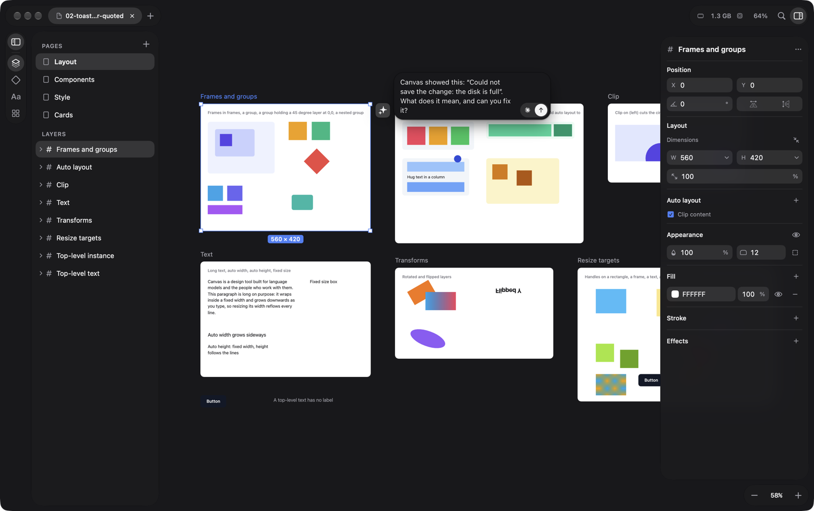
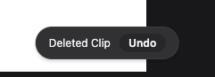
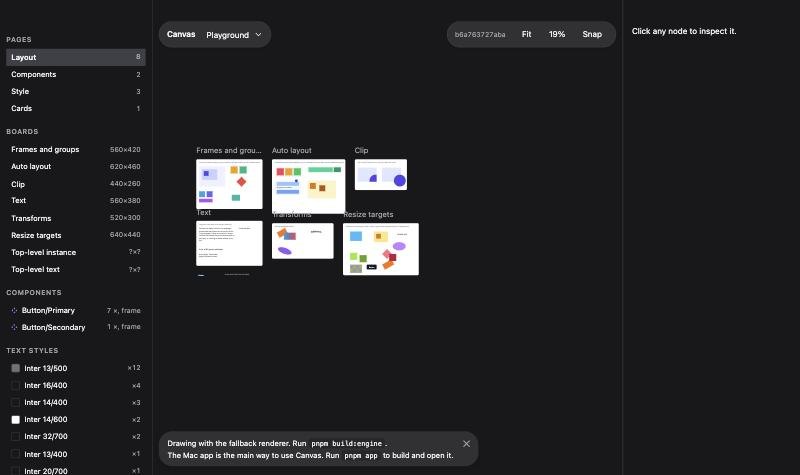
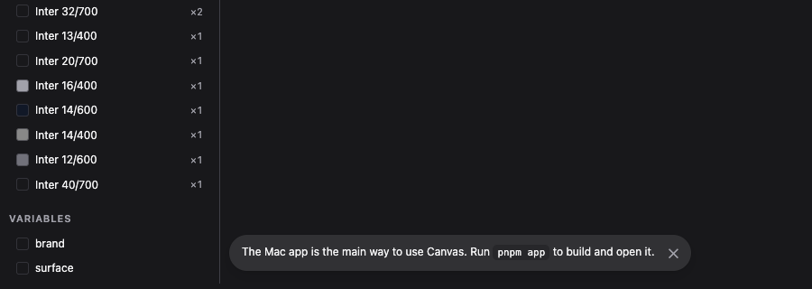
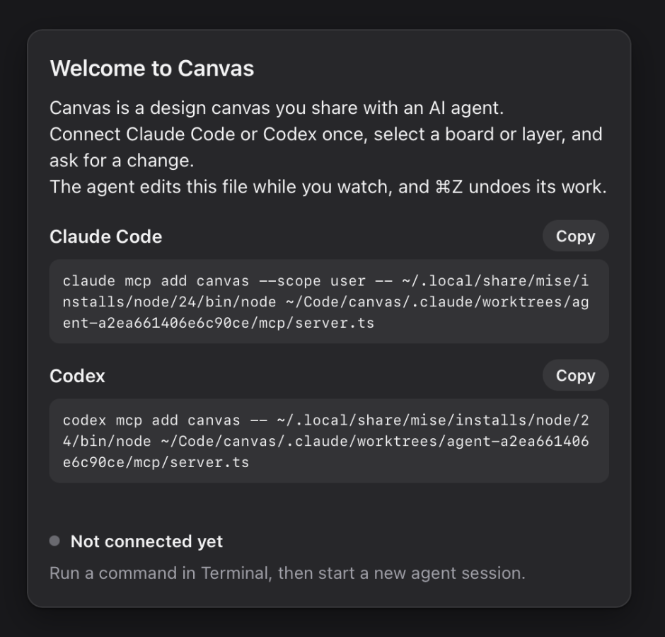
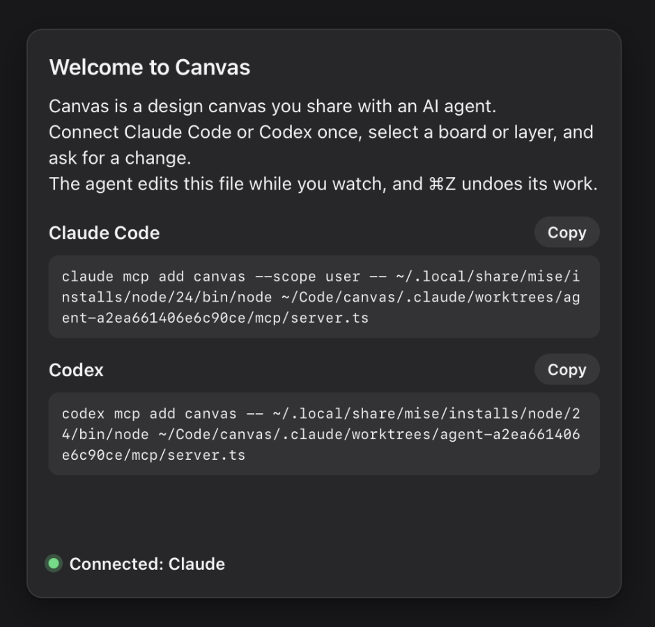
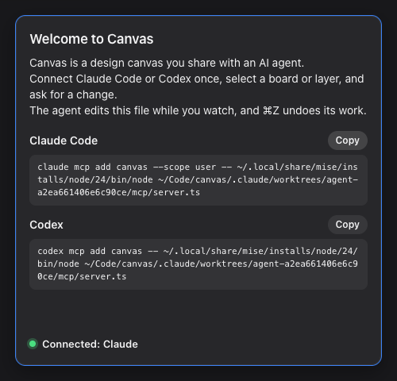
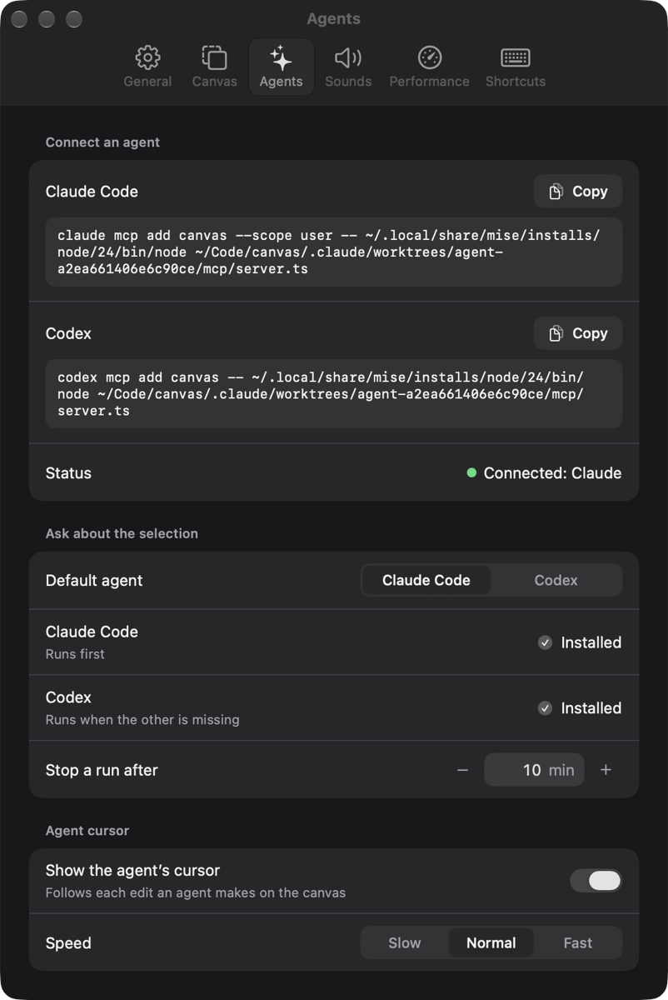

First run and toasts you can act on: the roadmap cards from a designer's first clone (the browser page looked broken, he could not tell what Canvas is for or which `/mcp` server was Canvas, and wanted a toast's path or error on the clipboard or in front of Claude). Rules in [README.md](README.md).

| Item | Commit | Tests | Command and result | Screenshot |
|---|---|---|---|---|
| 1a. Toasts copy on click: a toast with a file path copies the path, an error copies its text, and the toast says Copied; plain news (Link copied, Exported) is not clickable. One line, cut in the middle, grey glass | 86a1f29 | `apps/macos/Tests/ShellLogicTests.swift` `toastActions` (paths with spaces, `~/`, brackets, quotes; errors vs news; levels); `qa/native/scenarios-firstrun.ts` "a toast with a path copies the path on click and says Copied" (real click on the toast, the instance's pasteboard) | `swiftc ... ShellLogicTests.swift`: `ok: 241 checks`; `pnpm qa:native toasts first-run`: `PASS toasts / a toast with a path copies the path on click and says Copied`, `5 passed, 0 failed, 0 skipped` |  |
| 1b. Ask agent on an error toast, when Claude Code or Codex is installed: the Cmd+Return composer opens on the selection (else the board in view) with the error quoted; nothing is sent until you press Return | 86a1f29 | `ShellLogicTests` `toastActions` (the prompt, one line); `qa/native/scenarios-firstrun.ts` "Ask agent on an error toast opens the composer with the error quoted" (clicks the button; checks the composer's field, its layers, no run started) | `pnpm qa:native toasts first-run`: `PASS toasts / Ask agent on an error toast opens the composer with the error quoted` | Toast:  Composer:  |
| 1c. Undo on toasts for undoable deletes: deleting a board ("Deleted Clip"), a page ("Deleted page ...") or a card. Undo steps back only while that delete is still the step Undo would take; after another edit it says so and changes nothing | 86a1f29 | `qa/scenarios-firstrun.ts` "deleting a board shows Undo, and Undo brings it back" (browser: Backspace, click Undo, then the refusal after a later edit); `qa/native/scenarios-firstrun.ts` "deleting a board shows Undo in the app's toast ..." and "deleting a page shows Undo, and Undo brings the page back" (right-click > Delete on the page row) | `pnpm qa first-run toasts`: `3 pass, 0 fail, 0 skip` (full `pnpm qa`: `78 pass, 0 fail`); `pnpm qa:native toasts first-run`: both `PASS` | App:  Browser:  |
| 1d. Undo toast on paste | not done | | | Design tools show no toast for a paste or a layer delete inside a board (the change is in plain sight), so neither does Canvas. Board, page and card deletes, which take something out of view, get one. Say if paste should toast anyway. |
| 2a. README "Run it" leads with one command, `pnpm app`: dependencies, the Rust target and pinned wasm-bindgen-cli when missing, the engine, `build/Canvas.app` with this checkout's path in it (so a clone outside `~/Code/canvas` works), then opens it. No postinstall, no new dependency. (`pnpm setup` is pnpm's own command, so the script is `app`.) | 86a1f29 | `scripts/app.sh`; `apps/macos/build.sh` `CANVAS_REPO` (Info.plist `CanvasRepo`, read by `main.swift`) | `CANVAS_APP_NO_OPEN=1 CANVAS_SIGN_IDENTITY=- pnpm app`: `built .../build/Canvas.app`, `plutil -p`: `"CanvasRepo" => "<this checkout>"`, `"CFBundleShortVersionString" => "0.1.0"` (build/ deleted after; the maintainer's app untouched) | |
| 2b. Browser page: a banner when the engine build is missing ("Drawing with the fallback renderer. Run pnpm build:engine.") and, in a browser, "The Mac app is the main way to use Canvas. Run pnpm app"; Hide remembers. Automation (headless Chrome) sees it only with `?hint=1` | 86a1f29 | `test/onboarding.test.ts` "the browser page says when the engine build is missing" (empty `CANVAS_ENGINE_PKG`); `qa/scenarios-firstrun.ts` "the browser page points at the Mac app; Hide keeps it away" | `node --test test/onboarding.test.ts`: `pass 6, fail 0`; `pnpm qa first-run toasts`: `3 pass, 0 fail, 0 skip` | Engine missing (a scratch server with an empty engine folder):  App line:  |
| 2c. `pnpm release:app`: builds Canvas.app into `qa/out/release/<version>/`, zips it with ditto as `Canvas-<version>.zip`, writes `RELEASE-NOTES.md` (size, SHA-256, commit, signer, requirements, changes since the last tag, the Developer ID and notarization steps). Refuses when package.json and Info.plist disagree. Publishes nothing | 86a1f29 | `scripts/release-app.sh` | `CANVAS_SIGN_IDENTITY=- pnpm release:app`: `Ready in qa/out/release/0.1.0: Canvas-0.1.0.zip sha256 5f4c... RELEASE-NOTES.md. Nothing was published.` (output deleted after) | |
| 2d. Version 0.1.0 | already | package.json and `apps/macos/Info.plist` were both 0.1.0 already; nothing changed | | |
| 2e. Publishing the release (GitHub release, upload, notarization) | not done | | | Outward-facing: the maintainer's call. The notes list the Developer ID and notarytool steps. |
| 3a. First launch opens the Welcome file: with no file opened before, the app asks the server for `~/Documents/Canvas/Welcome.canvas` (a copy of `demos/sample.canvas`, made once) with the welcome card left of the boards: three lines on what Canvas does, the exact `claude mcp add canvas ...` and `codex mcp add canvas ...` commands for this Mac with Copy, and a live Connected dot | 86a1f29 | `test/onboarding.test.ts` (the copy, the card, made once, the person's edits kept, no temp left, writes need the header); `ShellLogicTests` `firstRun` (fresh install, welcomed, existing users, QA); `qa/native/scenarios-firstrun.ts` "a first launch opens the Welcome file ..." (a second QA instance with a fresh HOME and preferences, `CANVAS_QA_FIRST_RUN=1`); `qa/scenarios-firstrun.ts` "the welcome card shows the canvas MCP commands, copies one, and turns Connected on" (real click on Copy) | `pnpm qa:native toasts first-run`: `PASS first-run / a first launch opens the Welcome file; Connected follows an agent; Settings > Agents shows the commands`; `pnpm qa first-run toasts`: `3 pass` | First launch:  |
| 3b. Connected turns on when an MCP client talks to the server: canvas-mcp says hello on connect and every 20 s, and every request it makes counts; off after 50 s of silence; Canvas's own runs do not count | 86a1f29 | `test/onboarding.test.ts` "Connected turns on when an MCP client connects, not for Canvas's own runs, and goes off after silence" (real stdio MCP children); both first-run scenarios send canvas-mcp's hello and wait for the dot | `node --test test/onboarding.test.ts`: `pass 6, fail 0` | App:  Browser:  |
| 3c. Settings > Agents shows the same commands with Copy and the same status | 86a1f29 | `qa/native/scenarios-firstrun.ts` (Cmd+, in the fresh instance, a real click on the Agents tab; checks the stored tab and the pane's height; the screenshot shows the card). Text recognition is not used in the second instance: under this Mac's load it broke recognition for the main instance | `pnpm qa:native toasts first-run`: `PASS first-run / ...` |  |
| 4. The MCP server is always `canvas`: `initialize` answers name `canvas`, title `Canvas` and a one-line description; README, developer guide, the Welcome card and Settings register it as `canvas` | 86a1f29 | `test/onboarding.test.ts` "the MCP server is named canvas and says in one line what it is", "setup commands register the server as canvas with absolute paths" | `node --test test/onboarding.test.ts`: `pass 6, fail 0` | |
| 5. The release scrub reads screenshots: every tracked image under `docs/` goes through macOS Vision (`qa/ocr.swift`) and its text is checked for personal paths, emails, private names, the committer's name and this Mac's user name. design/, qa/baselines/ and test/golden/ are not read (about 600 mockups and test pictures: not cheap) | 86a1f29 | `qa/release.ts` `scrubImages`. Before the retakes it flagged the old shots (`FAIL images under docs/: 35 ... hits`, all in firstrun-*.png) | `node qa/release.ts --quick --only scrub`: `PASS images under docs/: 44 read, no personal paths, emails or names in their text`, `16 pass, 0 fail, 4 need the maintainer` (the four are older history and metadata, none from this branch) | |

Notes

- The commands on the Welcome card and in Settings write the home folder as the shell's own (`~/...`, or `"$HOME/..."` when the rest needs quoting), so no user name is on screen and a paste into zsh or bash expands it (`test/onboarding.test.ts` runs one through bash). They still name this checkout's folder (`~/Code/canvas` or a worktree), so the browser welcome scenario keeps its opt-out from the pixel baseline. The native welcome shots are cropped to the card: the sample beside it (`demos/sample.canvas`, copied into Welcome.canvas) shows a person's name, see the last note.
- The copy glyph on a hovered toast is drawn on SwiftUI hover; the QA build's synthetic pointer moves do not trigger hover, so no screenshot shows it.
- The toast scenarios click the toast's text and buttons where the app drew them (QA state `toastFrames`), not by text recognition.
- Full `pnpm qa:native` on this Mac tonight: the five scenarios above pass; the scenarios that read text on screen (widgets drag, zoom pill menu, Settings persists, Styles) fail with `e5rtError ... create_precompiled_compute_operation` from the Neural Engine while other agents' QA runs share it. They fail the same way in a run without this card's scenarios (`pnpm qa:native widgets menus inspector styles "change persists"`: `6 passed, 6 failed`, every failure e5rt or text not found).
- Found, not fixed (outside these cards): `demos/sample.canvas`, which the Welcome file copies, has a card showing the maintainer's full name ("Live test card"). Every first launch puts it on screen. Swap it for a placeholder name before the release.
- Found, not fixed (outside these cards): deleting a board with Backspace leaves it in its page's list in `widgets.json` (`qa/checks.ts` flags it). The board-delete scenario ends on Cmd+Z to stay clear of it.
