Evidence for the last gaps of [docs/interaction-conventions.md](../interaction-conventions.md) and the "not done" rows of [drops.md](drops.md), [components-inspector.md](components-inspector.md), [fills.md](fills.md), [paste.md](paste.md), [leftovers.md](leftovers.md) and [qa-infra.md](qa-infra.md) (2026-11-17). Rules: [README](README.md). Branch `worktree-agent-a6e1ff8423911d2fc`, with the work of three branches merged in: `worktree-agent-ae6fb76975000a1ef` (text), `worktree-agent-a9e85141ec0bc1067` (components), `worktree-agent-aaac3aa9abba303ec` (inspector paint rows).

The rules: copy and paste properties (click to highlight a property, copy, select the other layer, paste), replace an image fill, reset instances (swap, reset one property), letter case and hanging quotes, bulleted and numbered lists, and Option+drag from Assets onto an instance to swap it. Forced small caps is not offered.

Full suites on the branch after merging main (505e561) and the three branches: `pnpm -s typecheck` clean; `pnpm -s test`: `tests 1675, pass 1675, fail 0`; `(cd engine && cargo test --lib)`: `193 passed; 0 failed`; `pnpm qa`: `114 pass, 0 fail, 0 skip in 104 s on 9 workers`; Swift: ShellLogicTests `ok: 313 checks`, PaintLogicTests `ok: 124 checks`, LayersLogicTests `ok: 65 checks`, ColorMathTests `ok: 111 checks`, PaletteLogicTests `ok: 25 checks`, SettingsTests `ok: 130 checks`, LayoutLogicTests `ok: 96 checks`, ResourceMeterTests `ok: 78 checks`; `TMPDIR=<own> QA_NATIVE_SHARDS=3 pnpm qa:native` (every native scenario): `72 passed, 1 failed, 0 skipped in 198 s, 16 text recognition reads`. The one failure was the new shader card scenario: in its shard it ran after the shader tile scenario, which leaves the Widgets section open, so the page rows were not there ("the left panel shows 0 rows"). It now opens Layers first; `pnpm qa:native widgets`: `7 passed, 0 failed, 0 skipped in 23 s, 0 text recognition reads`.

| Item | Commit | Tests | Command and result | Screenshot |
|---|---|---|---|---|
| 1. Drag a shader card already on the canvas onto a layer with Cmd held: the same blue outline as a tile's Cmd-drop on the layer under the pointer (the card is looked through while picking); let go and the card's shader is the layer's fill on top (a Paper preset card: its shader, preset and params; a hand-written card: its WGSL and uniforms; a card that plays only on hover: `autoplay: false`), replacing a shader fill already there; the card goes back where it was; one write, one undo step. Without Cmd the card moves as before | 55f19b7 | `test/drop-logic.test.ts` "cardFill" (3 tests); `qa/scenarios-drops.ts` "Cmd-drag a shader card onto a frame: outline mid-drag, the card's shader is the frame's fill, the card goes back; one undo" (real mouse, Cmd down once the drag started; outline rect, preset fill, then a WGSL card's source replaces it, a plain drag moves the card and fills nothing, three undos, redo drawn by the engine); `qa/native/scenarios.ts` "Cmd-drag a shader card onto a board: its shader is the board's fill, the card stays" | `node --test test/drop-logic.test.ts`: `pass 14, fail 0` (before: `does not provide an export named 'cardFill'`); `pnpm qa "Cmd-drag a shader card"` before the change: `FAIL ... Cmd over the board outlines it mid-drag`, after: `pnpm qa drops`: `7 pass, 0 fail, 0 skip`; `pnpm qa:native widgets`: `PASS widgets / Cmd-drag a shader card onto a board: its shader is the board's fill, the card stays` | Mid-drag, the board outlined under the card: 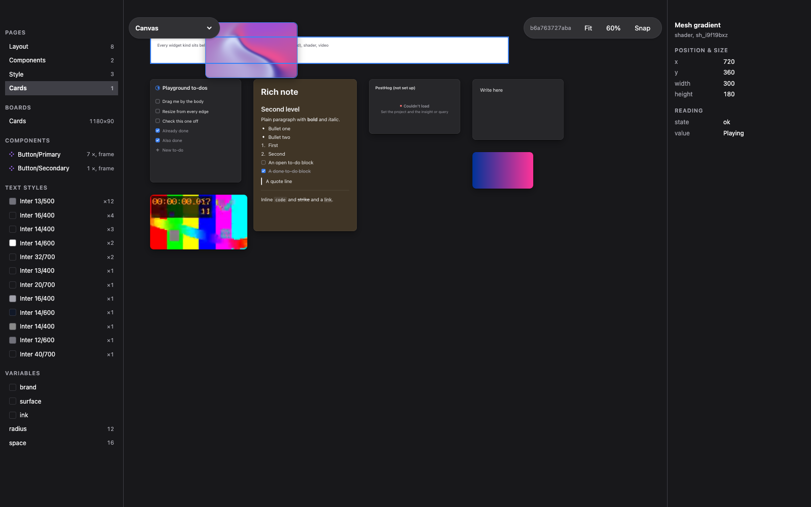 In the app, the board filled (Fill: Mesh Gradient over FFFFFF), the card back in its place: 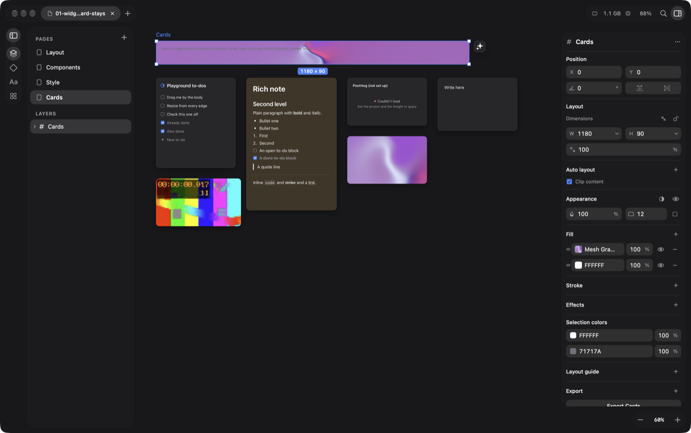 |
| 2. Swap a nested instance (an instance inside an instance): its Component section picker, the canvas menu's Swap instance, or MCP `swap_instance` with `Outer/Nested` swap it through an override in the outer instance (`{ref, descendants?}` in `descendants`); its id stays; overrides below it and the main's own overrides on it carry over by layer names and type, others are dropped and named; a "Swapped component" row resets it (`keys: ["ref"]`); push, duplicate, detach, copy to another file and delete parking accept it; one undo step, original bytes back. Refused (409) only when the nested instance sits inside or is a replacement node | 1caa156, 79c2dc9 | `test/instance-swap.test.ts` "swap a nested instance" (7 tests); `test/qa-checks.test.ts` swap check; `test/mcp.test.ts` "swap_instance, reset_overrides, push_overrides"; Swift OverrideLabels; `qa/native/scenarios.ts` "swap a nested instance from the inspector's component picker; the swap is an override row, undo and its reset put the original back" | `node --test test/instance-swap.test.ts`: `pass 16, fail 0`; `node --test test/mcp.test.ts`: `pass 42, fail 0`; full native run above: `PASS components / swap a nested instance from the inspector's component picker; ...` | Card's nested button swapped to Button/Secondary, the Swapped component row: 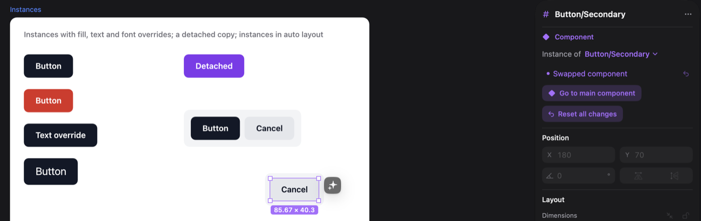 |
| 3. Components panel rows drag onto the canvas: an instance where it lands (its middle under the pointer), in the frame under the pointer, at the flow slot in an auto layout frame; one undo step. Option+drag onto an instance (a nested one too) outlines it mid-drag and swaps it; one undo step. The shell now sends Option with Command to the page | 1caa156, 79c2dc9 | `test/drop-logic.test.ts` "a component dragged from the Components panel" (3 tests); `qa/scenarios-drops.ts` "a component row dropped on a board: an instance where it lands; into an auto layout row at the slot; Option onto an instance swaps it"; `qa/native/scenarios.ts` "drag a component row onto a board: an instance where it lands; Option+drag another onto it swaps it" (real VirtualDrag, Option held) | `node --test test/drop-logic.test.ts` (merged): `pass 17, fail 0`; `pnpm qa drops` (merged): `7 pass, 0 fail, 0 skip`; full native run: `PASS components / drag a component row onto a board: ...` | Button/Primary dropped, then Button/Secondary Option-dragged onto it: 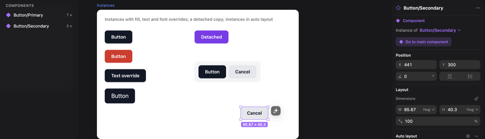 Option over the instance mid-drag, outlined: 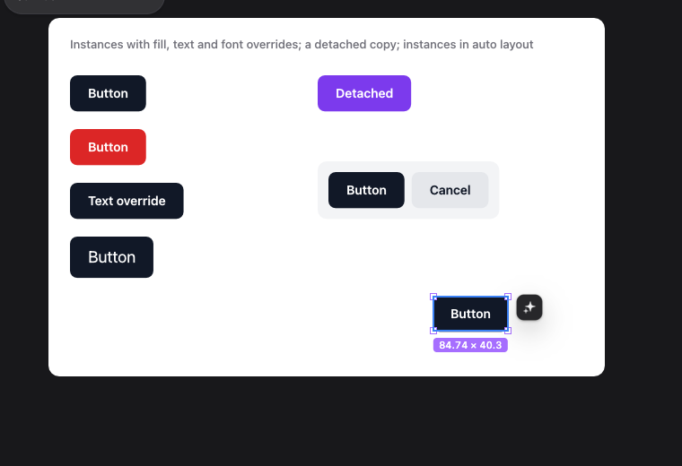 |
| 4. Right-click a property field on an instance to reset that override: Fill and Stroke rows (above Copy Fill / Paste Fill), and the Fill, Stroke, Effects, Appearance (opacity, corner radius, ...) and Typography sections show "Reset <property>" only when it is overridden (Stroke resets stroke, width and alignment together); it calls `/api/overrides/reset` with that property's keys | 04dc7b2 | `apps/macos/Tests/ShellLogicTests.swift` fieldResets(); `qa/native/scenarios-gaps.ts` "right-click an overridden Fill, Opacity or text field on an instance and Reset it; no Reset without an override" | Swift: `ok: 313 checks` (merged); full native run: `PASS components / right-click an overridden Fill, Opacity or text field on an instance and Reset it; no Reset without an override` | Font size gone from the override list, Font weight left: 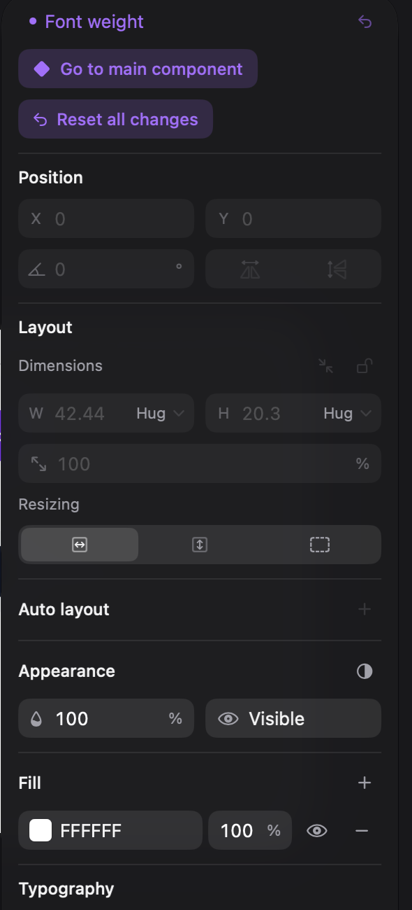 |
| 5. Replace an image fill: click the area left of the fill swatch (the row turns grey), Cmd+V with a picture on the clipboard (PNG, TIFF or a Finder image file): uploaded through `/api/images`, only the paint's `url` changes; mode, crop, rotation, adjustments and opacity stay; one undo. On a colour row the picture replaces it with an image fill | 04dc7b2 | PaintLogicTests rowSelection() (withImageURL, imagePasted, rowPasteSource); `qa/native/scenarios-gaps.ts` "paint row: Cmd+V with a picture on an image fill's row replaces the picture, keeps crop, rotation and adjustments" (`qa.pasteboard` PNG, real Cmd+V, disk, one Cmd+Z) | Swift: `ok: 124 checks`; full native run: `PASS inspector / paint row: Cmd+V with a picture on an image fill's row replaces the picture, ...` | 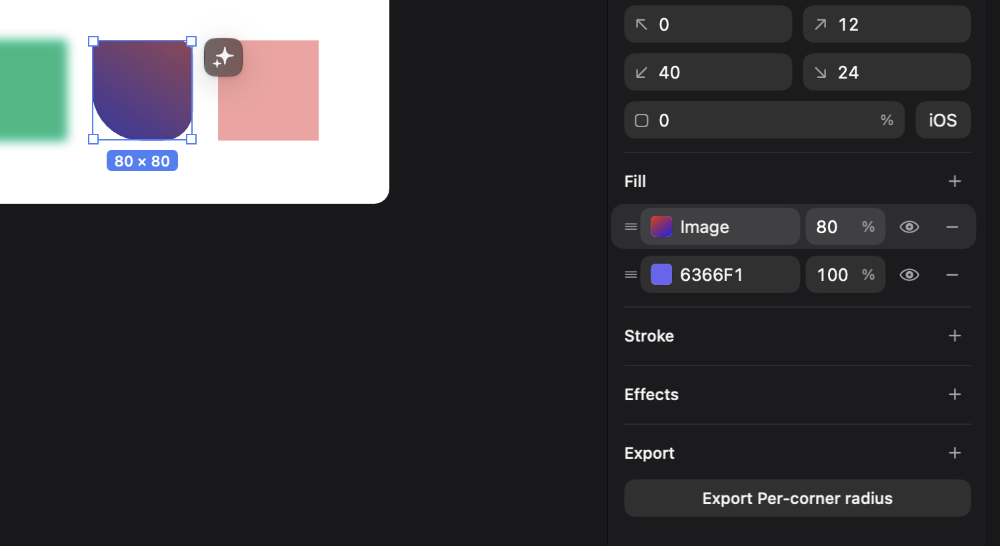 |
| 6. Copy one paint: pick a fill, stroke or effect row (left of the swatch, grey), Cmd+C copies it (sealed, its list named on the pasteboard); Cmd+V on a picked row replaces it, with no row picked a copied paint goes on top of the list it came from (the article does not say replace or add; a first stroke gets 1 px). Cmd+X, Delete and Esc on a picked row; a new selection or any click lets it go; with no row picked Cmd+C / Cmd+V copy and paste layers on the canvas as before | 04dc7b2 | PaintLogicTests rowSelection() (rowValue, rowPasteSource, copiedList); `qa/native/scenarios-gaps.ts` "paint row: pick a fill row, Cmd+C, Cmd+V onto another layer's row; Esc, a click and a new selection let it go", "paint row: with no row picked a copied paint goes on top of its own list; stroke and effect rows; Delete removes one", "paint row: with no row picked, Cmd+C and Cmd+V still copy and paste layers on the canvas" | full native run: the three `PASS ... paint row: ...` lines | The picked fill row in grey: 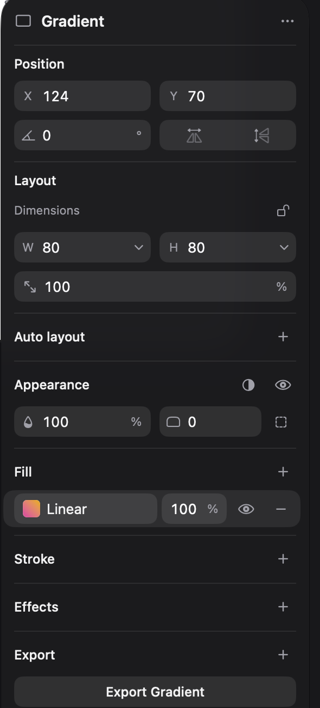 |
| 7a. Letter case (Type details): Original, Uppercase, Lowercase, Title case, Small caps (the font's `smcp`; greyed out for an installed font without it); `letterCase` on the layer, the letters kept as typed; engine (`apply_case` moves styled ranges with the letters: ß to SS, a final sigma), DOM renderer, SVG export, editor (caret on the drawn letters, also in the app's WebKit), Copy as CSS. Forced small caps is not offered | bedd208, 6de8979 | `engine/src/scene.rs` `letter_case_draws_the_letters_in_their_case_and_moves_ranges_with_them`; `engine/src/text.rs` `small_caps_take_the_fonts_smcp_and_leave_a_font_without_it_alone`; `test/text-paras.test.ts`, `test/text-edit.test.ts`; Swift typeDetails(); `qa/scenarios-gaps-text.ts` "letter case: upper, title and small caps drawn by the engine, the editor's letters on the drawn ones, kept in SVG" (every line's first and last letter in the editor within 3 px of the engine's: the 3 px check extended to each line's right edge, engine `textLines` reports `right`); `qa/native/scenarios-gaps-text.ts` "Typography: Letter case (Small caps only with the font's own), List spacing, Hanging punctuation and Hanging lists" | `cargo test --lib`: `193 passed; 0 failed`; `pnpm qa`: `114 pass, 0 fail` (`PASS text / letter case: ...`); full native run: `PASS inspector / Typography: Letter case ...` |  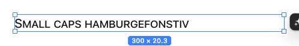 |
| 7b. Hanging punctuation: an opening quote (curly, straight, guillemets) that starts a paragraph hangs outside the box in left-aligned and justified text, its line keeps the box's whole width; engine, DOM renderer, SVG export, editor; Typography checkbox. A quote at the start of a wrapped line stays inside (the article speaks of hanging quotes only) | bedd208, 6de8979 | `engine/src/text.rs` `an_opening_quote_that_starts_a_paragraph_hangs_outside_the_box`, `a_hanging_quote_leaves_its_line_the_whole_box`; `test/text-paras.test.ts` hanging quotes; `qa/scenarios-gaps-text.ts` "hanging punctuation: an opening quote hangs outside the box; the caret on the drawn lines; kept in SVG"; native as above | `pnpm qa`: `PASS text / hanging punctuation: ...`; native as above | 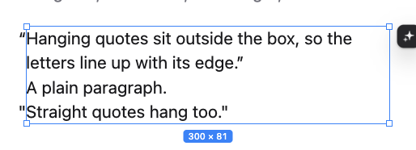 |
| 8. Lists, the rest: List spacing (px between list items next to each other), Hanging lists (markers outside the box), each marker in its own item's first letter's colour (the article says the first item's colour sets the whole list's; the brief asked per item), Backspace at an item's start takes the marker and keeps the indent (type `none`, the numbering carries on; again takes it a level out). Cmd+] stays Bring Forward. Note: list items next to each other take `listSpacing` (default 0), not `paragraphSpacing` | bedd208 | `engine/src/text.rs` `list_spacing_goes_between_items_and_hanging_lists_put_markers_outside`, `an_item_without_its_marker_keeps_its_indent_and_the_count`, `a_marker_takes_its_items_first_letters_colour`; `test/text-paras.test.ts` (plan, unmark, markerColor, DOM); `qa/scenarios-gaps-text.ts` "lists, the rest: Backspace keeps the indent, list spacing, hanging lists, markers in their item's colour; drawn and exported"; native as above | `pnpm qa`: `PASS text / lists, the rest: ...`; native as above | Pears lost its marker and kept its indent, Plums' marker in its red, markers hanging: 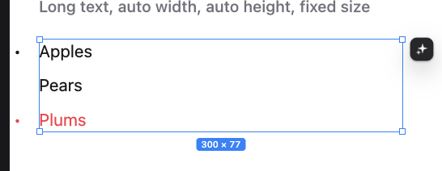 In the app, Type details: 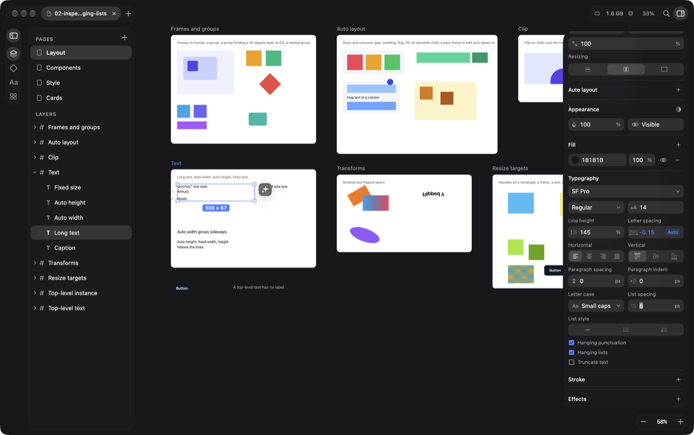 |
| 9. History atomicity: a structure op's page-list write (and a paste's or cut's cards) joins the op's own undo step by its number (`joinTop` gives `into: seq`), even when another write landed on top in the ~30 ms between: the late write goes into that step as long as nothing above it changes the same thing (the page list, a widget, a node or a parent's children), else it stays a step of its own so undo never jumps over another edit. `clipboardOp` reads the step once, right after the op, so a paste's cards cannot join an agent's step either | f89d6c6 | `test/history-join-gap.test.ts`: duplicate and delete on page 2 with an agent's `/api/update` injected in the gap (the sidecar's commit hook): two steps (op with its listing, the agent's), undo the agent's then the op's gives document and sidecar back byte for byte, redo both; a step above that touches the page list or the same siblings: no join | `node --test test/history-join-gap.test.ts` before: `actual: [ 'Duplicate', 'Agent Edits', 'Duplicate' ], expected: [ 'Duplicate', 'Agent Edits' ]` (and the same for Delete), after: `pass 3, fail 0`; history, structure, pages, paste and clipboard tests: `tests 120, pass 120, fail 0` | Not pictured (undo steps) |

Not done:

| Item | Commit | Tests | Command and result | Why |
|---|---|---|---|---|
| Letter case per styled range (set per selection of letters) | | | | Built per layer only; ranges need the case applied inside the style runs in the engine and the editor |
| A hanging quote at the start of a wrapped line | | | | The article speaks of hanging quotes at a paragraph's start; wrapped lines would need the line breaker to measure each line's first glyph |
| Cmd+] / Control+] to indent a list item | | | | Cmd+] is Bring Forward in Canvas; Tab nests |
| Forced small caps | | | | No help article documents it |
| Nested swap inside a replacement node | | | | Refused with 409: a replacement node's children are not the main's, so there is no path to keep stable |
