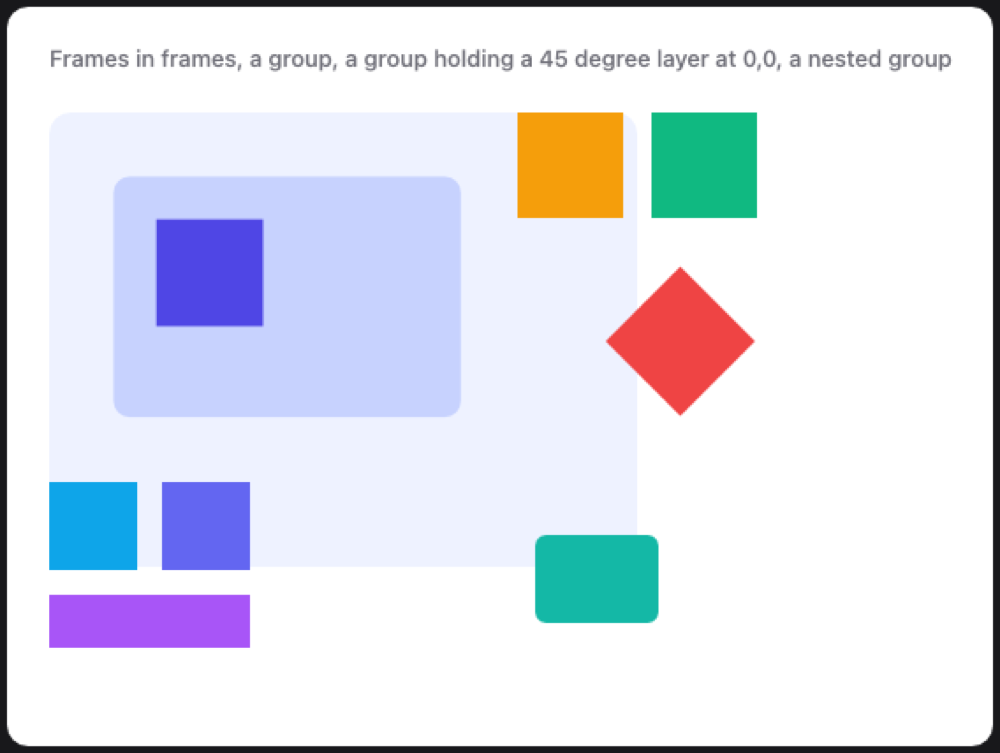

Shortcuts that had no real-key test until 2026-11-17 (`pnpm qa:coverage` listed 8 of 72 keyboard pairs uncovered). Each one now has a scenario in `qa/scenarios-keys.ts` that presses the real key (Chrome's Input.dispatchKeyEvent) and reads the result from the file on disk or the page.

| Item | Commit | Tests | Command and result | Screenshot |
|---|---|---|---|---|
| K: scale tool, a frame and its child scale by the same factor; Esc leaves it | see git log for "Shortcut tests" | `qa/scenarios-keys.ts` "K: the scale tool" | `pnpm qa -- keys`: `8 keys scenarios PASS` (in `20 pass, 0 fail, 0 skip` with drops) | The Outer frame scaled 1.5x with its inner frame:  |
| Opt+Cmd+Shift+R: the board shrinks to its content | same | "Opt+Cmd+Shift+R" | same | - |
| Opt+Cmd+C / Opt+Cmd+V: copy and paste properties | same | "Opt+Cmd+C then Opt+Cmd+V" | same | - |
| . repeats the last edit (opacity 50% on another layer) | same | ". repeats the last edit" | same | - |
| Cmd+] / Cmd+[ and Option+Cmd+] / [ | same | "Cmd+] / Cmd+[" | same | - |
| Opt+Cmd+K makes a component, Opt+Cmd+B detaches an instance | same | "Opt+Cmd+K makes a component" | same | - |
| Cmd+Return opens the composer | same | "Cmd+Return opens the composer" | same | - |
| Shift+Cmd+Return asks for variations (the request is caught before an agent runs) | same | "Shift+Cmd+Return asks for variations" | same | - |

After this, `pnpm qa:coverage` lists no keyboard pair without a scenario.
