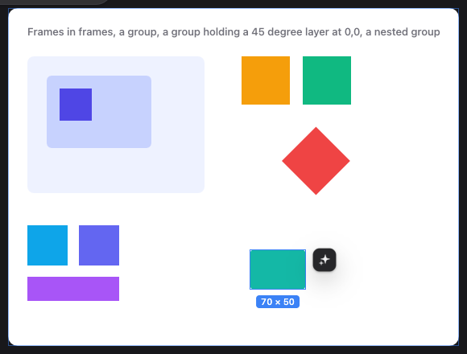
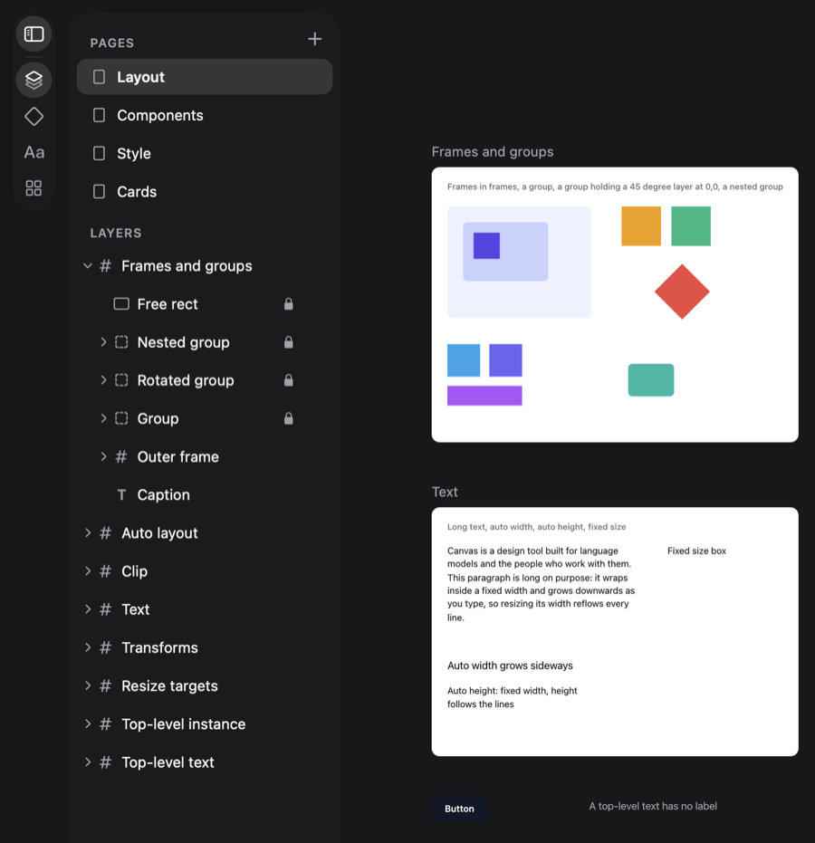
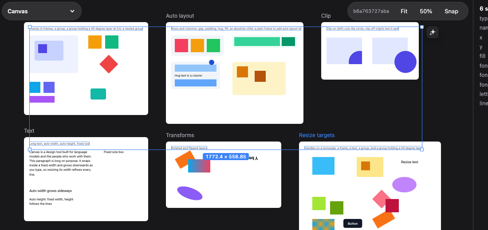
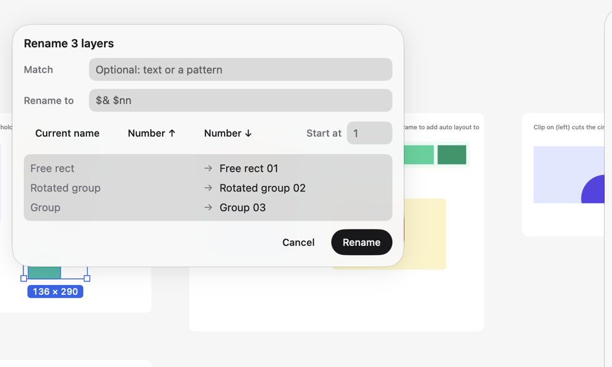
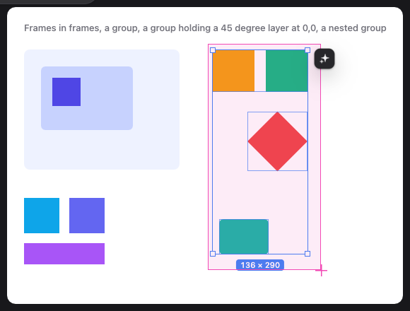

Evidence for the Layers panel and selection niceties ([interaction-conventions.md](../interaction-conventions.md), Selecting and Layers panel). Rules: [README](README.md). Branch `worktree-agent-a8f425ddf24c2664a`; code in ecff129, 09006e7 and 38fd223, merged with main in 5576c35.

The roadmap card "Decide: layer lock toggle" is settled: `locked` is a file property, Shift+Cmd+L and a padlock per row set it, the canvas ignores locked layers, the Layers panel and the inspector do not.

| Item | Commit | Tests | Command and result | Screenshot |
|---|---|---|---|---|
| Lock (P2): Shift+Cmd+L (Object > Lock/Unlock Selection) locks the selection, or unlocks it when all of it is locked; a padlock on each Layers row (on hover, kept while locked); locked layers ignore clicks, Cmd+click, the marquee, Cmd+A and select matching, show no handles and do not move from a press on them; a locked frame locks its children (they cannot unlock on their own); the Layers panel still selects them. `locked` in the schema, the Layers outline, `set_node_props` (described), `inspect_node` (it is a plain property); undo reads "Lock Change". The engine's hit test skips locked layers so a click reaches what is under them; the page also guards an older engine build | ecff129, 09006e7 | `test/layers-lock.test.ts` (schema, outline, label, Shift+Cmd+L rule, keys); `engine/src/hit.rs` `locked_layers_let_the_point_through`; `apps/macos/Tests/LayersLogicTests.swift` `locks`; `qa/scenarios.ts` lock: "Shift+Cmd+L locks a layer...", "a locked frame locks its children...", "an agent locks a board with set_node_props..."; `qa/native/scenarios.ts` "the padlock locks a row; a drag down the padlocks locks the rows it crosses; Shift+Cmd+L unlocks" | `pnpm qa lock select`: `19 pass, 0 fail`; `(cd engine && cargo test --lib)`: `171 passed; 0 failed`; layers tests `ok: 65 checks`; `pnpm qa:native padlock`: `PASS layers / the padlock locks a row...` |   |
| Lock many (P3): a drag down (or up) the padlock column locks or unlocks every row it crosses, one undo step; rows a parent locks and rows inside an instance are skipped | 09006e7 | LayersLogicTests `locks` (`lockSweep`); the native padlock scenario (drag from Nested group to Group, then one Cmd+Z) | as above |  |
| Select matching layers (P2): Option+Cmd+A (Edit > Select Matching Layers) selects layers with the same name and kind in the other boards of the page, with the selection; never in the layer's own board; a board has nothing to match; nothing found says "No matching layers to select on this page". Shift+click adds or removes one match, as everywhere | ecff129 | `test/layers-lock.test.ts` "Select matching layers"; `qa/scenarios.ts` "Option+Cmd+A selects matching layers in the other boards", "Option+Cmd+A with nothing to match says so" | `pnpm qa lock select`: `19 pass, 0 fail` |  |
| Select all with the same property (P3): Edit > Select All with Same: Fill, Stroke, Effect, Text Properties, Font, Instances (Cmd+K's matches gained stroke and effect); locked layers are left out | ecff129 | `test/layers-lock.test.ts` "Select All with the same stroke or effect"; `qa/scenarios.ts` "Edit > Select All with Same Stroke and Effect"; ShellLogicTests `menuSpec` | `pnpm qa lock select`: `19 pass, 0 fail`; shell tests `ok: 211 checks` | Not pictured: the end state is two identical swatches on top of each other, selected (see the scenario's baseline `qa/baselines/select-edit-select-all-with-same-stroke-and-effect.png`) |
| Batch rename (P2): Cmd+R with several layers opens Rename Layers above the canvas: Match (a pattern, or plain text when it is not one; empty: the whole name), Rename to with Current name, Number up, Number down buttons, Start at, a preview; tokens $&, $1 to $9, $\`, $', $n / $nn / $nnn, $N / $NN / $NNN, $$; numbers follow the Layers panel's order; Return renames all in one undo step, Esc closes | ecff129, 09006e7 | LayersLogicTests `batchRename`; `qa/native/scenarios.ts` "Cmd+R with several layers opens Rename Layers; Current name and Number rename them in one undo step" | layers tests `ok: 65 checks`; `pnpm qa:native layers`: `PASS layers / Cmd+R with several layers opens Rename Layers...` |  |
| Tab to the next name (P3): Tab while a name is edited saves it and edits the next row's; Shift+Tab the previous; rows inside an instance are skipped | ecff129 | LayersLogicTests `tabRename`; `qa/native/scenarios.ts` "Tab while renaming goes to the next row's name; Option+L collapses every row" | `pnpm qa:native layers`: `PASS layers / Tab while renaming...` | Not pictured: a text field moving one row down does not read in a still picture; the scenario checks both names on disk |
| Collapse all (P3, unconfirmed key): Option+L on the canvas (Object > Collapse Layers) closes every open row | ecff129 | the same native scenario | `pnpm qa:native layers`: `PASS layers / Tab while renaming...` | Not pictured (a panel of closed rows) |
| Select inverse (P3): Shift+Cmd+A (Edit > Select Inverse) selects Select All's scope (the selection's siblings, else the page's boards and cards) minus the selection; nothing selected selects everything | ecff129 | `test/layers-lock.test.ts` `inverseOf`; `qa/scenarios.ts` "Shift+Cmd+A selects the inverse; backslash selects the parent" | `pnpm qa lock select`: `19 pass, 0 fail` | Not pictured: the end state is the board with five layers selected |
| Select parent, second key (P3, unconfirmed): \\ selects the parent, like Shift+Enter | ecff129 | `test/layers-lock.test.ts` "backslash selects the parent"; the select inverse scenario | `pnpm qa lock select`: `19 pass, 0 fail` | Not pictured |
| Keyboard box selection (P3): Option+Space puts a pink cursor on the canvas; arrows move it (Shift: 10x); Return selects what is under it by the click rule; Cmd+arrows draw a box from it that selects what it touches, like a marquee from empty canvas; Esc puts it away and keeps the selection | ecff129 | `test/layers-lock.test.ts` "keyboard selection"; `qa/scenarios.ts` "Option+Space: a keyboard cursor picks a layer with Return and draws a selection box with Cmd+arrows" | `pnpm qa lock select`: `19 pass, 0 fail` |  |

Runs after the merge with main (5576c35): `pnpm -s typecheck` clean; `pnpm -s test`: `1428 pass, 1 fail` (`docwriter.test.ts` "killed mid-write", a load flake: `node --test test/docwriter.test.ts` alone `10 pass, 0 fail`); `pnpm qa`: `68 pass, 0 fail, 0 skip`; the engine rebuilt from the merged tree.

Native runs: the full `pnpm qa:native` after the merge (two instances): `22 passed, 3 failed`, every Layers scenario among the passes; the three failures are the machine's text recognition (`qa.find: e5rtError ... precompiled_compute_operation ... 13` and an empty read of "Appearance"), in scenarios that do not touch this work (widgets drags, opacity field); a rerun of `pnpm qa:native widgets opacity` hit the same Vision error in the same three widget scenarios, and its "opacity field" screenshot shows the Appearance section on screen that text recognition did not read. Many QA instances were running on the Mac at once. A last `pnpm qa:native layers` on the final code: `6 passed, 0 failed`.

Two fixes this work needed outside its area, both in the shell's menus: a Shift chord on a letter is now spelled in capitals in `buildMenu` (AppKit never matched "l" with Shift to Shift+Cmd+L, and fell back to Cmd+L, Copy Link); Copy Link and Select All decline a key that holds Shift. The QA build's synthetic keys now carry Shift in their characters under Command, as the hardware does.
