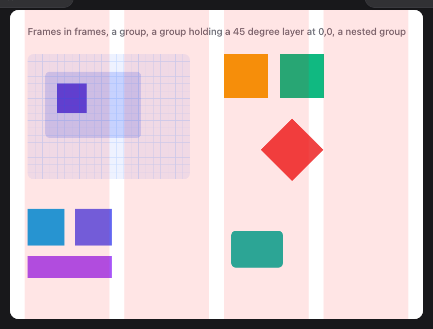
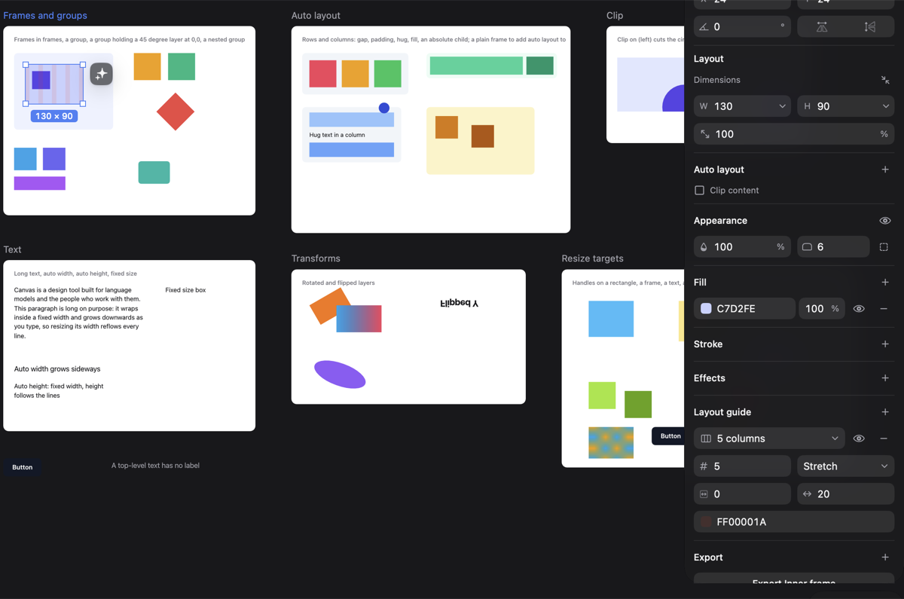
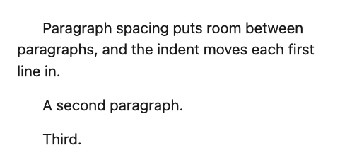
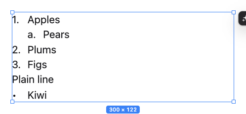
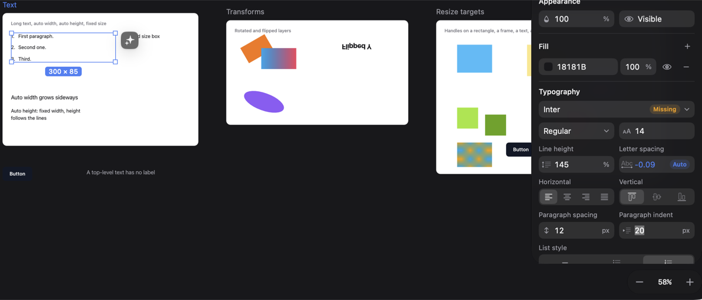

Evidence for the leftover P3 rows of [docs/interaction-conventions.md](../interaction-conventions.md): layout guides (Zoom and navigation), paragraph settings and lists (Text). Rules: [README](README.md).

The rules: layout guides (grid, columns, rows; count, type, width, offset, margin, gutter; red at 10%; Control+G and Shift+G both toggle them), paragraph settings (spacing between paragraphs; indent on each paragraph's first line, left-aligned text only), bulleted and numbered lists (five levels, Tab indents, "- " / "1. " start a list, bullets the same at every level, numbers turn numbers, letters, roman numerals; Shift+Cmd+8 / 7). Canvas's own choices: Shift+Tab to outdent, snapping to layout guides, the default column count and gutter (5 and 20).

Page scenarios: `qa/scenarios-leftovers.ts` (pictures `qa/out/evidence/leftovers-*.png`). Native scenarios: `qa/native/scenarios-leftovers.ts` (controls found by their QA frames, no text recognition). Full runs after merging main (a8f9d6a): `pnpm -s typecheck` clean, `pnpm -s test`: `1604 pass, 0 fail`, `(cd engine && cargo test --lib)`: `185 passed; 0 failed`, `QA_SHARDS=4 pnpm qa`: `104 pass, 0 fail, 0 skip`, Swift `ShellLogicTests`: `ok: 297 checks`, `QA_NATIVE_NO_OCR=1 TMPDIR=$(mktemp -d) pnpm qa:native` (the whole native suite): `61 passed, 0 failed, 0 skipped`. The first full native run failed Typography scenarios on the QA window, whose inspector ends above Typography's lower rows (now taller with these fields); both scenarios now scroll the inspector first (`intoInspector`, `qa/native/scenarios-leftovers.ts`).

| Item | Commit | Tests | Command and result | Screenshot |
|---|---|---|---|---|
| Layout guides (P3): grid, columns and rows per frame (`metadata.canvasLayoutGuides`: count, type stretch / left / center / right, width, offset, margin, gutter, colour #RRGGBBAA, per-guide eye), several per frame; drawn by the page over the canvas, clipped to the frame; a layer moved or resized inside the frame snaps to column and row edges and grid lines while they show; Control+G (View > Layout Guides, the menu owns it in the app: WebKit never hands the page a Control+letter the menu declines) and Shift+G (the page's) show and hide them all; Control+G is no longer Group in the page; inspector "Layout guide" section with +, type menu, eye, -, symbol-labelled fields and colour | 012a70d, caaa4b3 | `test/layout-guides.test.ts` (keys, defaults, stretch and fixed bands, grid lines, snap lines, metadata, board metas); Swift `layoutGuides()` checks; page scenario "layout guides: columns and a grid drawn on frames; moves and resizes snap to them; Control+G hides them"; native scenario "Layout guide: + adds a grid, its type menu makes it columns; View > Layout Guides and Control+G hide and show them" | `pnpm qa -- "layout guides"`: `1 pass, 0 fail, 0 skip`; `QA_NATIVE_NO_OCR=1 pnpm qa:native "Layout guide:"`: `PASS inspector / Layout guide: ...` |  four stretched columns on the board, a 10 px grid on the outer frame; in the app:  five columns on Inner frame and its Layout guide section |
| Paragraph settings (P3): `paragraphSpacing` (px between paragraphs, none above the first) and `paragraphIndent` (px on each paragraph's first line, left-aligned text only) on a text layer; Typography > Paragraph spacing and Paragraph indent. Engine: parley's line breaker is driven a line at a time (`break_paras`, `engine/src/text.rs`): each line's start and width follow its paragraph, a paragraph's first line moves down by the spacing; the DOM renderer and SVG export lay one block per paragraph (margin, text-indent); the editor field turns into the same blocks, so the caret sits on the drawn lines. Engine `textLines` reports the drawn lines for QA | f34c5d1, caaa4b3 | `engine/src/text.rs` `paragraph_spacing_goes_between_paragraphs_only`, `paragraph_indent_moves_each_paragraphs_first_line_only`; `test/text-paras.test.ts` (plan, file checks, DOM blocks); `test/text-edit.test.ts` (paragraph props through `/api/update`); page scenario "paragraph spacing and indent: drawn, the caret on the drawn lines, kept in SVG" (each paragraph's first letter in the editor within 3 px of the drawn line, before and after a typed Return; field height equals the drawn height; SVG keeps indent and spacing); native scenario "Typography: paragraph spacing and indent fields, and List style bulleted then numbered" | `pnpm qa -- "paragraph spacing"`: `1 pass, 0 fail, 0 skip`; `QA_NATIVE_NO_OCR=1 pnpm qa:native "Typography: paragraph"`: `PASS inspector / Typography: ...` |  24 px first-line indents, 12 px between paragraphs |
| Lists (P3): `lists` (`[{p, type: bullet / number, level 1-5}]`, one per paragraph) with a hanging indent (each level 1.5 x the font size, whole px) and the marker a step left of the text on the first line; bullets "•" at every level, numbers count runs per level as 1. a. i.; drawn by the engine (markers shaped apart, kept in the shape cache), the DOM renderer and SVG export (markers as text). Keys: Shift+Cmd+8 / Shift+Cmd+7 on selected layers (every paragraph) and while editing (the selected paragraphs), again takes them off; Tab nests a list item, Shift+Tab takes it out, Return continues a list, Return on an empty item takes it a level out, Backspace at an item's start takes its marker off, "- ", "* ", "1. ", "1) " typed at a paragraph's start make a list (its own undo step, so Cmd+Z gives the letters back). Lists follow content edits (`/api/text`, find and replace, any write). Typography > List style (none, bulleted, numbered) | f34c5d1, caaa4b3 | `engine/src/text.rs` `list_items_hang_and_carry_markers`; `test/text-paras.test.ts` (markers, follow, toggle, nest, typed starts, keys, file checks); `test/text-edit.test.ts` "POST /api/text with lists"; page scenario "lists: Shift+Cmd+8 and 7, Tab nesting, Return, typed starts; markers drawn and exported" (caret on the drawn lines, five markers at their steps, `1. a. 2. 3. •` in the SVG, one undo); native scenario as above (List style bulleted, numbered, none) | `pnpm qa -- "lists:"`: `1 pass, 0 fail, 0 skip`; native as above |  a numbered list with a nested a., a plain line and a bullet; in the app:  Paragraph spacing, indent and List style in Typography |
| Paragraph settings, the rest: hanging punctuation, letter case | done later: see [gaps.md](gaps.md) | | Not in this run's brief (the brief named spacing and indent); letter case needs a text-transform the engine and the editor apply alike | |
| Lists, the rest: List spacing (px between items), Hanging lists toggle (markers outside the box), a marker in its item's first letter's colour, Backspace keeping the indent after the marker goes, Cmd+] / Control+] to indent | done later except Cmd+] (Bring Forward in Canvas): see [gaps.md](gaps.md) | | List spacing and the hanging toggle are two more Type details fields on the same engine path (a `before` per item, a negative marker x); Canvas draws markers in the layer's style; Cmd+] is Bring Forward in Canvas, so only Tab nests | |
