Evidence for moving, arranging and auto layout handles ([interaction-conventions.md](../interaction-conventions.md): Moving and reparenting, Resizing and rotating, Auto layout, Smart selection and arranging). Rules: [README](README.md). Branch `worktree-agent-ad6f2cceb1c5d0fd2`. Scenarios are in `qa/scenarios-moving.ts`; frame checks use `qa/frames.ts` (`checkDragFrames`, now with held keys and a selection of its own).

| Item | Commit | Tests | Command and result | Screenshot |
|---|---|---|---|---|
| Keep the parent while dragging (P1): Space held mid-drag keeps a layer in its parent. It does not nest into the frame it is dropped on, does not leave its frame, a board stays a board, several layers stay, an auto layout child stays in its flow (in the slot nearest the pointer). No hand cursor after the drop. Space alone still pans | f1a078f | `qa/scenarios-moving.ts` "Space held while dragging keeps the layer in its parent; Space alone still pans" (real mouse and Space key); two of its drags go through `checkDragFrames`: every frame draws only the layer at the pointer. Fails on the old code (the layer nests into `fr_outer`) | `pnpm qa "Space held"`: `1 pass, 0 fail`; full `pnpm qa` after merging main: `74 pass, 0 fail, 0 skip` | Mid-drag over a frame, no drop outline: 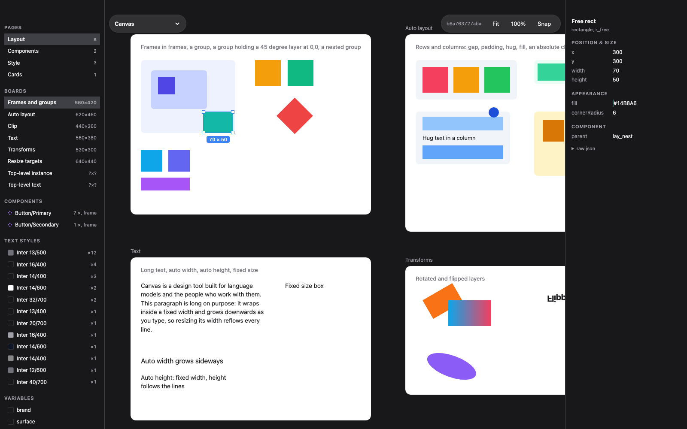 Auto layout child dragged below its row, its slot kept open: 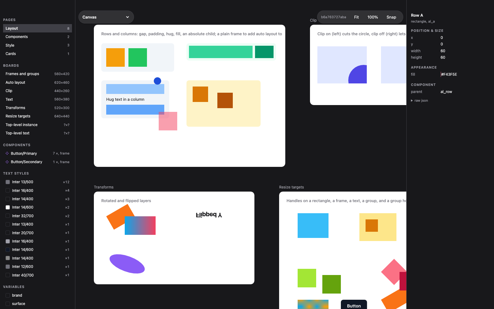 |
| Bypass snapping (P2): Control turns object snapping off for a move and a resize. Cmd does not (it did before; on a move it lets a layer drop into a frame smaller than itself) | b6b28cf, Control only: see git log for `snap.js` | `test/snap.test.ts` "bypassing snapping while dragging"; scenario "Control turns snapping off for a move and a resize; Cmd does not" (plain drag and Cmd drag snap to 290, Control stays at 293; resize 58 with snapping, 60 with Control). Fails on the old code: `drag with {"meta":true}: got {"x":293,"y":300}, want {"x":290,"y":300}` | `pnpm qa "Control turns"`: `1 pass, 0 fail`; `pnpm test`: `1452 pass, 0 fail` | Plain drag, guide shown: 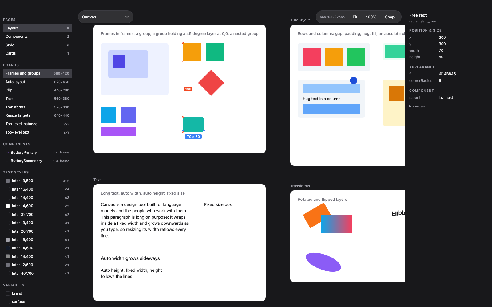 Control held, no guide: 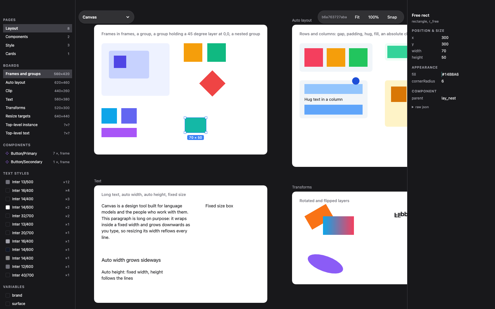 |
| Padding handles with modifier keys (P2): Option the opposite side, Option+Shift all four, Shift alone big-nudge steps on that side; gap Shift steps as before | b6b28cf | `test/autolayout-page.test.ts` "modifier keys" and "Shift steps by the big nudge"; scenario "padding handles take modifier keys" (Shift: `[16,16,16,20]`, Option: `[16,23]`, Option+Shift: `23`, one undo each) | `pnpm qa "padding handles take"`: `1 pass, 0 fail` | Option+Shift drag, all four sides striped: 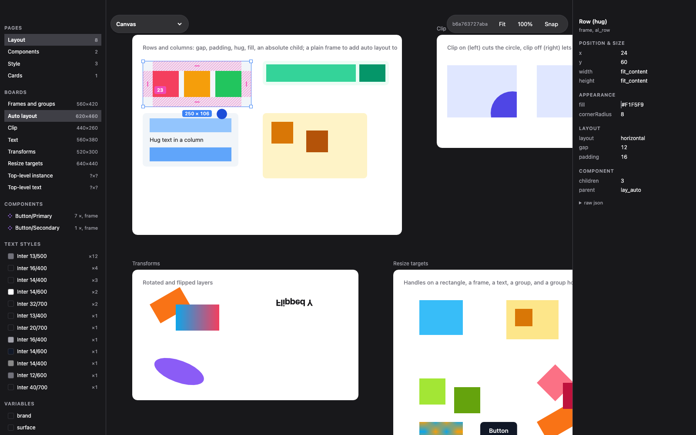 |
| Click a padding area (P3): with Option held a padding area is a handle; Option+click types a value for that side and its opposite, Option+Shift+click for all four. The frame does not copy | b6b28cf | same scenario (Option+click top area, 24: `[24,16]`; Option+Shift+click, 6: `6`) | `pnpm qa "padding handles take"`: `1 pass, 0 fail` | The field open, top and bottom striped: 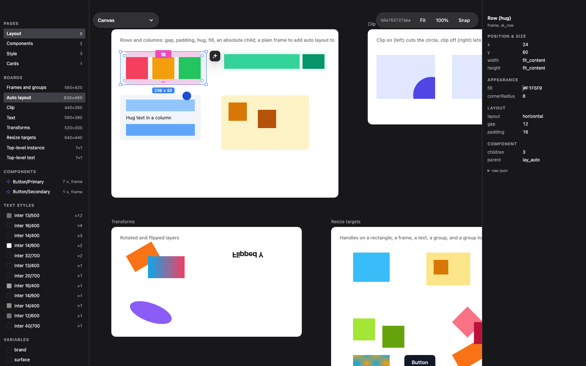 |
| Smart selection (P2): three or more layers of one parent (absolutely placed), or boards, evenly spaced in a row, a column or rows (2D). Pink ring on each layer; hovering shows a pink handle in each gap (and between rows in 2D): drag it to change every gap (Shift: big-nudge steps); drag a ring to another slot (blue line), Cmd swaps (blue outline); the layers panel order stays | 32ba12b, 8054ee9 | `test/smart-logic.test.ts` (detect, arrange, slots, swap, handles, fields, tidy); scenario "smart selection: spacing handles, rings to reorder and swap, marks, Cmd+D and Delete, spacing fields, tidy up". The ring drag goes through `checkDragFrames` (the dragged layer is lifted onto the ghost board, the rest land where they go) | `pnpm qa "smart selection"`: `1 pass, 0 fail` | Rings and gap handles: 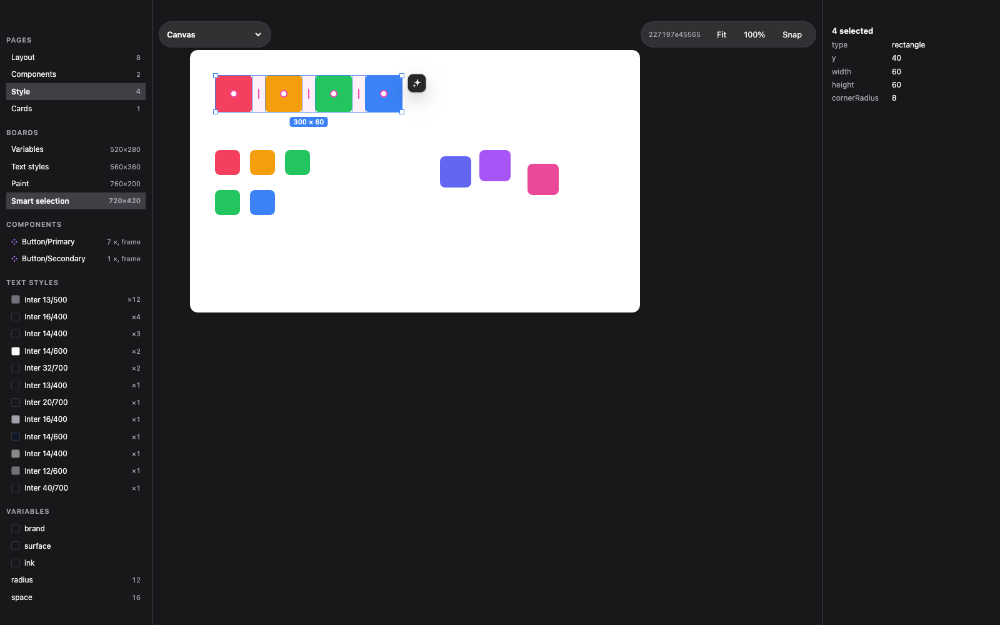 Gap handle mid-drag, value 32: 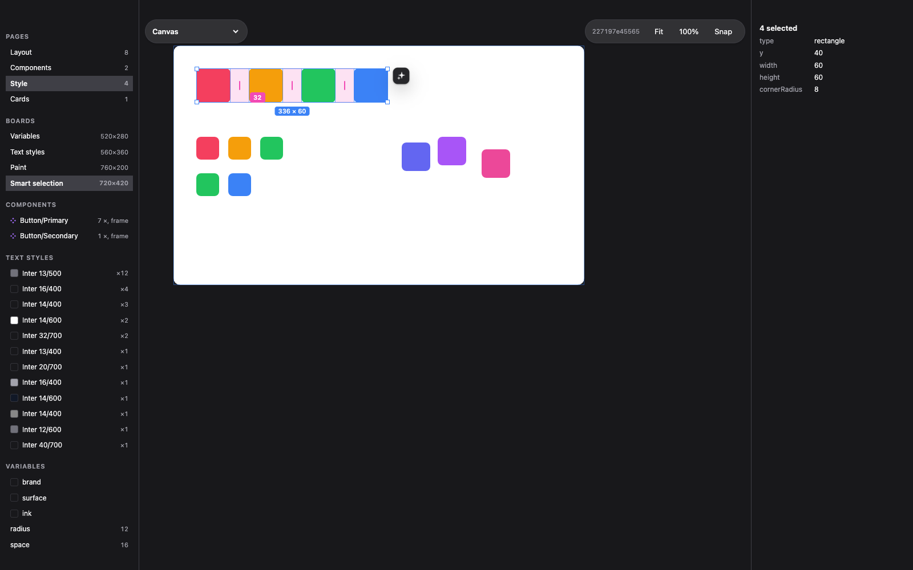 Ring drag, blue line before the last: 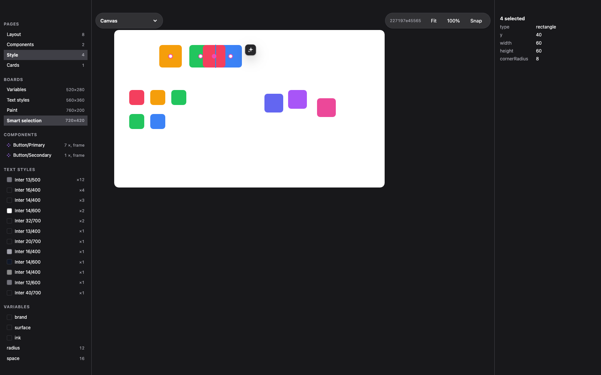 Cmd swap, blue outline: 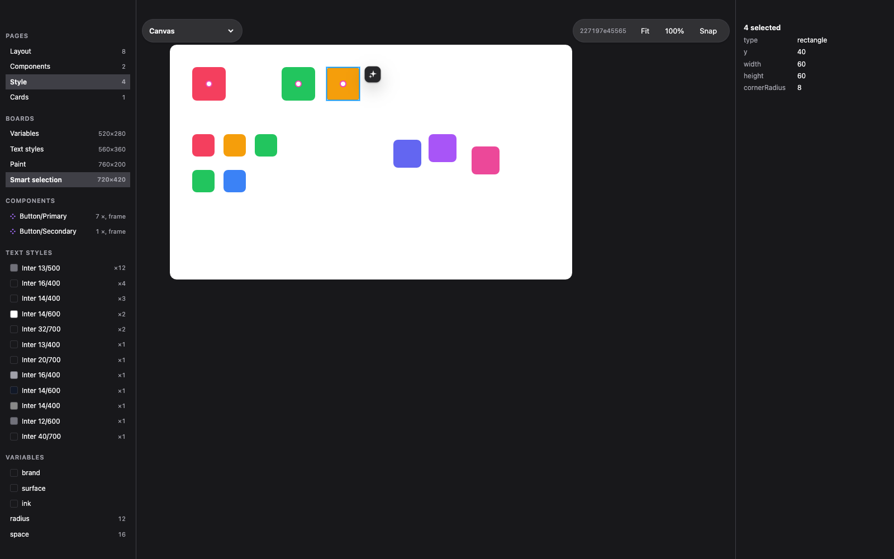 |
| Mark several (P3): a click on a ring marks it (solid), Shift+click marks more, a double-click on a ring marks all (Shift+double-click: the row, 2D); Cmd+D copies the marked layers into the list (each after its original), Delete removes them and the rest close up; one undo each | 32ba12b | same scenario (`["sm_a","copy","sm_b","sm_c","copy","sm_d"]`, one undo; Delete closes to `[40,120,200]`) | `pnpm qa "smart selection"`: `1 pass, 0 fail` | Two marked: 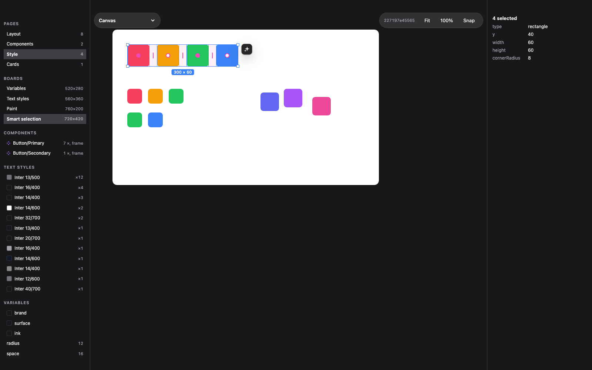 |
| Spacing fields (P2): the inspector shows horizontal and vertical space between for a smart selection; a value moves them all, one undo | 8054ee9 | `qa/native/scenarios.ts` "the inspector's Spacing field sets the space between evenly spaced layers" (real NSEvents: 20 to 30); page side in the smart selection scenario (`smartGap` 8) | `pnpm qa:native "Spacing field"`: `1 passed, 0 failed` | 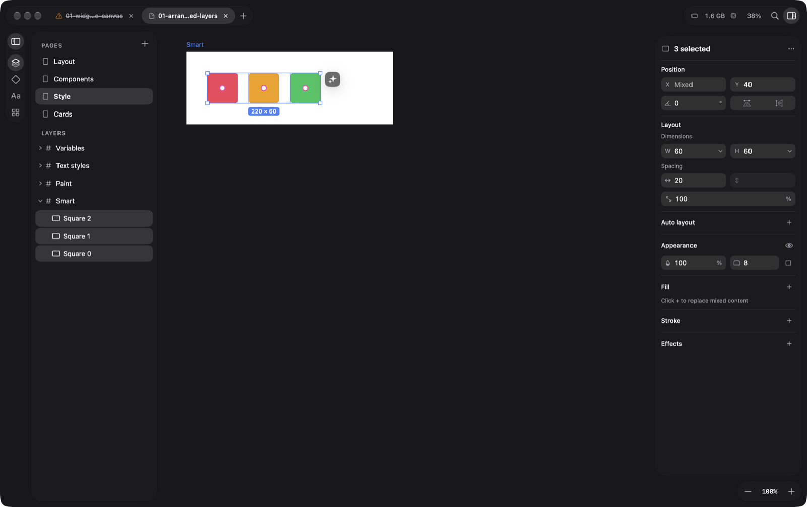 |
| Tidy up (P2): Control+Option+T (and Arrange > Tidy Up) makes the selection an evenly spaced row, column or rows from its top-left, the mean gap rounded; then it is a smart selection | 32ba12b, 8054ee9 | `test/smart-logic.test.ts` "tidy up"; smart selection scenario step 8 (`[400,470,540]`, one undo) | `pnpm qa "smart selection"`: `1 pass, 0 fail` | After Control+Option+T, already a smart selection: 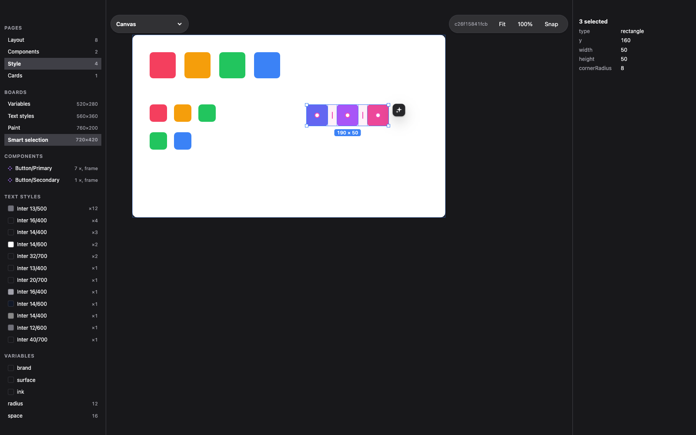 |
| Align to the parent (P3): Shift held on an Arrange align item (Canvas has no align buttons; with buttons the rule is Shift+click) aligns several layers to their shared parent as a group | 8054ee9 | scenario "Shift on an align item aligns several layers to their parent" (`align-left:parent`: `[0,80]`; `align-bottom:parent`: `[80,100]`; plain `align-left`: `[20,20]`) | `pnpm qa "Shift on an align"`: `1 pass, 0 fail` | Both at the frame's left edge, spacing kept: 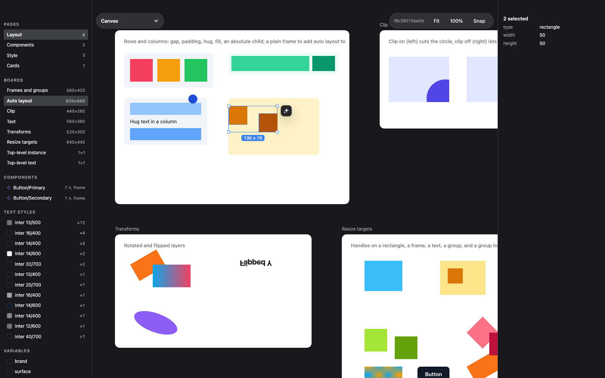 |
| Suggest auto layout (P3): Control+Shift+A gives each selected frame auto layout from its own children (direction and the gap they have), no new frame around them, one undo. Shift+A already infers the gap from evenly spaced children (`src/autolayout.ts` inferLayout). Nested frames are not converted | 8054ee9 | same scenario (`["horizontal",14,"vertical",9]`, one undo) | `pnpm qa "Shift on an align"`: `1 pass, 0 fail` | 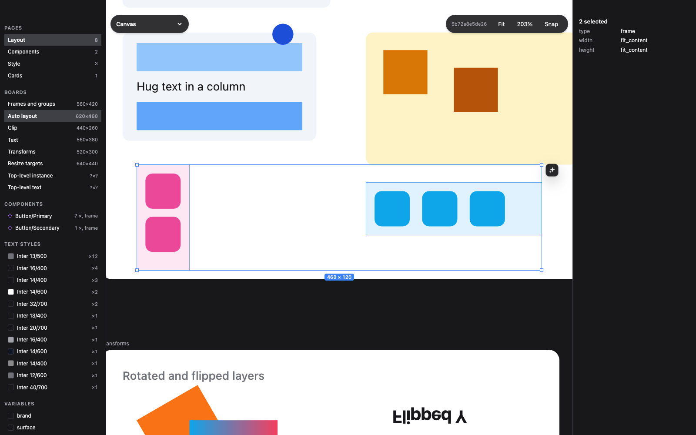 |
| Move the rotation origin (P3): Option+R shows a target at the layer's centre; drag it (snaps to centre, corners, edge middles); turns go round it and it stays put; Option+R hides it. Absolutely placed layers only | 18d714c | `test/move-logic.test.ts` "a moved rotation origin"; scenario "Option+R shows the rotation origin; dragged to a corner, the layer turns round it" (-90 degrees about the top-left: box `250,300,50,70`) | `pnpm qa "rotation origin"`: `1 pass, 0 fail` | Origin on the corner:  Mid-turn round it:  |
| Swap two children by Shift+drag in auto layout (P3) | not done | - | - | Skipped: Shift already locks a drag's axis. Swapping is Cmd in a smart selection, which is built |

The frame checks of plain layer drags run with object snapping off: a snapped layer sits a few px off the pointer on purpose, which the checker would read as a stray frame.

Runs after merging main: `pnpm -s test`: `1469 pass, 0 fail`; `pnpm qa`: `81 pass, 0 fail, 0 skip`. Full `pnpm qa:native`: `21 passed, 5 failed`; every failure is the QA instance's text recognition erroring (`qa.find: 500 e5rtError ... precompiled_compute_operation`, the Neural Engine shared with other agents' QA runs at load 25 to 30), and reruns either stop at "text recognition does not answer" or hit the same error. The Spacing field scenario passed alone before that (`1 passed, 0 failed`).
