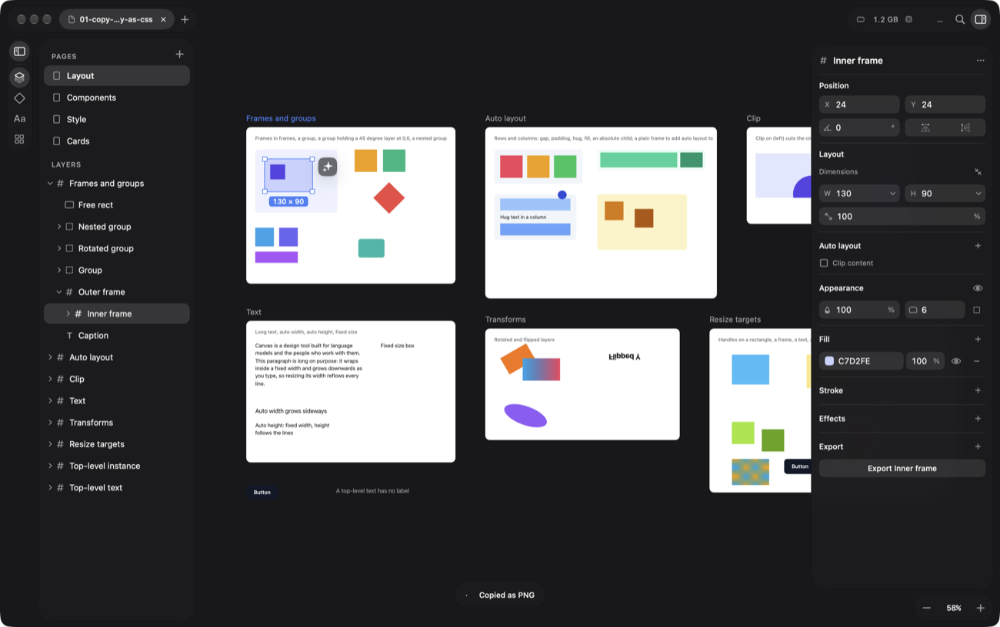
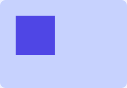
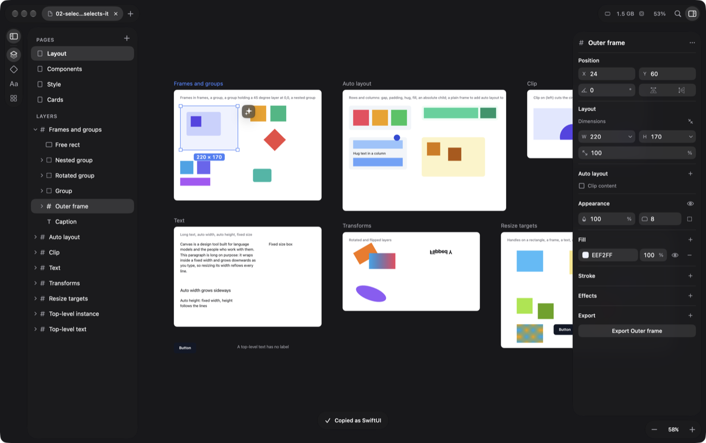
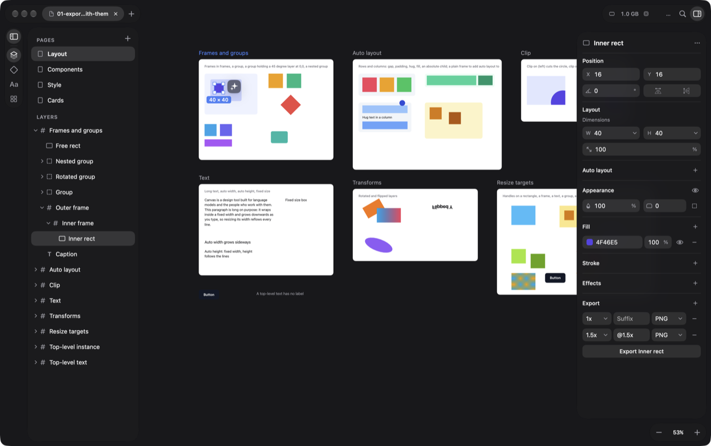
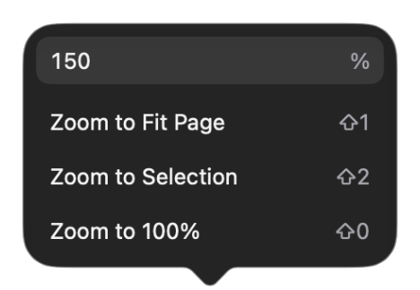
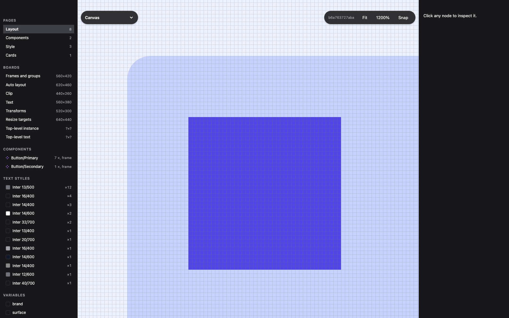
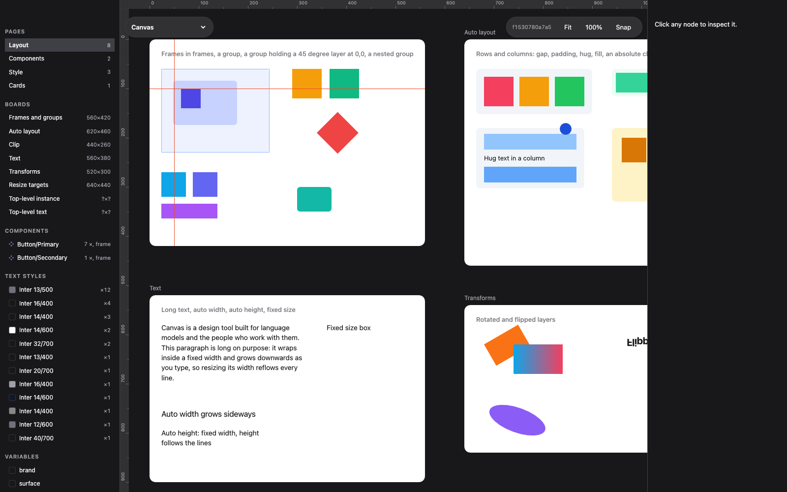
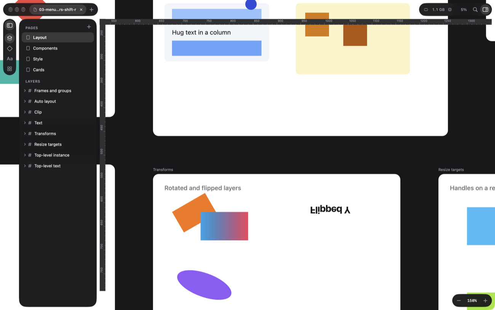

Navigation, export, Copy as and the right-click menu (2026-11-16). How they work: [developer guide, Keyboard shortcuts](../developer-guide.md#keyboard-shortcuts).

The rules for this work: the pixel grid shows from 400% up and toggles with Cmd+' (Shift+Cmd+' is snap to the pixel grid), zoom in and out are Shift + and Shift -, arrows pan with nothing selected, Shift+Cmd+E is bulk export of the layers with export settings, a suffix goes on the file name as typed, and the formats are PNG, JPG, SVG and PDF, plus WebP. Rulers are Shift+R and the zoom tool is Z.

| Item | Commit | Tests | Command and result | Screenshot |
|---|---|---|---|---|
| Copy as PNG, Shift+Cmd+C (P1; `pnpm -s test` after the last merge (f77ede6): `pass 1520, fail 2`, the 2 load-timing tests in docwriter and scene pass alone: `pass 10, fail 0`, `pass 19, fail 0`): a 2x PNG of the selection on the pasteboard (app: PNG and TIFF) and the clipboard (browser); several layers make one picture placed as on the canvas, what lies between them left out | 565121e | `test/copy-as.test.ts` (picture math, source-over blending, a real 2x run through the server: one layer 80x60, two layers 300x180 with the gap empty), `qa/scenarios.ts` "Shift+Cmd+C copies the selection as a 2x PNG; several layers make one picture" (260x180, 272x120, a 560x420 board 1120x840, the document untouched), `qa/native/scenarios.ts` "Shift+Cmd+C (Edit > Copy as PNG) puts a 2x PNG on the pasteboard; right-click > Copy as > CSS" (Shift+Cmd+C pressed; the item's key is Shift+Cmd+C; the instance's pasteboard holds public.png and public.tiff, 260x180) | `node --test test/copy-as.test.ts`: `pass 14, fail 0`; `pnpm qa` (f77ede6, after merging main): `95 pass, 0 fail, 0 skip in 82 s on 9 workers`; `QA_NATIVE_NO_OCR=1 pnpm qa:native "copy as png" "export section" "select layer lists" "zoom pill"` (f77ede6): `5 passed, 0 failed, 0 skipped in 21 s`; the whole suite, `TMPDIR=$(mktemp -d) pnpm qa:native` (f77ede6): `33 passed, 10 failed, 0 skipped in 273 s`, all 10 text recognition failures under load (`qa.find: 500 e5rtError`, or text never found) in widgets, inspector, settings and styles scenarios, none of this work's (before 44af62f copy-as and export also failed there, expecting a lower-case key after main started writing Shift chords as capitals) |  the copied picture:  |
| Copy as SVG and Copy as code (P2): right-click > Copy as > PNG, SVG, CSS, SwiftUI, text, link; CSS and SwiftUI describe the layer itself | 565121e | `test/copy-as.test.ts` (CSS order and values, auto layout, a filling child, type; SwiftUI Text, shapes, stacks; text; SVG nested at offsets; real SVG, CSS, SwiftUI and text through the server), `qa/native/scenarios.ts` same scenario (the submenu's six items; Copy as CSS and Copy as SwiftUI put the code on the pasteboard) | `node --test test/copy-as.test.ts`: `pass 14, fail 0`; native as above |  |
| Right-click > Select layer (P2): every layer under the pointer, topmost first; picking one selects it | 565121e | `engine/src/hit.rs` `every_layer_under_a_point_topmost_first`, `qa/scenarios.ts` "Select layer: every layer under the pointer, topmost first; picking one selects it", `qa/native/scenarios.ts` "right-click > Select layer lists the layers under the pointer; picking one selects it" (Inner rect, Inner frame, Outer frame, Frames and groups; Outer frame picked and selected) | `cargo test --lib`: `175 passed; 0 failed`; `pnpm qa`: `95 pass, 0 fail`; the same native run: PASS select / right-click > Select layer ... |  |
| Export by key, Shift+Cmd+E (P2): File > Export exports the selection, else every layer on the page with export settings, each with its settings into a folder | 565121e | `apps/macos/Tests/ShellLogicTests.swift` exportSettings (items, a layer without settings is one 1x PNG; File > Export on Shift+Cmd+E), `qa/native/scenarios.ts` "the Export section saves settings on the layer; Shift+Cmd+E exports with them" | `ShellLogicTests`: `ok: 264 checks`; the same 5-scenario native run: PASS export / the Export section saves settings on the layer; Shift+Cmd+E exports with them (two "+" clicks, then Shift+Cmd+E writes "Inner rect.png" and "Inner rect@1.5x.png") |  |
| Export settings per layer with suffix and scale (P3): the inspector's Export section, saved under `metadata.canvasExports`; "+" adds the next scale up with its "@2x" suffix; a suffix replaces the scale's "@2x" in the name | 565121e | `test/copy-as.test.ts` "a suffix goes on the name as typed", "items: one setting per file", `ShellLogicTests` exportSettings, the native scenario above (two "+" clicks write `[{png, 1}, {png, 1.5, "@1.5x"}]`; Shift+Cmd+E writes "Inner rect.png" and "Inner rect@1.5x.png") | as above |  |
| More formats (P3): JPG (over white), WebP, PDF (the SVG drawing printed by Chrome, one page the layer's size), in the right-click Export as, the Export section and `export_nodes` | 565121e | `test/copy-as.test.ts` "export: JPG over white, WebP, PDF, and a suffix" (a JPEG 100x80 at 2x, a WEBP, a PDF with MediaBox 150x90 pt for a 200x120 board) | `node --test test/copy-as.test.ts`: `pass 14, fail 0` | (files, no picture) |
| Zoom in and out by key (Shift+= / Shift+-), pan by arrows with nothing selected (Shift: further), Z held and click zooms in about the pointer, Option zooms out | 565121e | `test/navigate.test.ts` (keys, zoom about a point), `qa/scenarios.ts` "Shift+= / Shift+- zoom, arrows pan with nothing selected, Z and click zooms about the pointer" (2x, back, 40 px and 200 px pans, a selected layer nudges instead, Z+click keeps the point under the pointer and selects nothing) | `node --test test/navigate.test.ts`: `pass 10, fail 0`; `pnpm qa`: `95 pass, 0 fail` | (camera numbers; no picture) |
| Typed zoom in the zoom pill: click the percentage, type 150, Return | 565121e | `apps/macos/Tests/ShellLogicTests.swift` copyAsAndZoom (150, 150%, 2x, fit, clamped), `qa/native/scenarios.ts` "zoom pill: type 150 and Return; View > Pixel Grid (Cmd+') and Rulers (Shift+R)" (zoom 150, camera 1.5) | the same native run: PASS menus / zoom pill: type 150 and Return ... |  |
| Pixel grid from 400%, Cmd+' and View > Pixel Grid toggle it | 565121e | `test/navigate.test.ts` gridLines, `qa/scenarios.ts` "the pixel grid shows from 400% up; Cmd+' toggles it" (none at 390%, shown at 400%, Cmd+' hides and shows), the native menus scenario (Cmd+' flips it and View > Pixel Grid's checkmark) | `pnpm qa`: `95 pass, 0 fail`; native as above |  |
| Rulers and guides (Shift+R, View > Rulers): drag out of a ruler onto a board; saved on the board (`metadata.canvasGuides`), one undo step per drag; drag to move, onto the ruler to remove | 565121e, 3881d64 (ruler shadows) | `test/navigate.test.ts` (ticks, drop on the topmost board, guide hit, metadata kept), `qa/scenarios.ts` "Shift+R shows rulers; a guide dragged out onto a board is saved on it, moved, and dragged back off; undo", the native menus scenario (Shift+R on and off) | `pnpm qa`: `95 pass, 0 fail` (the shared checks: undo of every step gives the original bytes); native as above |  in the app:  |
| Layout guides (columns, rows, grid per frame, Control+G) | built later | | See [leftovers.md](leftovers.md) | |
