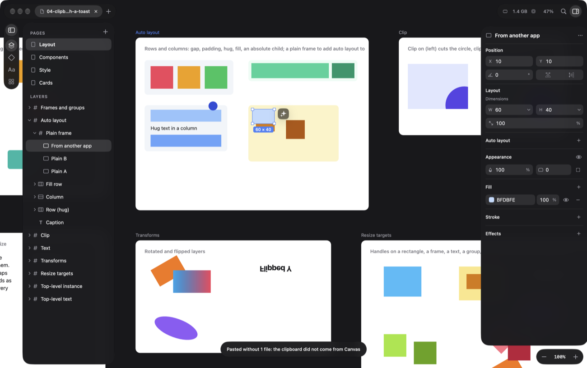
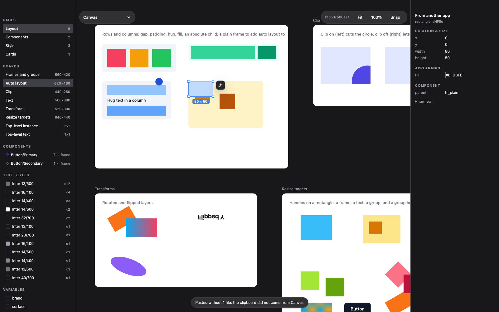
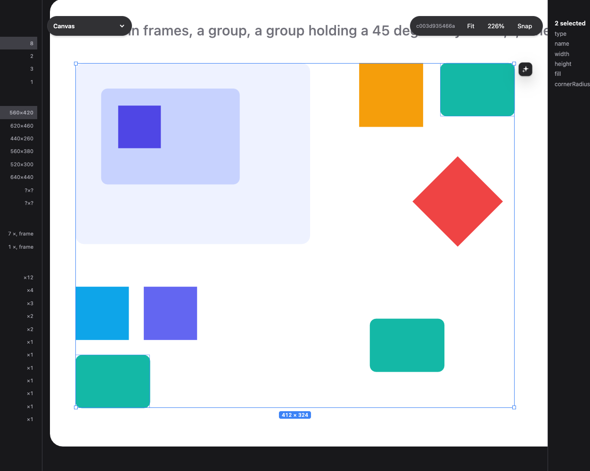
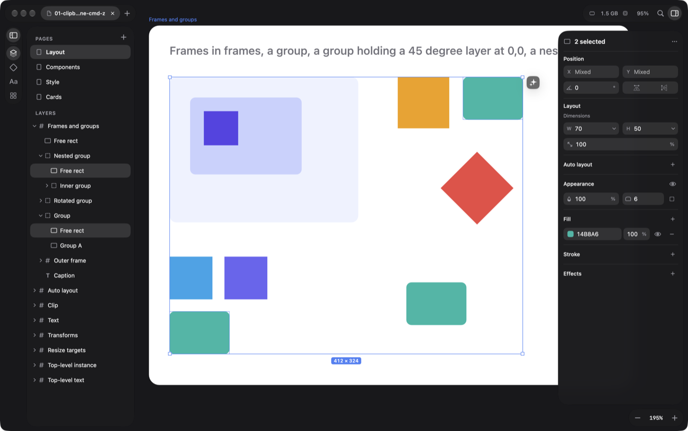
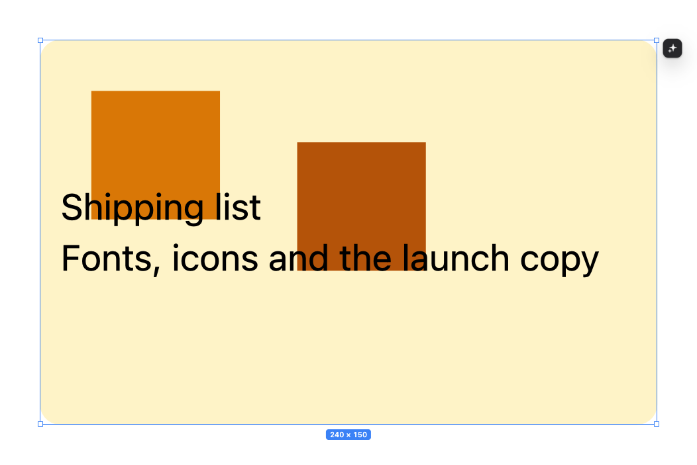
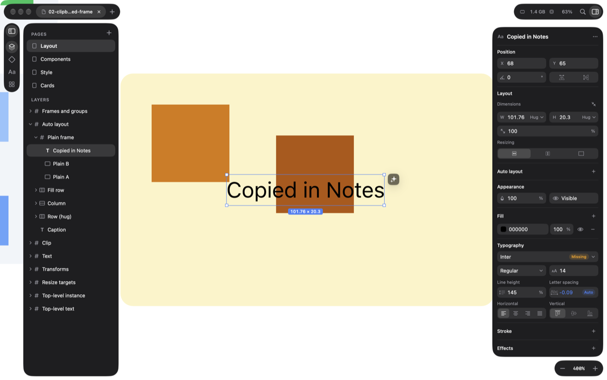
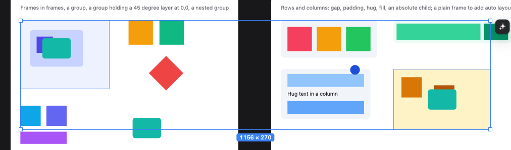
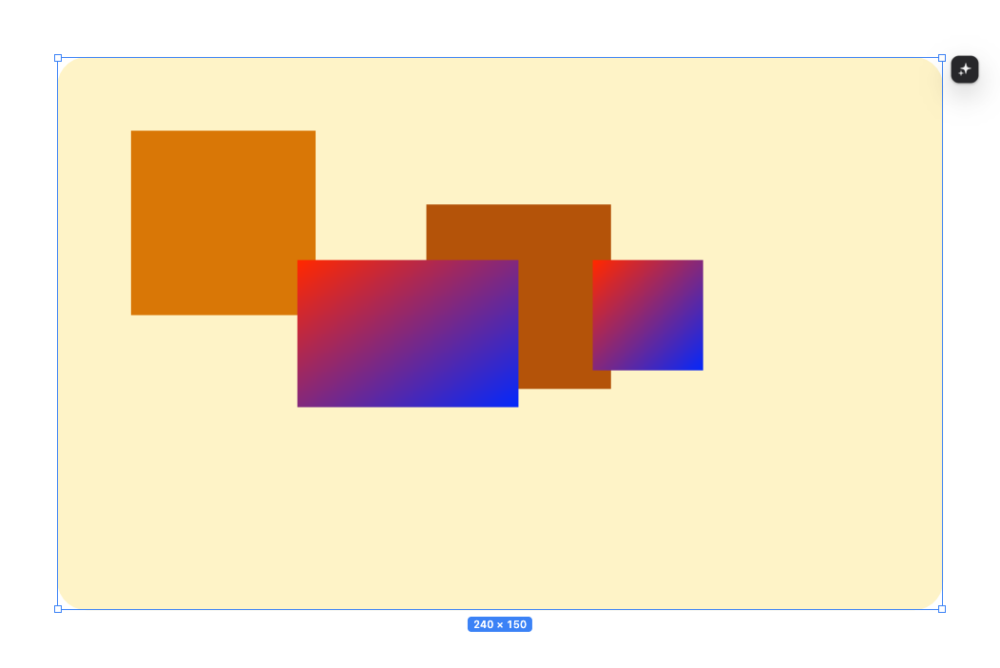
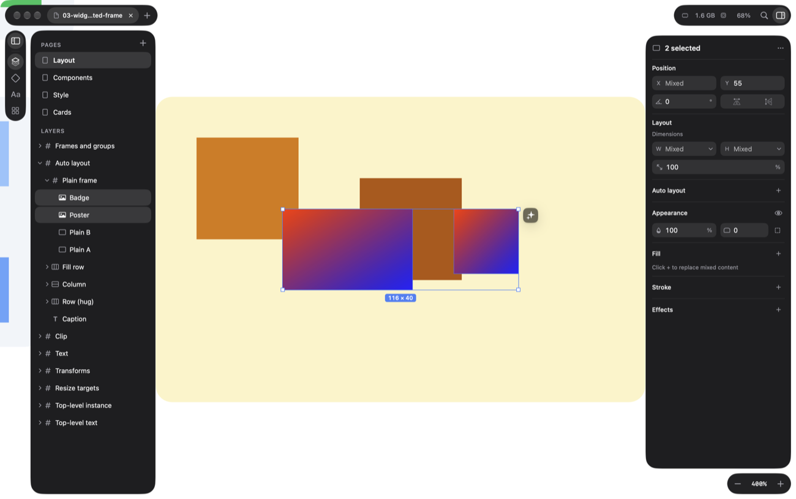

The other pastes and image placement, and the safety of a paste from the system clipboard (2026-11-16). Rules in [README.md](README.md); Rows in [interaction-conventions.md](../interaction-conventions.md) ("Paste to replace", "Paste plain text", "Paste into several frames", "Keep the parent when adding", "Place image", "Replace an image fill"). How it works: [developer guide, Copy and paste](../developer-guide.md#copy-and-paste).

| Item | Commit | Tests | Command and result | Screenshot |
|---|---|---|---|---|
| Security: a payload from the system clipboard copies files only when Canvas wrote it (sealed by the server, checked as it is now) or from inside its source's `.canvas` package or a document the server opened; otherwise the layers paste without those files (image paint left out, video forgets its file) and a toast says so | 09c059b | `test/paste-safety.test.ts` (another app's payload with four sources, a sealed payload changed after, Canvas's copy through the pasteboard JSON, an unsealed copy from inside its package); `qa/scenarios-paste.ts` "another app's payload pastes its layers without the files it names, and says so"; `qa/native/scenarios-paste.ts` "a payload another app wrote under Canvas's type ..." (real Cmd+V, payload under `cc.getcanvas.canvas.clipboard`) | `node --test test/paste-safety.test.ts`: `pass 7, fail 0`; `pnpm qa paste`: `10 pass, 0 fail, 0 skip`; `pnpm qa:native "another app wrote"`: `PASS clipboard / a payload another app wrote under Canvas's type pastes without the file it names, with a toast` | The pasted layer keeps its colour, no picture; the toast:  Browser:  |
| Security: undo of a paste into another file takes back the image and video files it copied (to a temp folder; redo puts them back); a file another layer uses, or one that was there before, stays | 09c059b | `test/paste-safety.test.ts` "undo of a paste into another file" (3 tests) | `node --test test/paste-safety.test.ts`: `pass 7, fail 0` | (files on disk, no picture) |
| Paste to replace, Shift+Cmd+R (Edit menu, right-click menu): each selected layer gives way to the copy at its x/y and index, in groups, nested and in auto layout; one undo | a395e61 | `test/paste-more.test.ts` "paste to replace" (3), keys; `apps/macos/Tests/ShellLogicTests.swift` (menu key, right-click entry); `qa/scenarios-paste.ts` "Shift+Cmd+R swaps ...", "Shift+Cmd+R in auto layout ..."; `qa/native/scenarios-paste.ts` "Shift+Cmd+R pastes to replace through the Edit menu, one Cmd+Z" | `pnpm qa paste`: `10 pass, 0 fail, 0 skip`; Swift: `ok: 218 checks`; `pnpm qa:native shift+cmd+r ...`: `4 passed, 0 failed, 0 skipped` | Group B and Nested C replaced by the teal rect:  In the app:  |
| Paste plain text: text from another app is an Inter 14 text layer (tracking -0.09, auto width; 400 wide past 60 characters) in the selected frame or the middle of the view; Canvas JSON on the clipboard still pastes layers | a395e61 | `test/paste-more.test.ts` textLayer; `qa/scenarios-paste.ts` "plain text from another app pastes as a text layer; Canvas's own copy still pastes layers"; `qa/native/scenarios-paste.ts` "plain text from another app pastes as a text layer in the selected frame" | `pnpm qa paste`: `10 pass, 0 fail, 0 skip`; `pnpm qa:native`: `PASS clipboard / plain text from another app ...` |  In the app (QA build: Inter shows Missing there):  |
| Paste into several frames: Cmd+V with two frames selected puts one copy in each, centred in a frame it does not fit (done for every paste into a frame); one undo | a395e61 | `test/paste-more.test.ts` "paste into several frames", frameTargets, "into a smaller frame ..."; `qa/scenarios-paste.ts` "Cmd+V with two frames selected pastes one copy into each, one undo" | `node --test test/paste-more.test.ts`: `pass 10, fail 0`; `pnpm qa paste`: `10 pass, 0 fail, 0 skip` | A copy of the teal rect in the inner frame and in the plain frame:  |
| Keep the parent when adding: Space held, a paste with a frame selected goes beside it, an image file dropped on a frame lands on the canvas | a395e61 | `test/paste-more.test.ts` "Space held" (2); `qa/scenarios-paste.ts` "Space held: a paste with a frame selected and a dropped image stay out of the frame" | `pnpm qa paste`: `10 pass, 0 fail, 0 skip` | (end state in `qa/baselines/paste-space-held-*.png`) |
| Place Image, Shift+Cmd+K: File > Place Image opens the open panel for images (a browser tab: its file picker); they go side by side in the selected frame or the middle of the view; one undo. One click per image is left out: Canvas has no placing tool | a395e61, 562f8fb | `apps/macos/Tests/ShellLogicTests.swift` (File menu key); `qa/scenarios-paste.ts` "Shift+Cmd+K opens a file picker ..." (Chrome's file chooser, two files); `qa/native/scenarios-paste.ts` "File > Place Image (Shift+Cmd+K) places the chosen images in the selected frame" (`qa.choose` stands in for the panel) | `pnpm qa paste`: `10 pass, 0 fail, 0 skip`; `pnpm qa:native`: `PASS widgets / File > Place Image ...` |  In the app:  |
| Replace an image fill (select the area left of the fill swatch, Cmd+V) | done later: see [gaps.md](gaps.md) | | Needs a selectable fill row in the inspector, which is the inspector paint work another agent has open. The page side is ready to take it: `host.drops.placeImages` uploads, `applyFill` in `src/page/drops.js` replaces a fill of the same kind. | |
