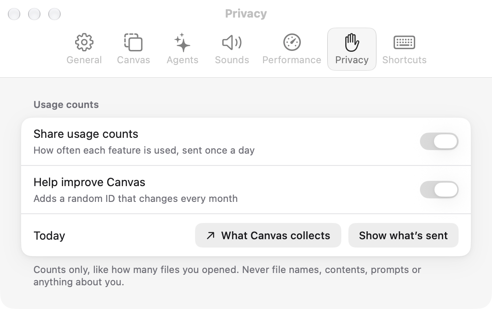
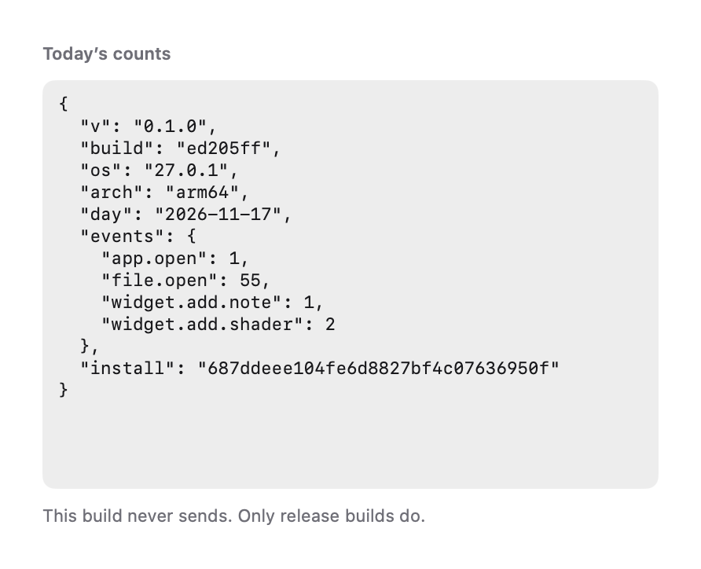

Usage counts and Settings > Privacy: anonymous daily feature counts to the website's contract (`POST https://getcanvas.cc/api/usage`), sent by release builds only. How it works: [developer guide, Usage counts](../developer-guide.md#usage-counts). Rules in [README.md](README.md).

| Item | Commit | Tests | Command and result | Screenshot |
|---|---|---|---|---|
| Counting and sending (`src/usage-counts.ts`): the name list, name and count limits, the 60-name cap, the body's shape against the contract's patterns, UTC days, one POST per completed day, a failure keeps the day and waits a day, a success drops it, the monthly install id only with Help improve Canvas, nothing sent from a checkout, a QA build or with sharing off (and nothing counted then), no Origin header (a local server through `CANVAS_USAGE_URL`), at most 30 unsent days, MCP connections once per session, a saved edit counted as `file.save` (that test failed before the count moved to the moment the bytes are on disk) | c92705a and the commit that adds this file | `test/usage-counts.test.ts` | `node --test test/usage-counts.test.ts`: `pass 16, fail 0`; `pnpm -s test`: `tests 1668, pass 1668, fail 0` (one run had `doclog.test.ts` "edits pause: the log is folded into document.json" fail under load; it passed 3 of 3 alone and the full rerun was green); `pnpm qa`: `125 pass, 0 fail, 0 skip` | |
| Settings > Privacy: Share usage counts (on), Help improve Canvas (off, greyed while sharing is off), What Canvas collects (the website's privacy page), Show what's sent (a popover with the exact JSON for today from `GET /api/usage/preview`) | c92705a | `apps/macos/Tests/SettingsTests.swift` `privacy` (defaults, stored values, what the server is told, the crash marker); `qa/native/scenarios.ts` "Settings > Privacy: Share usage counts on, Help improve Canvas adds the monthly id, Show what's sent shows today's JSON" (real clicks; reads the popover's JSON and checks it against the server's) | `swiftc ... SettingsTests.swift`: `ok: 144 checks`; `pnpm qa:native`: `73 passed, 0 failed, 0 skipped` | Tab:  JSON:  |
