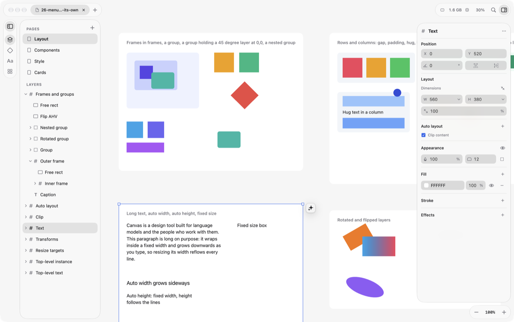

Evidence for the QA harness work of 2026-11-16: native QA that does not depend on text recognition, a menu check for every Shift+Cmd chord, and new or deleted boards kept in step with the page list. Rules: [README](README.md). Branch `worktree-agent-a2ed3b2e162934595`.

| Item | Commit | Tests | Command and result | Screenshot |
|---|---|---|---|---|
| qa:native finds controls without OCR. Before: under load, Vision failed (`qa.find: 500 e5rtError`, empty reads), and the start-up warm-up failed with "text recognition does not answer in QA instance 1", which skipped the whole run with exit 0. Reproduced at load 51: `qa:native skipped: text recognition does not answer in QA instance 1`. Now `.qaID("id")` / `.qaText(title)` (`DesignSystem/Components.swift`; the normal build compiles it to the view itself, `nm` finds no `QAMark` in it) lays an invisible AppKit view under a SwiftUI view in a QA build, kept out of hit testing, and `qa.marks` (QA.swift) answers its frame (clipped to scroll views) and label. Marked: `ListRow`, `SectionHeader`, `InspectorSection`, `SearchField`, `SettingsRow`, `SettingsSegments`, `TextSegments`, `CheckField`, shader tiles, library rows and sections, the zoom pill, the inspector's field captions. `findText`/`textAt`/`waitText` read marks first and wait for a mark to stop moving (the inspector slides in: a click aimed mid-slide missed Truncate text after the row grew a field); OCR is only a fallback, one read at a time across the Mac (`/tmp` lock, across runs), retried on the CPU when the Neural Engine fails, and noted per scenario. No warm-up step (main's `QA_NATIVE_NO_OCR` is gone with it). Also found and fixed: two runs at once shared bundle id `cc.getcanvas.canvas.qa.s1` and each run's clean-up deleted the other's caches (`ENOTEMPTY ... Caches/cc.getcanvas.canvas.qa.s1` killed a start); bundle ids are now per run. Layers rows and inspector fields are read once they settle (two concurrent runs failed "opacity field before: got 0" and the row drag-out before that fix) | ba51b76, 7a99368, 506d833, 83a0d62, 669a134 | `test/qa-native-harness.test.ts` (the lock lets one of 8 readers in at a time, a stale lock is taken over, a throwing read releases it, bundle ids are per run); every native scenario | Three full runs in a row on the final code (46 scenarios after merging main), all green with 0 text recognition reads. A (1 instance, load 17 to 18): `46 passed, 0 failed, 0 skipped in 190 s, 0 text recognition reads`. B (`QA_NATIVE_SHARDS=3`, `pnpm qa` alongside, load 14 to 53): `46 passed, 0 failed, 0 skipped in 100 s, 0 text recognition reads`; the `pnpm qa` beside it: `95 pass, 0 fail, 0 skip in 102 s on 9 workers`. C (`QA_NATIVE_SHARDS=3` while a second `qa:native` with 2 instances ran, load 29 to 36): `46 passed, 0 failed, 0 skipped in 81 s, 0 text recognition reads`; the second run: `46 passed, 0 failed, 0 skipped in 102 s, 0 text recognition reads`. Before the merge, with 30 scenarios, the same three kinds of run also passed (load up to 151: `46 passed ... 0 text recognition reads` with 3 instances and `pnpm qa` alongside) | Not pictured: the marks are invisible by design |
| Menu chords: buildMenu spells a Shift chord on a letter in capitals. A native scenario presses every Shift+Cmd chord as real key events and checks its own action ran, and the plain Cmd chord its own: Shift+Cmd+H hides the layer (no app hide) / Cmd+H asks to hide Canvas; Cmd+Z undo / Shift+Cmd+Z redo, and with nothing to redo it undoes nothing; Cmd+G group / Shift+Cmd+G ungroup; Cmd+C, then with a frame selected Shift+Cmd+V pastes back in place / Cmd+V into the frame; Shift+Cmd+C Copy as PNG, no layers copied; Shift+Cmd+A select inverse / Cmd+A select all; Shift+Cmd+L lock, no link / Cmd+L link, no lock; Shift+Cmd+S Save as Canvas / Cmd+S nothing; Shift+Cmd+K Place Image / Cmd+K Quick Actions; capitals typed into a Layers name field type (Shift+A, Shift+H, Shift+V are menu keys too). Nothing was broken with the capitals in place. Proof the check bites: with the lowercase key put back, the scenario fails on 8 chords, among them Shift+Cmd+L not locking and Cmd+S opening Save as Canvas. QA builds never show save or open panels (noted in `qa.state` `panels`, answered Cancel) and never hide (`hides`) | ba51b76, 8e01f44, d173557, and the last merge | `qa/native/scenarios.ts` "every Shift+Cmd chord runs its own menu item, the plain Cmd chord its own" (`menu-keys` in `qa/features.yaml`) | `pnpm qa:native "Shift+Cmd chord"`: `PASS menus / every Shift+Cmd chord runs its own menu item, the plain Cmd chord its own`; with `i.key.uppercased()` reverted: `FAIL ... Shift+Cmd+H (Show/Hide Selection) ... Shift+Cmd+L (Lock) ... Cmd+S: panels asked for by Cmd+S: got ["Save as Canvas"]` |  |
| A board added with `/api/structure` op:add on the first page is listed on it (keepOnPage returned early for the first page, so the board was on no page's list and followed whichever page was put first). Implicit-page files show it on their one page and stay without a stored list. Main got the same one-line fix from the paste work; the merge keeps this branch's version, which also does the next row | 4ceae86, 370f8b3 | `test/structure-add-page.test.ts`: first page listed and kept after a reorder, another page, implicit pages, one undo takes board and listing back | `node --test test/structure-add-page.test.ts`: `pass 9, fail 0` (before the fix: `listed on the first page: actual undefined, expected 'p1'`) | Not pictured (a page list on disk) |
| A board deleted (Backspace) or cut leaves its page's list; one undo puts widgets.json back byte for byte, redo takes it out again; an edit made after the delete stays its own undo step. keepOnPage writes new boards and drops gone ones in one pages change (`settleBoards`) that joins the op's undo step. `qa/scenarios-firstrun.ts` "deleting a board shows Undo" now checks the board left its page's list, and waits for the second toast itself (it took the first toast's hidden button, so its rename raced the delete's page-list write) | d482470, 493575c | `test/structure-add-page.test.ts`: delete on the first page, on page 2, cut on page 2, a rename after the delete (a single-file document and the playground package, deleted, undone, deleted again) | `node --test test/structure-add-page.test.ts`: `pass 9, fail 0` (before: `B0 is still listed after the delete: ["B0","B1","B2"]`); `pnpm qa "deleting a board shows Undo"` 3 times: `1 pass, 0 fail, 0 skip` | Not pictured |
| Done later (see [gaps.md](gaps.md)): the page-list write of a structure op is a second write that joins the op's undo step through `joinTop`. A write from elsewhere (an agent) landing in the ~30 ms between the two makes the listing a step of its own, labelled like the op. This was already so for boards added or duplicated onto another page; it now also covers deletes. Recording both in one step whatever lands between needs a change in `src/history.ts`, left for the history owner | | | | |

Full suites on the branch after the last merge of main: `pnpm -s typecheck` clean; `pnpm -s test` `pass 1559, fail 0`; `pnpm qa` `95 pass, 0 fail, 0 skip` (run B above).
