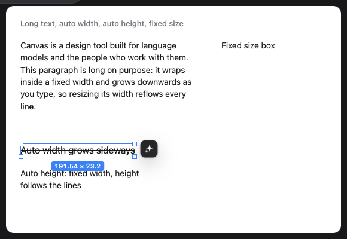
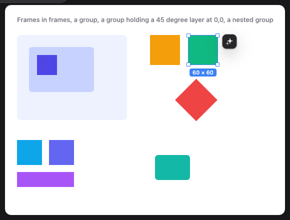
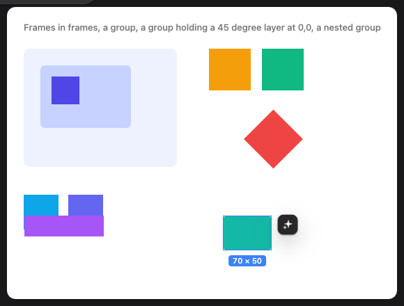

Evidence for the second bug hunt's fixes: five findings reproduced on main, each with a failing test first, the fix, and the test passing. Rules: [README](README.md). Branch `worktree-agent-a33833b9298a9d5e3`; code in e6095da, merged with main in 689beae (the merge brought a new fake-DOM editor test; `patchField` now also checks the field's nodes before it touches them, in the commit after the merge).

| Item | Commit | Tests | Command and result | Screenshot |
|---|---|---|---|---|
| 1. Shift+Cmd+X (and Ctrl+Shift+X) cut the layer as well as striking it through, in a browser tab. structure.js `clipKey` (the fallback that runs a cut when no clipboard event comes) took any Cmd+X. Now only V counts with Shift (Shift+Cmd+V, paste in place); Shift+Cmd+X stays text strikethrough (shortcuts.js) and Shift+Cmd+C copy as PNG (copy-as.js, which already stopped the event first) | e6095da | `qa/scenarios-review2.ts` "Shift+Cmd+X and Ctrl+Shift+X strike text through and keep the layer; Cmd+X cuts and Shift+Cmd+V pastes in place"; the existing "Shift+Cmd+C copies the selection as a 2x PNG" still passes. Before the fix the scenario failed at the first strike (`timed out waiting for Shift+Cmd+X to strike the text through`: the layer was cut) | `pnpm qa "strike text"`: `1 pass, 0 fail`; full `pnpm qa`: `108 pass, 0 fail, 0 skip` |  |
| 2. Enter (select children) selected locked children. It now leaves out children locked by their own lock or a parent's, like Cmd+A, select inverse and the marquee; with every child locked the parent stays selected | e6095da | `qa/scenarios-review2.ts` "Enter selects a group's children but not the locked ones". Before: `Enter selects the unlocked child only: got ["r_g1","r_g2"], want ["r_g2"]` | `pnpm qa "locked ones"`: `1 pass, 0 fail` |  |
| 3. Canvas keys moved a locked layer selected from the Layers panel. The lock rule: a locked layer cannot be interacted with or moved in the canvas; it can be selected in the Layers panel and any of its properties adjusted. The rule does not name the keys, so Canvas reads "moved in the canvas" as every canvas key and handle that moves or reshapes: arrows and Shift+arrows (one layer, several, a board, and no flow reorder), Cmd+arrows resize, Option+Cmd+Up/Down rotate, Shift+H/V flip, Option+W/A/S/D/H/V align, Option+Shift+H/V distribute, Control+Option+T tidy, smart spacing, scale handles in K mode, Option+Cmd+Shift+R resize to fit, and Repeat (.) of a nudge. With unlocked layers in the selection those move and the locked ones stay (align then lines the others up against the locked one). Property keys still apply (digits for opacity, paints, text styles), as does the inspector (X, Y, W, H, padding, the scale field). The page skips locked layers before it draws anything (server.ts nudge and groupItems, shortcuts.js, live.js); the server refuses a user's `/api/move` of a locked layer (409 `locked`) and skips locked items in a move of several (`skipped: [{code: "locked"}]`), which also covers smart.js (whose preview goes back) without touching that file. An agent's move_board still moves a locked layer, as a plugin API would. Find and replace: decided to keep replacing text in locked layers, since text content is a property and properties may change on a locked layer; a test pins it | e6095da | `test/review-fixes-2.test.ts` "canvas moves leave locked layers where they are" (5 tests: several, one, inspector, Repeat, find and replace); `qa/scenarios-review2.ts` "canvas keys leave a locked layer selected in the Layers panel where it is; the inspector still edits it" (8 keys on a locked layer, arrows and tidy with an unlocked one, a locked board, the inspector's X). Before: `ArrowRight (nudge) changed the locked layer: got {"x":301...}`; the server tests failed 3 of 5 (the two that passed pin what stays allowed) | `node --test test/review-fixes-2.test.ts`: `9 pass, 0 fail`; `pnpm qa "locked layer selected"`: `1 pass, 0 fail` |  |
| 4. Builds from before 2026-11-16 refuse a copy or duplicate of a layer with that night's new keys ("<key> is not a ... property"). Old builds stay as they are: **builds before this commit still reject the 2026-11-16/17 keys** (paragraphSpacing, paragraphIndent, lists, textTruncation, maxLines and the rest). From this commit on, a whole new node (insert, paste, add_nodes, a copy from a newer Canvas) keeps a key no node type of this version knows, and the answer warns: `warnings` on a paste or add_nodes (POST /api/structure and the MCP tool), `issues` in the snippet path. A property write (set_node_props, the inspector) still refuses an unknown key, and a key that belongs to another type (cornerSmoothing on an ellipse, lists on a rectangle, children on a rectangle) is still an error, since that is a mistake rather than a newer format. Limit: a future version that gives an existing key to another type would still be refused by this one | e6095da | `test/review-fixes-2.test.ts` "the schema keeps keys it does not know on a new node" (validateNode and unknownKeys, a property write, insertNode, add_nodes and a copy and paste through the server); `test/structure.test.ts` "refuses bad input" now refuses a wrong-type key instead of an unknown one. Before: 3 of the 4 failed | `node --test test/review-fixes-2.test.ts`: `9 pass, 0 fail`; `pnpm -s test`: `1613 pass, 0 fail` | Not pictured: a schema change, nothing on screen |
| 5. Typing in a 400k-character text layer took about 25 ms per key: every key rebuilt the field (render), and the next selection set made the browser lay out all 400k characters again. Measured split before the fix: render 0.1 ms, select 24.6 ms, the canvas pin 0.1 ms. The fix is in a file of its own, `src/page/text-patch.js` (`patchField`): a plain field (no styled ranges, no paragraph mode) takes the key in its one text node with `Text.replaceData`, adding or removing the end-of-text line break mark; anything else renders as before. text-edit.js gains one import and one call in `edit()`, the lines the other agent's work did not touch | e6095da | `qa/scenarios-review2.ts` "typing in a 400k-character text layer: each key's handler and the frame after it": the field's text node is the same one after 26 keys, the field shows the model, Return at the end adds the end mark and Backspace removes it; it notes the timings. Before: `a key built the field again instead of changing it in place` | `pnpm qa "400k"`: `1 pass, 0 fail`, note `handler median 8.5 ms (max 21.1), key to frame median 9.3 ms` against `21.4 ms` / `21.6 ms` with the old render on the same machine (first measurement 24.3 / 25.1 ms) | Not pictured: a timing; the scenario opts out of the pictures because the board holding 400k characters is still grey, laying out, when they are taken |

Suite runs before the merge with main: `pnpm -s typecheck` clean; `pnpm -s test`: `1613 pass, 0 fail`; `pnpm qa`: `108 pass, 0 fail, 0 skip`; `pnpm qa:native` (own TMPDIR, 2 instances): `61 passed, 0 failed, 0 skipped`.

After the merge (689beae): `pnpm -s test` first failed one new main test, `hunt T3: Backspace and Delete take a whole emoji` (its fake DOM span has no `firstChild`: `Cannot read properties of undefined (reading 'nodeType')` in `patchField`); `patchField` now reads `childNodes[0]` and checks it is a text node with `replaceData` before using it. Then: `pnpm -s typecheck` clean; `pnpm -s test`: `1634 pass, 0 fail`; `pnpm qa`: `108 pass, 1 fail` (`a board and every card kind copied on one page paste on another`: `nothing pasted lands on a board of the Style page`, a load flake with 9 workers and a native run sharing the machine: alone `1 pass, 0 fail` three runs in a row, and it passed in the full run before the merge; the 400k scenario noted `handler median 12.5 ms` under that load); `pnpm qa:native` (own TMPDIR, 2 instances): `64 passed, 0 failed, 0 skipped`.
