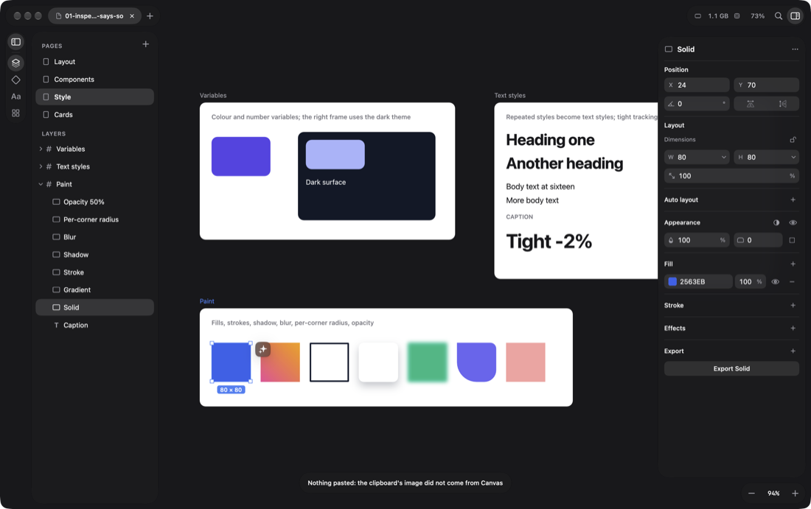

Codex's review of the 2026-11-16 merges: one row per finding, each reproduced by a test that failed before the fix and passes after it. Rules in [README.md](README.md). Timing races are made deterministic with fault-injection hooks: `settleHooks.beforeMove` (src/pastefiles.ts), `writerHooks.afterStableRead` (src/docwriter.ts), a held structure answer in the page (qa scenario), and `qa.paint {delay}` holding an upload's or a Selection colors write's answer in the QA build (`PaintHooks.answerDelay`).

| Item | Commit | Tests | Failing before | Passing after | Screenshot |
|---|---|---|---|---|---|
| a1 HIGH security: a forged clipboard payload naming a private file under `metadata.fonts[].url` passed `screenPayload` (dropped 0) and `planAssets` copied it. The screen now walks the same file-reference fields the copy reads (`visitRefs`: image fills, `image`, font urls) and drops any not proven safe | 9f61e74 | `test/review-paste.test.ts` "a1: every file reference in a payload from the clipboard is screened" (2) | `node --test test/review-paste.test.ts`: `✖ screenPayload drops a font url outside the source package and counts it` (`the font url is a file reference like an image fill`), `✖ the paste copies nothing and says so` (`no file came into B`) | same command: `pass 8, fail 0` | (files on disk, no picture) |
| c1 HIGH security, server half: `copyReferencedFiles` (Save As) and `planAssets` (paste) copied any file a reference named. Both now take only files that are an image, video or font by their first bytes (`mediaKind`), and none in a hidden folder outside the document's (`copyableMedia`: `~/.ssh`, `~/.private`) | 9f61e74 | `test/review-paste.test.ts` "c1 (server half)" (3: Save As of `../../.ssh/id_rsa`, a text file named `.png`, a real PNG in a hidden folder; a paste of a fake `.png`; `mediaKind` by bytes); `test/canvas-doc.test.ts` fixtures now hold real (SVG) image bytes | `✖ Save As refuses a private key named as an image fill, and a fake image` (`linked/` held `id_rsa`, `notes.png`, `real.png`), `✖ a paste from another document copies a picture but not a text file named .png`, `✖ mediaKind reads the bytes, not the name` | `node --test test/review-paste.test.ts test/canvas-doc.test.ts`: `pass 8` and `pass 17, fail 0` | |
| c1 HIGH security, app half: Paste Fill took any app's unsigned `cc.getcanvas.paint` JSON, so `{"v":{"type":"image","url":"../../.ssh/id_rsa"}}` went into the file. Copy Fill now seals the paint (HMAC-SHA256 under a key made at launch); Paste Fill keeps file references only of a sealed paint and drops every local one otherwise (the server's rule for layers), with a toast | 9f61e74 | `apps/macos/Tests/PaintLogicTests.swift` `clipboardScreen` (forged, legacy, other key, tampered, nested, web url, colour); `qa/native/scenarios-fills.ts` "review c1: Paste Fill of another app's image paint leaves its file out and says so" (real right-click, Paste Fill; then Canvas's own Copy Fill still pastes) | Swift: compile error, `PaintLogic` has no `clipboardText`/`readClipboard`; `pnpm qa:native "review c"` on the build without the screen: `FAIL inspector / review c1 ...: no layer names the private file` | `swiftc ... PaintLogicTests.swift`: `ok: 109 checks`; `pnpm qa:native "review c"`: `PASS inspector / review c1 ...` | The fill stays blue, the toast says why:  |
| a2 HIGH data loss: redo after another app wrote the pasted image's path deleted the stashed original without comparing. Redo now never writes over a file (`link`, or `COPYFILE_EXCL`); the same bytes there drop the stash, other bytes keep the original beside it as `<name>-original.<ext>` | 9f61e74 | `test/review-paste.test.ts` "a2: redo after another app wrote the pasted file's path" (2) | `✖ keeps the original bytes beside the new ones instead of deleting them` (`the original bytes are kept beside it: images/pic.png`) | `pass 8, fail 0` | |
| b1 HIGH data loss: multi-edit `touched` stayed true after Undo took every edit back; ending the edit wrote the first layer's text into all of them. `touched` now follows the editor's history (true while there is a step to undo) | 9f61e74 | `test/hunt6-textedit.test.ts` "review b1: multi-edit undone back to the original writes nothing to the other layers", "review b1: redo after that writes the typing to every layer again" | `node --test --test-name-pattern="review b" test/hunt6-textedit.test.ts`: `✖ review b1: multi-edit undone back ...` (`the other layer shows its own text again`) | `node --test test/hunt6-textedit.test.ts test/text-edit.test.ts`: `pass 72, fail 0` | |
| c2 HIGH data loss: the recovery after a write that turned out not to be ours read the file, then took its signature; a save in between paired the old bytes with the new signature. `readStable` takes the signature before and after the read and reads again on a mismatch (null when the file never holds still: the caller reloads later) | 9f61e74 | `test/review-docwriter.test.ts` (2) | with the old read-then-stat: `✖ c2: a save between the read and the signature is read again ...` (`the bytes are the ones under that signature (not A's)`), `✖ c2: a file that never holds still answers null` | `node --test test/review-docwriter.test.ts`: `pass 2, fail 0` | |
| c4 HIGH data loss: queued Selection colors writes took `model.currentFile` when their turn came, with the first edit's layer ids: a tab switch sent them into the other document. Each queued write now carries its file and ids from when it was made | 9f61e74 | `qa/native/scenarios-fills.ts` "review c4: a queued Selection colors edit goes to its own document after a tab switch" (first answer held 3 s, second edit queued, tab switched to a copy with the same ids) | `pnpm qa:native "review c"`: `FAIL ... review c4 ...: the other document is untouched: got "#DC2626", want "#16A34A"` | `PASS inspector / review c4 ...` | |
| a3 MEDIUM: undo computed the files nothing uses, then yielded while moving them; a paste in the gap reused a file the undo then stashed. The move now re-reads what the document uses right before it, with no await between the check and the (synchronous) rename | 9f61e74 | `test/review-paste.test.ts` "a3: a paste in the gap of an undo's file moves" (`settleHooks.beforeMove` holds the move until the other paste is in) | `✖ the file the new paste reuses is not stashed by the undo that began before it` | `pass 8, fail 0` | |
| b2 MEDIUM: a click away during an IME composition wrote the composed text with the styled ranges of the text before it (`end: 5` for one letter), which the server refused. The ranges now follow the text from where the composition began on every composition input | 9f61e74 | `test/hunt6-textedit.test.ts` "review b2: a commit during an IME composition sends ranges that fit the composed text" | `✖ review b2 ...` (`a range inside the text: [{"start":0,"end":5,"fontWeight":"700"}]`) | `pass 72, fail 0` | |
| b3 MEDIUM: Replace All stopped at 10,000 matches in a layer (`findAll`'s cap) and said nothing. The cap is a parameter; Replace All passes none | 9f61e74 | `test/review-search.test.ts` "b3" (10,001 a's) | `node --test test/review-search.test.ts`: `✖ b3 ...` (`the count says every match`) | `pass 2, fail 0` | |
| b4 MEDIUM: whole-word matching read half a surrogate pair, so "cat" matched in "𐐀cat" and "cat𐐀". The letters before and after are read as whole code points | 9f61e74 | `test/review-search.test.ts` "b4" | `✖ b4 ...` (`a letter before it: not a whole word`) | `pass 2, fail 0` | |
| c3 MEDIUM: the duplicate or delete that starts Cmd+D / Delete on marked layers of a smart selection was not a tracked write: an Undo pressed while its answer was on the way ran first, then the move shifted the row and cleared Redo. The whole operation is one tracked write from its start | 9f61e74 | `qa/scenarios-moving.ts` "smart selection: Undo pressed while Cmd+D or Delete on marked layers is on its way waits for the whole step" (the page's structure answer held 700 ms) | `pnpm qa "undo pressed while"`: `FAIL ... duplicate: the row is where it was: got [40,120,280,360], want [40,120,200,280]` | `1 pass, 0 fail, 0 skip` | (end state in `qa/baselines/arrange-smart-selection-undo-pressed-while-*.png`) |
| c5 MEDIUM: an image upload's answer applied to whatever was selected (and whichever document was open) when it came back, with the first layer's paint list. It now applies only when the document and selection are the ones it was chosen for, else a toast | 9f61e74 | `qa/native/scenarios-fills.ts` "review c5: an image chosen for one layer never lands on the layer selected while it uploads" (upload answer held 2.5 s) | `pnpm qa:native "review c"`: `FAIL ... review c5 ...: the layer selected meanwhile keeps its fill: got "[\"#2563EB\",{\"type\":\"image\",...}]"` | `PASS inspector / review c5 ...` | |

## Claude bug hunt, same files (its #3 is a1 above)

| Item | Commit | Tests | Failing before | Passing after | Screenshot |
|---|---|---|---|---|---|
| T1 MEDIUM: a paste in the text editor whose clipboard holds only an image (no text/plain) deleted the selected letters (`edit` with ""). An empty paste now changes nothing | 4e3bc6e | `test/hunt6-textedit.test.ts` "hunt T1: a paste with no text on the clipboard changes nothing" | `node --test --test-name-pattern="hunt T" test/hunt6-textedit.test.ts`: `✖ hunt T1 ...` (`Keep me` became "") | `node --test test/hunt6-textedit.test.ts test/text-edit.test.ts`: `pass 75, fail 0` | |
| T2 MEDIUM: multi-edit sent the main layer's ranges and lists with `also`, so every other layer took them. The server (editMany) gives each other layer its own ranges and lists followed to the new text (the editor's `follow`); the page pins and overrides them the same way while typing | 4e3bc6e | `test/review-search.test.ts` "T2: multi-edit keeps each other layer's own ranges, mapped to the new text" (server); `test/hunt6-textedit.test.ts` "hunt T2: the other layers of a multi-edit show their own styling" (page) | `node --test test/review-search.test.ts`: `✖ T2 ...` (`A keeps no ranges of its own: [{"start":0,"end":2,"fontWeight":"700","fill":"#FF0000"}]`); page: `✖ hunt T2` (`{"content":"Hi","spans":[{"start":0,"end":2,"fontWeight":"700"}]}`) | `pass 5, fail 0`; `pass 75, fail 0` | |
| T3 LOW-MEDIUM: Backspace after a flag (and a ZWJ family, a skin tone) with no target ranges from the browser deleted half of it. Backspace and Delete now take one grapheme cluster (`Intl.Segmenter`; a surrogate pair without it) | 4e3bc6e | `test/hunt6-textedit.test.ts` "hunt T3: Backspace and Delete take a whole emoji" (🇭🇷, 👨‍👩‍👧, 👍🏽, é; `clusterBefore`/`clusterAfter`) | `✖ hunt T3 ...` (`Backspace after 🇭🇷: "Hi 🇭!"`) | `pass 75, fail 0` | |
| S1 LOW: Find, the search palette and Select All matching listed layers inside the hidden board that holds deleted main components (`metadata.canvasDeletedComponents`); `qa/checks.ts` called that board "on no page". `partsOf` skips it (as usage.ts does) and the check accepts it | 4e3bc6e | `test/review-search.test.ts` "S1: find and search skip the hidden holder ...", "S1: the QA document check accepts the holder on no page" | `✖ S1: find and search skip ...` (`Find lists only the visible text`), `✖ S1: the QA document check ...` (`top-level Holder is on no page`) | `pass 5, fail 0` | |

## Suites after the fixes

| Suite | Result (after merging main, all fixes in) |
|---|---|
| `pnpm -s typecheck` | clean |
| `pnpm -s test` | `tests 1625, pass 1625, fail 0` |
| `pnpm qa` | `105 pass, 0 fail, 0 skip in 79 s on 9 workers` (engine/pkg copied again after the merge: main's paragraph engine changes need the newer build, else the text paragraph scenarios time out) |
| `pnpm qa:native` (own TMPDIR) | `64 passed, 0 failed, 0 skipped in 334 s`. One earlier run had `Truncate text and Max lines in Typography` time out (main's scenario, nothing here touches it); alone it passed: `1 passed, 0 failed` |
| Swift tests (`apps/macos/Tests/*.swift`, each with its own `swiftc` line) | ColorMath 111, LayersLogic 65, LayoutLogic 96, PaintLogic 109, PaletteLogic 25, ResourceMeter 78, Settings 130, ShellLogic 297 checks, all `ok` |
| `node qa/release.ts --quick` | `95 pass, 2 fail`, both already on main and untouched here: README says 76 MCP tools (tools/list answers 79), and `CANVAS_WELCOME_DIR` (src/onboarding.ts) is not in the developer guide. A test fixture here first tripped the private-key scan; it is built from parts now and the branch history was squashed so no commit holds it |
