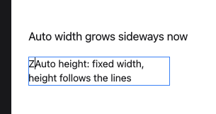
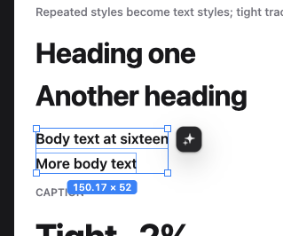
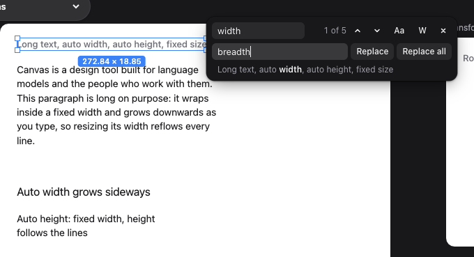
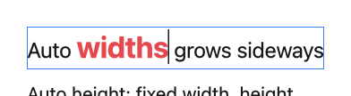
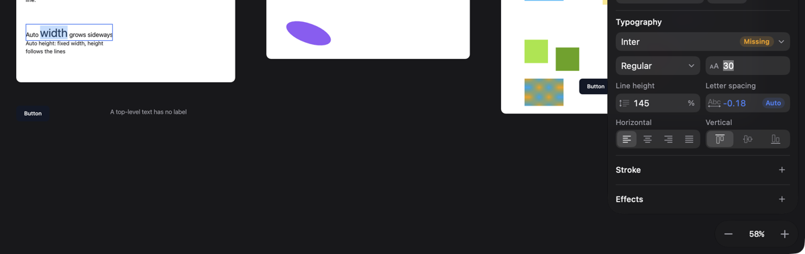
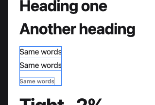
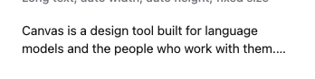

Evidence for the Text rows of [docs/interaction-conventions.md](../interaction-conventions.md). Rules: [README](README.md).

Page scenarios live in `qa/scenarios-text.ts` (imported by `qa/scenarios.ts`); each writes its key frame to `qa/out/evidence/text-<slug>.png`, copied here. Full runs after merging main (b6fff12): `pnpm -s typecheck` clean, `pnpm -s test`: `1452 pass, 0 fail`, `(cd engine && cargo test --lib)`: `174 passed; 0 failed`, `QA_SHARDS=4 pnpm qa`: `74 pass, 0 fail, 0 skip`, Swift `ShellLogicTests`: `ok: 224 checks`. Native (`TMPDIR=$(mktemp -d) pnpm qa:native`, run per area: with several agents on the Mac, the QA instance's text recognition often does not start and the run says `qa:native skipped: text recognition does not answer`; a rerun gets through): after the merge, `pnpm qa:native find "typing in a text layer" "font size on selected" "Truncate text"`: `5 passed, 0 failed, 0 skipped`. The full native suite could not finish here: other agents' QA instances kept text recognition from starting (`qa:native skipped`). The native typing scenario types real keys into the new contenteditable editor in the app (WebKit), Return included, and Cmd+B on a word.

| Item | Commit | Tests | Command and result | Screenshot |
|---|---|---|---|---|
| Edit the next text layer (P1): a plain click on another text layer while editing edits it, the caret at the click; two edits, two undo steps | fcb2745 | `test/text-edit.test.ts` "nextEdit"; scenario "a click on another text layer while editing edits that one at the click" | `pnpm qa -- "another text layer"`: `1 pass, 0 fail, 0 skip` |  the second layer in edit, "Z" typed at its start, the first one already written |
| Type keys (P2): Option+&gt; / &lt; letter spacing 0.1 px, Option+Shift line height 1 px (Auto turns into the px it draws at), Option+Cmd weight to the next hundred; each layer from its own value; a quick run of presses is one undo step. The step sizes are Canvas's choice | 6dc89fa | `test/shortcuts.test.ts` "textToggle type keys"; scenario "type keys: Option+&lt; &gt; letter spacing, ..." | `pnpm qa -- "type keys"`: `1 pass, 0 fail, 0 skip` |  two body texts after +0.2 px tracking, 24 px line height and weight 600 |
| Find and replace (P2): Cmd+F (Edit > Find and Replace, also in Cmd+K) opens a bar; literal find on every page with Match case and Whole words; Return / Shift+Return step through matches (page switches, layer selected); Replace one, Replace all; one undo step each; styled ranges follow | e2a7ae2 | `test/text-edit.test.ts` "find and replace" (findAll, GET /api/search/text, POST /api/replace, stale match refused, ranges follow); `test/find-replace.test.ts`; page scenario "find and replace: Cmd+F finds text on every page, ..."; native scenario "Cmd+F through Edit > Find and Replace" | `pnpm qa -- "find and replace"`: `1 pass, 0 fail, 0 skip`; `pnpm qa:native find`: `PASS find / Cmd+F through Edit > Find and Replace: find, Replace all on every page, one undo` |  "width": 1 of 5, the snippet with the match in bold, "breadth" typed as the replacement |
| Style part of a text (P2, L): while editing, Cmd+B / I / U, Shift+Cmd+X, Shift+Cmd+. / , and the Option type keys style the selected letters only; the inspector shows the selected letters' style (Mixed where they differ) and its text fields style them; a styled layer reads Mixed when not editing. File format: optional `spans` on a text node (UTF-16 offsets, sorted, no overlaps, only what differs); files without it read unchanged; a whole-layer key takes it off the spans; content edits, replace and the scale tool carry them. Engine (parley ranged styles, per-run colour and decorations), DOM renderer and SVG export draw them. The editor became a plain-text contenteditable so the caret and selection sit where each styled letter is drawn | c0efcee, 8a693fb, 3433983, 9aabdbd | `engine/src/text.rs` `a_styled_range_changes_only_its_letters`, `engine/src/scene.rs` `spans_count_utf16_and_land_on_bytes`; `test/text-spans.test.ts`; `test/text-edit.test.ts` (styleStep, commitPlan, keys, /api/text with spans, whole-layer wins); `test/hunt6-textedit.test.ts` (the editor on a stand-in contenteditable); `test/scale.test.ts`; Swift `TextRangeState` checks; page scenario "style part of a text: ..." (field box equals the drawn box within 3 px, SVG export keeps the styled word); native scenario "font size on selected letters while editing; a styled text reads Mixed" | `pnpm qa -- "style part"`: `1 pass, 0 fail, 0 skip`; `pnpm qa:native "font size on selected"`: `PASS inspector / font size on selected letters while editing; a styled text reads Mixed` |  "widths" bold, 22 px, red, caret after it;  in the app: "width" set to 30 from the inspector's font size field while editing |
| Multi-edit text (P3): Return with several text layers selected edits the first selected; the others show and take what is typed; one undo step | 1c0f388 | `test/text-edit.test.ts` "multi-edit" (also, refusal, empty deletes all in one step); page scenario "multi-edit text: ..." | `pnpm qa -- "multi-edit"`: `1 pass, 0 fail, 0 skip` |  three texts showing "Same words" while it is typed (the caption keeps its own style) |
| Truncate text and Max lines (P3): `textTruncation: "ending"` and `maxLines`; Typography > Truncate text and a Max lines field; the engine ends the last line that shows with an ellipsis (after Max lines, or where a fixed-size box ends) and measures auto height to those lines; DOM renderer line-clamps; editing shows the whole text | b9459c0 | `engine/src/text.rs` `truncate_ends_the_last_line_that_shows_with_an_ellipsis`; page scenario "truncate text with max lines: ..."; native scenario "Truncate text and Max lines in Typography" | `pnpm qa -- "truncate text"`: `1 pass, 0 fail, 0 skip`; `pnpm qa:native "Truncate text"`: `PASS inspector / Truncate text and Max lines in Typography` |  the six-line paragraph cut to two lines ending "them.…" |
| Paragraph settings (P3): paragraph spacing, indent | built later | | See [leftovers.md](leftovers.md) | |
| Lists (P3): Shift+Cmd+7 numbered, Shift+Cmd+8 bulleted | built later | | See [leftovers.md](leftovers.md) | |
